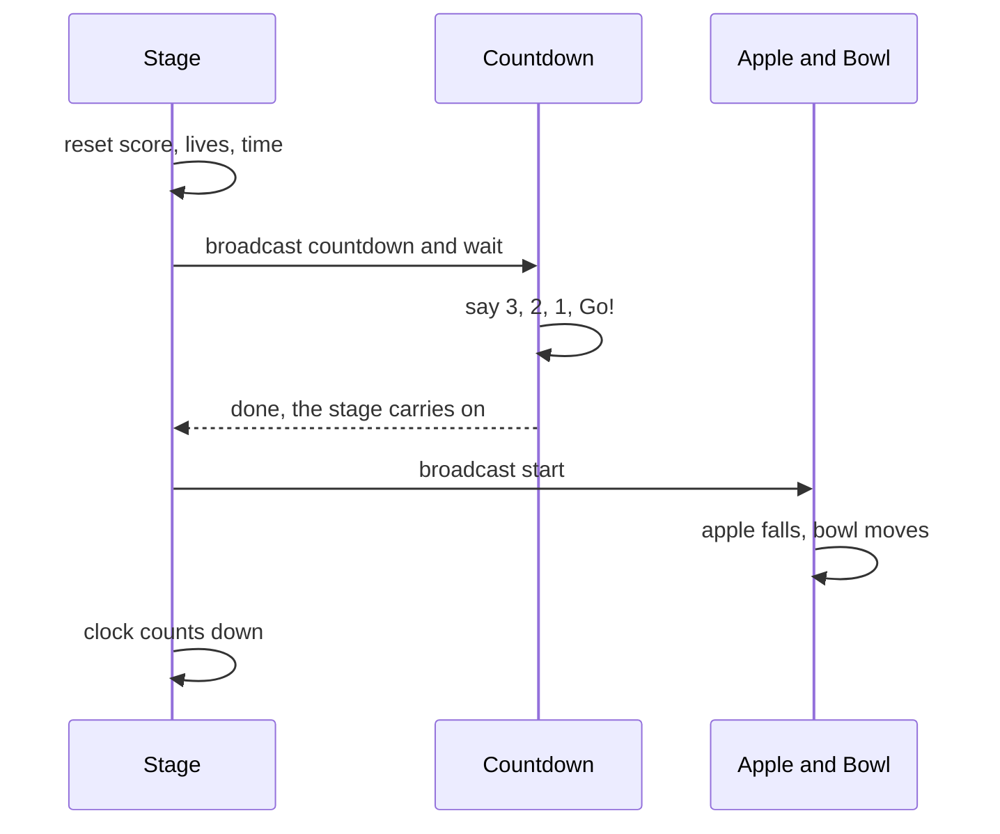

:::objectives
- Create, reset, and change variables without looking at the notes.
- Measure time with the built-in `timer` and glue words and numbers together with `join`.
- Make sprites take turns with `broadcast () and wait`.
- Track down a broadcast bug and add features to Apple Catcher.
:::

Six exercises, getting harder as you go, then a challenge. Start each one in a new project unless it says to open your **Apple Catcher**. Give every exercise a real try before you open the hint, and try the hint before you open the solution. Being stuck for a few minutes is normal; that's the part where you're actually learning.

Three habits for this whole page:

-   Make every variable **For all sprites** unless the exercise says otherwise.
-   Every variable gets a `set` under `when green flag clicked`, unless the exercise tells you to keep its value.
-   Test by clicking the green flag at least **twice**. Bugs love the second game.

## Warm-up: predict the box

Without building anything, read this script and decide what the monitor shows after you click the green flag and press space twice. Then build it and check.

```scratch title="Cat"
when green flag clicked
set [jumps v] to (0)
change [jumps v] by (5)

when [space v] key pressed
change [jumps v] by (-1)
```

```text
jumps 3
```

The flag puts 0 in the box, then adds 5. Each space press takes one away: 5, 4, 3.

### Exercise 1: Click counter

Make a variable called `clicks`. Every time you click the cat, `clicks` goes up by 1. When the green flag is clicked, `clicks` goes back to 0. Show the monitor on the stage.

After five clicks you should see:

```text
clicks 5
```

:::hint
You need two scripts with two different hat blocks: one for the green flag, and one that runs when the sprite is clicked. Look in **Events** for the second one.
:::

:::solution
```scratch title="Cat"
when green flag clicked
set [clicks v] to (0)

when this sprite clicked
change [clicks v] by (1)
```

Click the cat five times and the monitor shows `clicks 5`. Click the green flag and it drops back to `clicks 0`. The `set` handles the reset, and `change` does the counting.
:::

### Exercise 2: Speed clicker

Now race the clock. When the green flag is clicked, the built-in timer resets. When `clicks` reaches 10, the cat says how many seconds it took, rounded to a whole number. Reuse your `clicks` scripts from Exercise 1.

If you click ten times in about four seconds, the cat says:

```text
You took 4 seconds!
```

:::hint
Three blocks do most of the work: `reset timer` and `(timer)` from **Sensing**, and `(round ())` from **Operators**. To make the cat wait for the tenth click, look for a **Control** block that pauses until something becomes true.
:::

:::solution
```scratch title="Cat"
when green flag clicked
set [clicks v] to (0)
reset timer
wait until <(clicks) = (10)>
say (join [You took ] (join (round (timer)) [ seconds!]))

when this sprite clicked
change [clicks v] by (1)
```

`wait until` holds the script still until the tenth click. The two `join` blocks are nested so you can glue three pieces together: words, a number, more words. Look closely at the space inside `[You took ]` and at the start of `[ seconds!]`. Without them the cat says `You took4seconds!`.
:::

### Exercise 3: Knock-knock joke

Add a second sprite (any animal). The two sprites tell a knock-knock joke, and each one must wait for the other to finish talking before it speaks. Use `broadcast () and wait`.

You should see one speech bubble at a time:

```text
Cat:    Knock knock!
Friend: Who's there?
Cat:    Boo.
Friend: Boo who?
Cat:    Don't cry, it's just a joke!
```

:::hint
The cat runs the whole joke from one green-flag script. Whenever it's the friend's turn, the cat sends a message and waits. The friend needs one `when I receive` script per line it says, so you'll make two messages.
:::

:::solution
```scratch title="Cat"
when green flag clicked
say [Knock knock!] for (2) seconds
broadcast (who v) and wait
say [Boo.] for (2) seconds
broadcast (boo who v) and wait
say [Don't cry, it's just a joke!] for (2) seconds
```

```scratch title="Friend"
when I receive [who v]
say [Who's there?] for (2) seconds

when I receive [boo who v]
say [Boo who?] for (2) seconds
```

Now swap `broadcast (who v) and wait` for plain `broadcast (who v)` and run it again. The cat and the friend talk over each other, because plain `broadcast` doesn't pause the cat. The "and wait" is what turns two sprites into a conversation.
:::

### Exercise 4: Spot the bug

A student put these two scripts on the Apple sprite. When lives hit 0, nothing happens and the apple keeps falling forever. Find the bug before you open the hint.

```scratch title="Apple"
when green flag clicked
set [lives v] to (3)
forever
  if <(lives) = (0)> then
    broadcast (gameover v)
  end
end

when I receive [game over v]
hide
stop [other scripts in sprite v]
```

:::hint
Read the message name in the `broadcast` block, letter by letter. Then read the one in `when I receive`.
:::

:::solution
The message names don't match. The script sends `gameover` (no space), but the receiver listens for `game over` (with a space). To Scratch those are two separate messages, and nobody is listening for `gameover`.

Fix it by choosing the same message from the dropdown in both blocks:

```scratch title="Apple"
if <(lives) = (0)> then
  broadcast (game over v)
end
```

Both scripts are on the Apple, so when the message arrives, `stop [other scripts in sprite v]` also halts the `forever` loop that sent it. To keep this bug from coming back, make each message once and then always pick it from the dropdown, instead of typing a new message with almost the same name.
:::

### Exercise 5: High score

Open your **Apple Catcher**. Add a variable called `high score`. When the game ends, if your score beats the high score, save it and have the bowl say "New high score!". Don't reset `high score` under the green flag; it should remember your best game.

Play once and score 6, then play again and score 9:

```text
high score 9
```

:::hint
The check belongs in the Bowl's `when I receive [game over v]` script. Compare `(score)` with `(high score)` using the `>` block, and only then use `set`.
:::

:::solution
Replace the Bowl's `when I receive [game over v]` script with this:

```scratch title="Bowl"
when I receive [game over v]
stop [other scripts in sprite v]
if <(score) > (high score)> then
  set [high score v] to (score)
  say [New high score!] for (2) seconds
end
say (join [Final score: ] (score))
```

After your 9-point game the bowl says "New high score!" and then "Final score: 9". Play a third time and score 4, and `high score` stays at 9, because 4 isn't bigger. A brand-new variable starts at 0, so your very first game always sets a record.
:::

### Exercise 6: Bonus lives

In **Apple Catcher**, give the player an extra life each time the score reaches a multiple of 10 (10, 20, 30, and so on).

Catch your tenth apple and the monitors show:

```text
score 10
lives 4
```

:::hint
The `(() mod ())` block in **Operators** gives the remainder after dividing. `20 mod 10` is `0`, and `23 mod 10` is `3`. Which scores give a remainder of 0 when you divide by 10?
:::

:::solution
Find the "caught it" part of the Apple's script and add the inner `if`:

```scratch title="Apple"
if <touching (Bowl v)?> then
  change [score v] by (1)
  start sound (Pop v)
  if <((score) mod (10)) = (0)> then
    change [lives v] by (1)
  end
else
  change [lives v] by (-1)
  if <(lives) = (0)> then
    broadcast (game over v)
  end
end
```

The new check sits **after** `change [score v] by (1)`, so it looks at the score that includes this catch. Put it before, and the bonus arrives one apple late.
:::

## Challenge: 3, 2, 1, Go!

Add a countdown to **Apple Catcher** before the apples start falling. Paint a new sprite called `Countdown` (a simple circle is fine). It says 3, 2, 1, Go! and then hides. Only after "Go!" should the clock start and the apples fall.

This is the trickiest one on the page because four parts of the game have to take turns. Here's the order they need to go in:



:::hint
The stage uses `broadcast (countdown v) and wait`, then sends a `start` message. On the Bowl and the Apple, the scripts that move things should begin with `when I receive [start v]` instead of `when green flag clicked`. The apple also needs to stay hidden during the countdown.
:::

:::solution
On the **Stage**, change the green flag script so it waits for the countdown:

```scratch title="Stage"
when green flag clicked
switch backdrop to (Blue Sky v)
set [score v] to (0)
set [lives v] to (3)
set [time left v] to (30)
broadcast (countdown v) and wait
broadcast (start v)
repeat until <(time left) = (0)>
  wait (1) seconds
  change [time left v] by (-1)
end
broadcast (game over v)
```

On the **Countdown** sprite:

```scratch title="Countdown"
when green flag clicked
hide

when I receive [countdown v]
show
say [3] for (1) seconds
say [2] for (1) seconds
say [1] for (1) seconds
say [Go!] for (0.5) seconds
hide
```

On the **Apple**, drag `when green flag clicked` off the top of the falling script and put `when I receive [start v]` there instead. Do the same for the **Bowl**'s movement script. Then give the Apple one new script so it isn't hanging in the sky during the countdown:

```scratch title="Apple"
when green flag clicked
hide
```

The game now pauses for about 3.5 seconds of countdown, then the apple appears and the clock starts at 30. The falling script already begins with `show`, so the apple pops into view right on "Go!".
:::

:::video 0ZHalwPO1og
A short walkthrough of the broadcast blocks. Watch for the moment `broadcast` and `when I receive` are paired up with the same message name, then think about where `and wait` would change what happens.
:::
