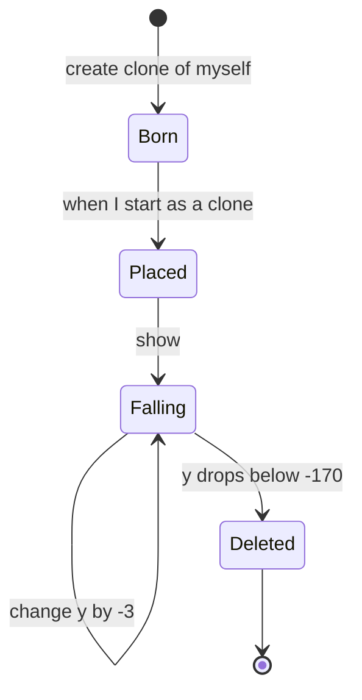

:::objectives
- Make clones with `create clone of`, control them with `when I start as a clone`, and remove them with `delete this clone`.
- Predict what a clone copies from its parent, including hidden sprites and private variables.
- Avoid the two classic clone bugs: invisible clones and clones that multiply.
- Build a My Block with an input, and explain why it makes scripts easier to fix.
:::

Click the green flag and thirty snowflakes drift down a night sky, each from a different spot. How many snowflake sprites are in the sprite list? One. That single sprite makes copies of itself while the game is running, and each copy falls on its own and then disappears.

You could build the snowstorm the slow way: thirty sprites, each with the same script pasted in. Then you'd decide the flakes should fall a little faster, and you'd have to fix thirty scripts. Today you learn two ways out of that kind of trap: **clones**, which are copies of a sprite made while the game runs, and **My Blocks**, which let you invent your own blocks.

## A clone is a copy made while the game runs

A **clone** looks like its sprite and runs that sprite's clone scripts. When its job is done, it removes itself. You write the scripts once, and every clone uses them.

Three orange **Control** blocks do all the work:

```scratch
create clone of (myself v)

when I start as a clone

delete this clone
```

-   `create clone of (myself v)` makes a new copy. The dropdown can also name a different sprite, to clone that sprite instead.
-   `when I start as a clone` is a hat block that only clones run. The original sprite never runs the script under it.
-   `delete this clone` removes the clone that runs it. If the original sprite runs it, nothing happens, so you can't delete your sprite by accident.

## A snowstorm from two scripts

Paint a small white circle and name the sprite `Snowflake`. Pick a dark backdrop so you can see it.

```scratch title="Snowflake"
when green flag clicked
hide
repeat (30)
  create clone of (myself v)
  wait (0.2) seconds
end

when I start as a clone
go to x: (pick random (-220) to (220)) y: (180)
show
repeat until <(y position) < (-170)>
  change y by (-3)
end
delete this clone
```

Click the green flag. Thirty flakes drift down, one every 0.2 seconds, each starting from its own spot along the top.

Here's who does what:

1.  The **original** Snowflake hides. Think of it as a hidden factory whose only job is making clones.
2.  The `repeat (30)` loop makes 30 clones, one every 0.2 seconds.
3.  Each clone runs `when I start as a clone` by itself: it picks a spot, shows itself, falls, and deletes itself at the bottom.



:::warning
A clone starts as an exact copy of its parent, **including being hidden**. Because our factory hides itself, every clone is born hidden. Forget `show` in the clone script and your clones exist, fall, and delete themselves, all invisibly. If nothing appears on screen, check for `show` first.
:::

## What a clone copies from its parent

At the moment it's born, a clone copies its parent's position, direction, costume, size, graphic effects, and whether it's showing. That's why each snowflake starts wherever the factory is standing, and why the clone script moves it to the top right away.

A clone also gets its **own copy** of any variable made **For this sprite only**, and from then on its copy is separate from everyone else's. Make a `speed` variable, choose **For this sprite only**, and try this clone script:

```scratch title="Snowflake"
when I start as a clone
set [speed v] to (pick random (1) to (5))
go to x: (pick random (-220) to (220)) y: (180)
show
repeat until <(y position) < (-170)>
  change y by ((0) - (speed))
end
delete this clone
```

Now some flakes float and others zoom. Each clone picked its own speed and remembers it. `((0) - (speed))` turns a speed of 4 into -4, so the flake moves down.

A **For all sprites** variable works differently: there's only one box, and every clone shares it. That's exactly what you want for `score`, and exactly what you don't want for each flake's speed.

## Clones hear messages and keys too

Clones run every hat block in their sprite except `when green flag clicked`. That includes `when I receive`, `when this sprite clicked`, and `when [space v] key pressed`. Often that's handy: a single `when I receive [game over v]` script with `delete this clone` under it clears every clone at once.

Sometimes it's a nasty surprise:

```scratch title="Laser"
when [space v] key pressed
create clone of (myself v)
```

Press space once and you get one clone. But now there are **two** copies of the sprite listening for space. Press again and both make a clone: four. Then eight. Then sixteen. The fix is to put the key script on a sprite that never gets cloned, like the player or the stage, and have it run `create clone of (Laser v)`. You'll do exactly that in the code-along.

### The 300-clone limit

Scratch lets a project have up to 300 clones at once. After that, `create clone of` quietly does nothing. Clones that never delete themselves pile up until new ones stop appearing, so give every clone a way to end with `delete this clone`.

Clicking the green flag or the red stop sign removes every clone, so each game starts clean.

:::video 8G-QDBi7AOo
The Scratch Team walks through clones step by step. Watch for the hidden "factory" sprite idea and for where `delete this clone` goes, then compare it with your snowstorm.
:::

## My Blocks: invent your own block

Sometimes the same handful of blocks shows up in three or four places. **My Blocks**, the pink category at the bottom of the block list, lets you bundle them under a new name.

### Making a block with an input

1.  Click **My Blocks**, then **Make a Block**.
2.  Type a name, like `jump`.
3.  Click **Add an input number or text**, and name the input `height`.
4.  Click **OK**.

A pink `define` hat appears in your code area. Whatever you snap under it is what your new block does:

```scratch title="Cat"
define jump (height)
repeat (10)
  change y by ((height) / (10))
end
repeat (10)
  change y by ((0) - ((height) / (10)))
end
```

Now use it like any other block:

```scratch title="Cat"
when [space v] key pressed
jump (60) :: custom

when [up arrow v] key pressed
jump (120) :: custom
```

Space gives a small hop and the up arrow gives a big leap. Both run the same `define` script; only the `height` changes. The first loop rises in ten small steps so you can see the motion, and the second comes back down by the same amount.

### Why bother?

-   **Shorter scripts.** `jump (60)` is easier to read than eight blocks of arithmetic.
-   **Fix it once.** If the jump looks too slow, change the `define` script and every jump in the sprite is fixed.
-   **Names explain your code.** A script that says `reset player` tells you what it does without reading every block inside.

### A block with no inputs

Inputs are optional. This one puts a player back at the start:

```scratch title="Player"
define reset player
go to x: (-200) y: (-140)
point in direction (90)
switch costume to (costume1 v)
show
```

Call `reset player` when the green flag is clicked, when the player loses a life, and when a new level begins. Three places, one definition.

### Four things that trip people up

-   **My Blocks belong to one sprite.** A block made in the Cat doesn't appear in the Dog. To share it, drag the `define` script onto the Dog in the sprite list, and Scratch copies it over.
-   **Inputs only work inside their own `define` script.** Drag the `(height)` reporter out of the `define` hat, not from Variables, and don't expect it to mean anything in other scripts.
-   **To change a block**, right-click its `define` hat and choose **Edit**.
-   **Run without screen refresh** is a checkbox in the Make a Block window. It makes the block finish in an instant without drawing each step. Leave it off for movement like `jump`, or the sprite teleports up and back and you never see the hop.

## Clones and My Blocks together

The two ideas team up nicely. Here's a block that makes a whole batch of clones:

```scratch title="Snowflake"
define spawn (count) flakes
repeat (count)
  create clone of (myself v)
end

when green flag clicked
hide
spawn (10) flakes :: custom
```

In the Make a Block window, type `spawn`, add an input named `count`, then click **Add a label** and type `flakes`. Now `spawn (10) flakes` reads almost like a sentence.

:::video rfklBqvDl-s
Part 1 of the Scratch Team's My Blocks series. Watch how a block gets made in the Make a Block window and how changing the `define` script changes every place the block is used.
:::

## Check your understanding

Use this script for the first question.

```scratch title="Star"
when green flag clicked
hide
repeat (3)
  create clone of (myself v)
end

when I start as a clone
go to (random position v)
```

:::quiz
Q: You click the green flag. How many stars can you see on the stage?
- [ ] 3
  Three clones exist, but look at what each one copied from its parent.
- [ ] 4
  The original is hidden, and the clones are too.
- [x] 0
  The original hides before cloning, so every clone is born hidden, and nothing ever runs `show`.

Q: A sprite has only `when [space v] key pressed` with `create clone of (myself v)` under it. You press space 3 times. How many copies of the sprite exist now, counting the original?
- [ ] 4
  That would be right if only the original made clones. Every clone also listens for space.
- [x] 8
  The count doubles with each press: 2, then 4, then 8, because every copy makes a clone.
- [ ] 3
  The original isn't a clone, but it still counts, and the clones make clones too.

Q: Eight fish clones each run `set [speed v] to (pick random (1) to (6))`, but `speed` was made **For all sprites**. What happens?
- [x] All the fish end up swimming at the same speed, set by whichever clone ran last
  A shared variable is one box. Each new clone overwrites it for everyone.
- [ ] Each fish keeps its own speed
  Only **For this sprite only** variables give every clone its own copy.
- [ ] Scratch shows an error
  Scratch never shows errors for this. The fish just don't behave the way you meant.

Q: You made a `jump (height)` block in the Cat. You click the Dog sprite and open **My Blocks**. What do you see?
- [ ] The `jump` block, ready to use
  My Blocks aren't shared between sprites automatically.
- [x] No `jump` block, until you drag the `define` script onto the Dog
  Each sprite has its own My Blocks. Dragging the `define` script to the Dog copies it.
- [ ] A red error block
  Nothing red appears; the Dog simply doesn't have that block.
:::

:::takeaways
- A hidden "factory" sprite plus a `when I start as a clone` script can fill the stage with copies.
- Clones copy everything about their parent, including being hidden, so the clone script usually needs `show`.
- Every clone should end with `delete this clone`, or you'll hit the 300-clone limit.
- Clones respond to keys and messages too. Put key scripts that make clones on a sprite that is never cloned.
- A My Block bundles repeated code under one name: shorter scripts, and one place to fix.
:::

## Further reading

-   [Cloning (Scratch Wiki)](https://en.scratch-wiki.info/wiki/Cloning): the three clone blocks, common uses, and how private variables work in clones.
-   [My Blocks (Scratch Wiki)](https://en.scratch-wiki.info/wiki/My_Blocks): every option in the Make a Block window.
-   [Run Without Screen Refresh (Scratch Wiki)](https://en.scratch-wiki.info/wiki/Run_Without_Screen_Refresh): what that checkbox really does and when to tick it.
