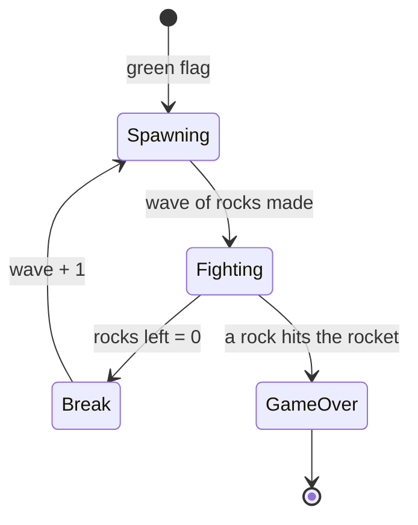

:::objectives
- Fire projectiles by cloning a different sprite from the one that listens for the key.
- Use a hidden "factory" sprite to make waves of enemy clones.
- Write two My Blocks, `explode` and `spawn wave (count)`, and call them from clone scripts.
- Make each wave harder by using a variable in the movement math.
:::

Your rocket is the last line of defense. Space rocks are raining down in waves: 3 rocks, then 6, then 9, each wave falling faster than the one before. Blast them with lasers before one of them hits you.

When it's working, the monitors tell the story of a good run:

```text
wave 1    rocks left 3 ... 2 ... 1 ... 0
wave 2    rocks left 6 ... 5 ...
wave 3    rocks left 9 ...
score 14
```

Behind the scenes there are only **three sprites**. Every laser and every rock on screen is a clone, and two My Blocks keep the rock scripts short enough to read. Here's the loop the whole game runs on:



## Step 1: Set up the sprites and variables

1.  Start a new project and delete the cat.
2.  Add the **Stars** backdrop.
3.  Add the **Rocketship** sprite. In its **Sounds** tab, add the **Laser1** sound.
4.  Add the **Rocks** sprite. In its **Sounds** tab, add **Pop**.
5.  Paint a new sprite: a short, thin, bright rectangle, about as tall as your finger is wide. Name it `Laser`.

Then make three variables, all **For all sprites**: `score`, `wave`, and `rocks left`. Keep all three monitors showing for now. You'll hide `rocks left` at the end, but while you build, it's the best way to see what the game is thinking.

## Step 2: Fly the rocket

Click **Rocketship** and build this:

```scratch title="Rocketship"
when green flag clicked
set size to (50) %
go to x: (0) y: (-140)
show
forever
  if <key (left arrow v) pressed?> then
    change x by (-7)
  end
  if <key (right arrow v) pressed?> then
    change x by (7)
  end
end
```

Click the green flag. The rocket shrinks, parks at the bottom of the stage, and glides left and right with the arrow keys.

## Step 3: Fire laser clones

Still on **Rocketship**, add a second script:

```scratch title="Rocketship"
when [space v] key pressed
create clone of (Laser v)
start sound (Laser1 v)
```

Look at the dropdown: it says **Laser**, not `myself`. The rocket is never cloned, so exactly one copy of this script is listening, and each press makes exactly one laser. If the Laser sprite listened for space itself, every laser on screen would make another laser, and the count would double on every press.

Now click the **Laser** sprite and add:

```scratch title="Laser"
when green flag clicked
hide

when I start as a clone
go to (Rocketship v)
show
repeat until <<touching (edge v)?> or <touching (Rocks v)?>>
  change y by (12)
end
wait (0.05) seconds
delete this clone
```

Press space a few times. Lasers shoot up out of the rocket and vanish at the top of the stage.

:::warning
Why the tiny `wait (0.05) seconds`? When a laser hits a rock, **both** sprites need to notice. If the laser deleted itself instantly, the rock might check a split second later and find nothing there. The short pause gives the rock time to see the hit.
:::

## Step 4: A My Block that blows up rocks

Click **Rocks**. Before building the clone script, make a helper block.

1.  Go to **My Blocks** and click **Make a Block**.
2.  Name it `explode`. Don't add any inputs. Click **OK**.

```scratch title="Rocks"
define explode
change [score v] by (1)
change [rocks left v] by (-1)
start sound (Pop v)
delete this clone
```

Every hit rock does four things: adds a point, counts itself as gone, pops, and disappears. Bundling them into `explode` means the clone script only needs one block for all of it, and if you later want a bigger reward for each rock, there's exactly one place to change.

## Step 5: What each rock clone does

Still on **Rocks**:

```scratch title="Rocks"
when I start as a clone
go to x: (pick random (-200) to (200)) y: (170)
show
repeat until <(y position) < (-170)>
  change y by ((-1) - (wave))
  if <touching (Laser v)?> then
    explode :: custom
  end
  if <touching (Rocketship v)?> then
    broadcast (game over v)
  end
end
change [rocks left v] by (-1)
delete this clone
```

Three things to notice:

-   `change y by ((-1) - (wave))` speeds up each wave. In wave 1 a rock falls 2 steps at a time, in wave 2 it falls 3, in wave 3 it falls 4.
-   A rock that slips past you still counts itself as gone with `change [rocks left v] by (-1)` before deleting. Without that line, the wave could never end.
-   Touching the rocket sends `game over`. Make that new message from the `broadcast` dropdown.

You can't test this step on its own yet, because nothing creates rock clones. That's the next step.

## Step 6: A My Block that spawns a wave

Make one more block on **Rocks**. Click **Make a Block**, type `spawn wave`, click **Add an input number or text**, name it `count`, and click **OK**.

```scratch title="Rocks"
define spawn wave (count)
set [rocks left v] to (count)
repeat (count)
  create clone of (myself v)
  wait (0.6) seconds
end
```

It fills in the counter first, then makes the rocks one at a time.

Now the main game loop, also on **Rocks**:

```scratch title="Rocks"
when green flag clicked
hide
set size to (60) %
set [score v] to (0)
set [wave v] to (1)
forever
  spawn wave ((wave) * (3)) :: custom
  wait until <(rocks left) = (0)>
  change [wave v] by (1)
  wait (1) seconds
end
```

The original Rocks sprite hides and becomes the rock factory. Clones copy their parent's size, so setting the factory to 60% makes every rock 60% too.

Read the `forever` loop out loud and it sounds like a story: make a wave, wait until it's cleared, move on to the next wave, take a breath, repeat. Click the green flag and play. Wave 1 has 3 rocks, wave 2 has 6, wave 3 has 9.

## Step 7: Game over

When a rock hits the rocket, everything should stop.

On **Rocks**:

```scratch title="Rocks"
when I receive [game over v]
stop [other scripts in sprite v]
delete this clone
```

Every rock clone hears the message, freezes, and deletes itself. The original Rocks sprite hears it too. It can't delete itself, because `delete this clone` does nothing on an original, but `stop [other scripts in sprite v]` still halts its `forever` loop, so no new waves appear.

On **Rocketship**:

```scratch title="Rocketship"
when I receive [game over v]
stop [other scripts in sprite v]
say (join [Game over! Score: ] (score)) for (2) seconds
stop [all v]
```

Let a rock hit you. The rocks vanish and the rocket says:

```text
Game over! Score: 14
```

Two seconds later, `stop [all v]` ends the whole project.

## Step 8: Test like a game designer

Run through this list, and fix anything that fails before moving on:

-   Shoot every rock in wave 1. Does `wave` change to 2 after a one-second break?
-   Let one rock fall past you. Does `rocks left` still go down by one?
-   Hold the space bar. Do lasers come out at a steady rate, not in huge bunches?
-   Click the green flag after game over. Do `score` and `wave` reset?

When everything works, untick the `rocks left` checkbox so players don't see it.

## The finished scripts

Rocketship has the three scripts from Steps 2, 3, and 7, and Laser has the two from Step 3. Rocks has the most, so here they all are together:

```scratch title="Rocks (all five scripts)"
define explode
change [score v] by (1)
change [rocks left v] by (-1)
start sound (Pop v)
delete this clone

define spawn wave (count)
set [rocks left v] to (count)
repeat (count)
  create clone of (myself v)
  wait (0.6) seconds
end

when green flag clicked
hide
set size to (60) %
set [score v] to (0)
set [wave v] to (1)
forever
  spawn wave ((wave) * (3))
  wait until <(rocks left) = (0)>
  change [wave v] by (1)
  wait (1) seconds
end

when I start as a clone
go to x: (pick random (-200) to (200)) y: (170)
show
repeat until <(y position) < (-170)>
  change y by ((-1) - (wave))
  if <touching (Laser v)?> then
    explode
  end
  if <touching (Rocketship v)?> then
    broadcast (game over v)
  end
end
change [rocks left v] by (-1)
delete this clone

when I receive [game over v]
stop [other scripts in sprite v]
delete this clone
```

:::video sqsNb0s7Oq4
griffpatch builds a space shooter from scratch, and he works fast, so pause often. Watch how his bullets are clones of their own sprite that start at the player, just like your lasers.
:::

## Check your understanding

:::quiz
Q: Why does the space-key script live on the Rocketship, cloning **Laser**, instead of on the Laser sprite cloning `myself`?
- [ ] The Laser sprite can't use key blocks
  Any sprite can use `when [space v] key pressed`.
- [x] Laser clones would hear the space key too, so every press would double the number of lasers
  Clones run key scripts. The rocket is never cloned, so it makes exactly one laser per press.
- [ ] `create clone of (myself v)` only works with the green flag
  It works under any hat block. The problem is who else is listening.

Q: You delete the line `change [rocks left v] by (-1)` that comes after the falling loop. A rock slips past you. What happens?
- [ ] The rock comes back to the top
  Nothing sends it back; it still reaches `delete this clone`.
- [ ] The next wave starts right away
  The opposite: the factory is waiting for `rocks left` to reach 0.
- [x] `rocks left` never reaches 0, so the next wave never starts
  `wait until <(rocks left) = (0)>` waits forever for a rock that already left without counting itself.

Q: In wave 4, how many rocks does `spawn wave ((wave) * (3))` make, and how many steps does each fall per move?
- [x] 12 rocks, falling 5 steps at a time
  4 × 3 = 12 rocks, and `(-1) - (4)` is -5.
- [ ] 7 rocks, falling 4 steps at a time
  That's adding 3 instead of multiplying, and it forgets the extra -1.
- [ ] 12 rocks, falling 3 steps at a time
  The count is right, but `(-1) - (wave)` gives -5 when the wave is 4.
:::

:::takeaways
- Put the key script that fires projectiles on a sprite that's never cloned, and clone the projectile sprite from there.
- A hidden factory sprite sets things like size before cloning, and every clone inherits them.
- Counting what's left (`rocks left`) lets the game know when a wave is over, but only if every way out of the wave counts down.
- My Blocks such as `explode` and `spawn wave (count)` turn long clone scripts into a few readable lines.
:::

## Make it yours

-   **Survive longer.** Add a `lives` variable so the rocket survives three hits before game over.
-   **Mix up the rocks.** Paint a second rock costume, then give each clone a random look with `switch costume to (pick random (1) to (2))` in its clone script.
-   **Shield up.** Write a `define shield` block on the Rocketship that flashes it with `change [ghost v] effect by (50)` and back again.

## Further reading

-   [Shooting Projectiles (Scratch Wiki)](https://en.scratch-wiki.info/wiki/Shooting_Projectiles): other ways to fire bullets, including shooting in the direction a sprite faces.
-   [When I Start as a Clone block (Scratch Wiki)](https://en.scratch-wiki.info/wiki/When_I_Start_as_a_Clone_(block)): exactly what a new clone runs and when.
-   [Custom Blocks (Scratch Wiki)](https://en.scratch-wiki.info/wiki/Custom_Blocks): more examples of `define` scripts with inputs and labels.
