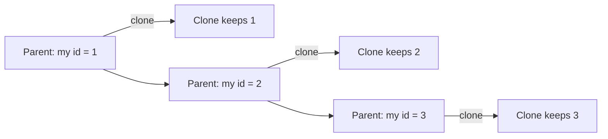

:::objectives
- Place clones exactly where you want them and remove them when they're done.
- Give each clone its own private value with a **For this sprite only** variable.
- Build My Blocks with one input, two inputs, and a label.
- Explain and fix the "clones that multiply" bug.
:::

These go from warm-up to "whoa." Each one is small, so start a fresh project every time and use any sprite you like unless the exercise names one. Try each exercise first, then the hint, and only then the solution.

:::tip
If your clones don't appear, check two things. Did the clone script run `show`? And did something actually run `create clone of`? Clicking a `when I start as a clone` script by itself does nothing, because only a brand-new clone starts that script.
:::

## Warm-up: count the cats

Read this script and guess how many cats you'll see after the green flag, then build it to check.

```scratch title="Cat"
when green flag clicked
show
go to x: (0) y: (0)
repeat (2)
  create clone of (myself v)
end
```

```text
You see one cat, but there are three.
```

The original is showing, so both clones are born showing too, but all three are standing on exactly the same spot. Put `change x by (100)` inside the loop, right after `create clone of`, and run it again. Now the cats spread out and you can count all three.

### Exercise 1: A row of five

Make the sprite put five copies of itself in a straight line across the middle of the stage, then hide the original. Use `repeat`, `create clone of (myself v)`, and `change x by`.

You should see five sprites at x = -160, -80, 0, 80, and 160.

:::hint
A clone is born wherever its parent is standing at that moment. So the parent can walk along the line, dropping a clone at each stop. Where should the parent start, and how far should it move between clones?
:::

:::solution
```scratch title="Cat"
when green flag clicked
show
go to x: (-160) y: (0)
repeat (5)
  create clone of (myself v)
  change x by (80)
end
hide
```

The parent drops a clone, steps 80 to the right, and repeats. That first `show` matters more than it looks: without it, the second time you click the green flag the parent is still hidden from last time, so every clone is born hidden too.
:::

### Exercise 2: Pop the balloons

Add the **Balloon1** sprite. Make 10 balloon clones in random spots. Clicking a balloon pops it (deletes the clone) and adds 1 to a `popped` variable.

Click all ten and you should see:

```text
popped 10
```

:::hint
You need three scripts: one that makes the clones, one that tells each new clone where to go, and one for clicks. Clones run `when this sprite clicked` too.
:::

:::solution
```scratch title="Balloon1"
when green flag clicked
hide
set [popped v] to (0)
repeat (10)
  create clone of (myself v)
end

when I start as a clone
go to (random position v)
show

when this sprite clicked
change [popped v] by (1)
delete this clone
```

The original hides, and hidden sprites can't be clicked, so only the clones respond. That's why the popped count can never go past 10.
:::

### Exercise 3: A pulse block

Make a My Block called `pulse` with one number input named `times`. It makes the sprite grow by 20, wait 0.1 seconds, shrink back, and wait again, as many times as `times` says. When the sprite is clicked, it pulses 3 times.

Click the sprite and it should throb three times, then end at its normal size.

:::hint
Click **Make a Block**, type `pulse`, then **Add an input number or text** and name it `times`. Inside the `define` script, a `repeat` loop can use `(times)` as its count. Drag that `(times)` reporter out of the `define` hat.
:::

:::solution
```scratch title="Sprite"
define pulse (times)
repeat (times)
  change size by (20)
  wait (0.1) seconds
  change size by (-20)
  wait (0.1) seconds
end

when this sprite clicked
pulse (3)
```

Each pass grows and shrinks by the same 20, so the sprite always ends where it started. Change the call to `pulse (10)` and it becomes a heartbeat.
:::

### Exercise 4: Two inputs and a label

Make a block that reads `hop (3) times height (40)`. It jumps up by `height`, waits 0.2 seconds, comes back down, waits again, and repeats `times` times. Space gives three small hops, and the up arrow gives one big one.

:::hint
In the Make a Block window, type `hop`, add an input named `times`, click **Add a label** and type `times height`, then add a second input named `height`. To come back down, you need the negative of `height`. What's 0 minus 40?
:::

:::solution
```scratch title="Sprite"
define hop (times) times height (height)
repeat (times)
  change y by (height)
  wait (0.2) seconds
  change y by ((0) - (height))
  wait (0.2) seconds
end

when [space v] key pressed
hop (3) times height (40)

when [up arrow v] key pressed
hop (1) times height (120)
```

`((0) - (height))` turns 40 into -40, so each hop lands exactly where it took off. The label between the inputs is what makes the block read like a sentence.
:::

### Exercise 5: Fix the firework bug

This Star sprite should launch one firework each time you press space. Instead, the first press makes 1, the next makes 2, then 4, then 8. Explain why, then fix it.

```scratch title="Star"
when green flag clicked
hide

when [space v] key pressed
create clone of (myself v)

when I start as a clone
go to x: (pick random (-200) to (200)) y: (-150)
show
glide (1) secs to x: (x position) y: (150)
delete this clone
```

After the fix, pressing space five times launches exactly five fireworks.

:::hint
Which hat blocks does a clone run? Count how many copies of the Star are listening for the space key after each press, including the ones still in the air.
:::

:::solution
Clones run `when [space v] key pressed` too. Every star still flying across the screen also makes a clone when you press space, so the number doubles each time.

Move the key script to something that's never cloned: the **Stage**. Delete the space-key script from the Star, then click the Stage and add:

```scratch title="Stage"
when [space v] key pressed
create clone of (Star v)
```

Now only the stage listens for space, and each press makes exactly one star. The stage can't be cloned, so it's a safe home for any key script that makes clones.
:::

### Exercise 6: A fish tank

Add the **Fish** sprite. Make 8 fish clones. Each fish swims at its **own** random speed between 1 and 6 and bounces off the edges, always facing the way it swims.

You should see eight fish going back and forth, some lazy and some zooming.

:::hint
Make a `speed` variable with **For this sprite only**, so each clone gets its own copy. Each clone sets its speed once, at birth. For facing the right way, look at `set rotation style` in **Motion**.
:::

:::solution
```scratch title="Fish"
when green flag clicked
hide
repeat (8)
  create clone of (myself v)
end

when I start as a clone
set [speed v] to (pick random (1) to (6))
go to (random position v)
set rotation style [left-right v]
point in direction (90)
show
forever
  move (speed) steps
  if on edge, bounce
end
```

Because `speed` is **For this sprite only**, every clone keeps its own value. Try making it **For all sprites** instead and all eight fish swim exactly alike, since there's only one shared box and the last clone born decides its value.
:::

## Challenge: Number your clones

Make 5 clones in a row. Each clone gets its own number from 1 to 5. Clicking a clone makes it say which one it is:

```text
I am clone number 3
```

This trick shows up in a lot of bigger Scratch games, any time the code needs to tell one clone from another, like knowing which enemy is the boss. Here's the idea in a picture:



:::hint
Make a `my id` variable **For this sprite only**. A clone copies its parent's private variables at the moment it's born, so the parent should change `my id` right **before** each `create clone of`. Each clone can then use its own `my id` to work out its x position.
:::

:::solution
```scratch title="Sprite"
when green flag clicked
hide
set [my id v] to (0)
repeat (5)
  change [my id v] by (1)
  create clone of (myself v)
end

when I start as a clone
go to x: (((my id) * (80)) - (240)) y: (0)
show

when this sprite clicked
say (join [I am clone number ] (my id)) for (2) seconds
```

The clones line up at x = -160, -80, 0, 80, and 160, because clone 1 goes to 80 - 240, clone 2 goes to 160 - 240, and so on. Click the middle one and it says "I am clone number 3". The parent's own `my id` ends at 5, but that doesn't matter, because each clone took a snapshot of the value at birth.
:::

:::video rQsMSamqDvM
A tutorial on clones and "for this sprite only" variables. Watch the part where each clone ends up with a different value, then use the same idea in Exercise 6 and the challenge.
:::
