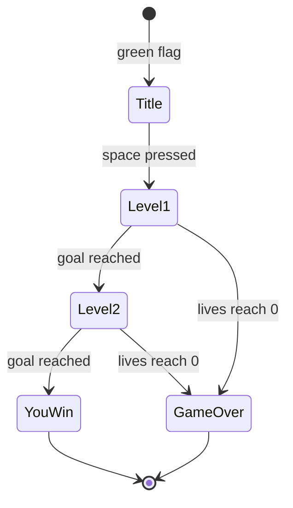

:::objectives
- Run a whole game's levels with one `level` variable and one `start level` message.
- Give every game a clear way to win and a clear way to lose.
- Run a playtest without helping, and turn what you see into a fix.
- Track down the most common Scratch bugs, and share or remix a project the safe, fair way.
:::

Your little brother plays your space shooter for twenty seconds. The rocks stop falling, nothing happens, and he turns to you: "Wait... did I win?"

That question means the game isn't finished yet. Every game that feels complete has three things: a **goal** to reach, a way to **lose**, and a challenge that **grows** as you get better. Then it needs to be tested by someone who isn't you, and fixed. Finally, if you want, it gets **shared**. This week covers all of it.

Here's the map of a small but complete game. Your Maze Escape in the code-along will look exactly like this:



Every arrow is something your code has to make happen, and every box is a screen the player should recognize.

## Levels: one variable, one message

A **level** is a stage of the game with its own layout or difficulty. Most Scratch games keep track of it with one variable, `level`, and one message that tells every sprite to get ready.

```scratch title="Stage"
when green flag clicked
set [level v] to (1)
broadcast (start level v)
```

Every sprite listens for `start level` and sets itself up for whichever level it is. The stage, for example, picks the right backdrop:

```scratch title="Stage"
when I receive [start level v]
if <(level) = (1)> then
  switch backdrop to (Level 1 v)
else
  switch backdrop to (Level 2 v)
end
```

To move up a level, change the variable and send the message again:

```scratch title="Player"
change [level v] by (1)
broadcast (start level v)
```

That's the whole pattern. To add Level 3 later, each sprite gets one more check in its `start level` script, and nothing else in the game has to change.

### Make later levels harder with math

New backdrops are nice, but you don't always need them. Put the `level` number into your movement math and the game gets harder by itself:

```scratch title="Meteor"
change y by ((-2) * (level))
```

Level 1 falls 2 steps at a time, level 2 falls 4, level 3 falls 6. One block, as many levels as you like.

Other quick ways to raise the difficulty:

-   Less time on the clock.
-   More clones per wave.
-   Smaller targets, with `set size to`.
-   A new obstacle that only appears when `level` is greater than 1.

## Endings: no one should have to ask "did I win?"

A good ending has three parts:

1.  **A check**, like `if <(lives) = (0)>` or `if <(level) > (2)>`.
2.  **A message**, like `broadcast (game over v)` or `broadcast (you win v)`.
3.  **A screen**: a backdrop, a sound, or a sprite that says clearly what happened.

```scratch title="Stage"
when I receive [you win v]
switch backdrop to (You Win v)
start sound (Cheer v)
wait (2) seconds
stop [all v]
```

You can also start scripts from the backdrop itself, with this hat block from **Events**:

```scratch title="Any sprite"
when backdrop switches to [You Win v]
say [We did it!] for (2) seconds
```

:::tip
Test your endings first, not last. Temporarily `set [lives v] to (1)` so you can lose fast, or start at the final level so you can win fast. Then write yourself a note to change it back before you share.
:::

## Playtesting: watch someone else play

**Playtesting** means watching another person play your game. It's the quickest way to find out what's confusing, because you already know how your game works and can't see it with fresh eyes anymore.

How to run a good playtest:

1.  Give the player your instructions, then **stay quiet**. Don't explain. If they're confused, that confusion is exactly what you came to find.
2.  Watch their hands and face. Where do they get stuck? Where do they grin?
3.  Write down what actually happens, not what you wish had happened.
4.  Afterward, ask three questions: What was the most fun part? What was confusing? Was it too easy, too hard, or about right?

Real playtest notes are short and specific:

```text
Tester: my brother
- Pressed W to shoot. Didn't know it was SPACE.
- Level 1 was too easy. Finished in 10 seconds.
- Laughed at the explosion sound.
- Got stuck on the Game Over screen. Didn't know to click the green flag.
Fix I'll make: put "Press SPACE to shoot" on the title screen.
```

:::video on7endO4lPY
Extra Credits explains how professional game designers get useful feedback. Watch for the advice about what a designer should and shouldn't say while someone plays, and compare it with the four steps above.
:::

## Debugging: think like a detective

A **bug** is anything your game does that you didn't mean it to. Every coder writes bugs, including the people who made Scratch. The skill isn't avoiding them; it's finding them.

### Detective tricks

-   **Make it happen again.** Find the exact steps that cause the bug: "When I touch the wall on Level 2, the score resets." A bug you can repeat is a bug you can fix.
-   **Watch your variables.** Tick the checkbox next to a variable so its monitor shows on the stage, and watch it change as you play.
-   **Make sprites talk.** Drop in a `say` block to show what a sprite "thinks" at that moment (there's an example right after this list).
-   **Click one script.** Clicking a script runs just that script, and it glows yellow while it runs. If it never stops glowing, it's stuck in a loop.
-   **Slow it down.** Put a `wait (0.5) seconds` inside a loop to watch each step, and take it out when you're done.

Here's the talking trick. Snap this into a loop and the sprite reports its lives every time around:

```scratch title="Player"
say (join [lives = ] (lives)) for (1) seconds
```

### The usual suspects

Most Scratch bugs are one of these:

| What you see | Likely cause |
| --- | --- |
| Works the first time, broken the second | A variable or backdrop isn't reset under the green flag |
| A sprite is missing | It hid last game and nothing tells it to `show` |
| A message does nothing | The sender and receiver picked different message names |
| Score changes for one sprite but not another | The variable was made **For this sprite only** |
| All lives vanish in one hit | Still touching the enemy, so the loop counts the hit again and again |
| Clones stop appearing | They never `delete this clone`, so you hit the 300 limit |

Change **one** thing at a time, then test again. If you change five things and the bug disappears, you won't know which change fixed it, or which one quietly broke something else.

## Sharing and remixing the right way

When your game is ready, you can share it on the Scratch website so anyone can play. That needs a Scratch account, so check with a parent or guardian first.

### Before you click Share

On your project page, fill in two boxes:

-   **Instructions**: which keys to press, what the goal is, and how to win.
-   **Notes and Credits**: who made what. If you used someone else's art, music, or code, name them here.

### The Scratch Community Guidelines

Scratch is a community of millions of young people, and its guidelines come down to six ideas:

-   **Treat everyone with respect**, in projects and in comments.
-   **Keep personal and contact information private.** No real last names, addresses, phone numbers, school names, email addresses, or links to social media. Your username is all anyone needs.
-   **Give helpful feedback.** Say something you liked, then suggest an idea kindly.
-   **Embrace remix culture.** Building on others' work is welcome, as long as you give credit and make a meaningful change.
-   **Be honest.** Don't pretend to be someone else, and don't pass off someone else's project as your own.
-   **Help keep the site friendly.** If you see something mean or unsafe, click **Report** instead of arguing back.

### Remixing well

The **Remix** button on any shared project makes your own copy to change, and Scratch automatically adds a credit linking back to the original. To be a great remixer:

-   Change something real: new levels, new art, a new rule.
-   Say what you changed and thank the original creator in **Notes and Credits**.
-   Never remove someone's credit from a project you remixed.

### Not sharing online?

That's completely fine. Use **File > Save to your computer** to download your game as an `.sb3` file. You can open it again later with **File > Load from your computer**, or send the file to your instructor.

## Check your understanding

A student added a Level 3 backdrop, but didn't change the stage's script:

```scratch title="Stage"
when I receive [start level v]
if <(level) = (1)> then
  switch backdrop to (Level 1 v)
else
  switch backdrop to (Level 2 v)
end
```

:::quiz
Q: `level` is now 3, and `start level` is broadcast. Which backdrop appears?
- [ ] Level 3
  Nothing in this script ever mentions Level 3, so Scratch can't pick it.
- [x] Level 2
  The `else` catches every level that isn't 1, including 3. Add a check for `(level) = (3)` to fix it.
- [ ] The backdrop doesn't change
  The `else` branch always runs when `level` isn't 1.

Q: Your game works perfectly the first time. On the second green flag, the player is invisible. Which suspect do you check first?
- [ ] The message names
  A name mismatch would break the first game too.
- [x] A `show` block under the green flag
  The player hid at the end of the first game, and nothing makes it visible again.
- [ ] The 300-clone limit
  Clicking the green flag removes every clone, so the limit resets each game.

Q: During a playtest, your tester keeps pressing W to shoot and looks confused. What should you do right then?
- [ ] Tell them to press space
  Then you'll never learn what a stranger would do with your game.
- [x] Stay quiet and write it down
  That confusion is the most useful thing the playtest can show you. Fix the instructions afterward.
- [ ] Stop the test and restart it
  Let it play out; there may be more to learn in the next minute.

Q: Which line is safe to put in your project's Notes and Credits?
- [x] "Thanks to the creator of the original maze. I added lava and a second level."
  It gives credit and says what changed, with no personal information.
- [ ] "Made by Sam at Lincoln Middle School."
  A school name is personal information that the guidelines ask you to keep private.
- [ ] "Email me at sam@example.com with your high score!"
  Email addresses are contact information. Keep conversations in Scratch comments instead.
:::

:::takeaways
- One `level` variable plus one `start level` message can run every level of a game.
- Every ending needs a check, a message, and a screen the player can't miss.
- During a playtest, watch and take notes. Don't explain.
- Debug by making the bug happen again, watching variables, and changing one thing at a time.
- Share with a grown-up's OK, give credit, make meaningful changes when you remix, and keep personal information off Scratch.
:::

## Further reading

-   [Scratch Community Guidelines](https://scratch.mit.edu/community_guidelines): the six guidelines in the Scratch Team's own words. Read them with a grown-up before you share.
-   [Remix (Scratch Wiki)](https://en.scratch-wiki.info/wiki/Remix): how the Remix button works and how credit is added.
-   [Debugging Scripts (Scratch Wiki)](https://en.scratch-wiki.info/wiki/Debugging_Scripts): more detective tricks, with examples of real bugs.
