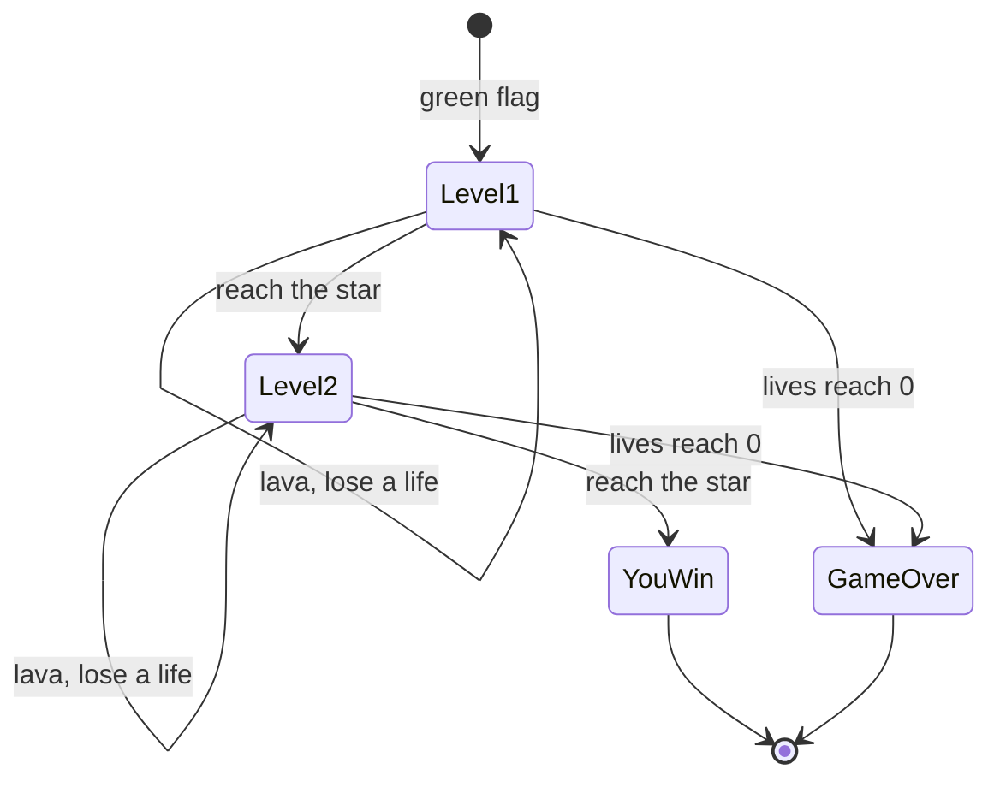

:::objectives
- Run two levels from one `level` variable and one `start level` message.
- Keep the player out of the walls with a My Block that has two inputs.
- Use `broadcast () and wait` so the game doesn't skip ahead before sprites are ready.
- Build both a win ending and a lose ending, and playtest every path through the game.
:::

You're a tiny green dot trapped in a maze. Reach the gold star to escape to Level 2. Touch the red lava and you're sent back to the start of the level, minus one life. Lose all three lives and it's game over. Escape both levels and you win.

In Week 3 you built a maze with solid walls. This one is a full game: it has levels, a way to lose, a way to win, and My Blocks that keep the code tidy. Here's every path a player can take through it:



By the end of Step 8, you'll have tested every arrow in that picture.

## Step 1: Paint the backdrops

You'll paint four backdrops. Click the **Stage**, open the **Backdrops** tab, and use the paint editor.

1.  **Level 1:** Draw maze walls with the rectangle tool in **one** color, like dark blue. Add two or three small red rectangles as lava. Leave open space in the **bottom-left** corner (the start) and the **top-right** corner (the goal).
2.  **Level 2:** Right-click Level 1 in the backdrop list and choose **duplicate**, then rename the copy. Make it harder: narrower paths and more lava. This time leave space in the **top-left** (start) and **bottom-right** (goal).
3.  **You Win:** Write `YOU ESCAPED!` with the text tool.
4.  **Game Over:** Write `GAME OVER`.

Name them exactly `Level 1`, `Level 2`, `You Win`, and `Game Over`, and delete the blank `backdrop1`.

:::warning
Use exactly the same wall color everywhere, and don't use that blue or the lava red anywhere else, including on your sprites. The game decides what counts as a wall by color alone, so a blue eye on your player would make it stick to itself.
:::

## Step 2: Add the sprites and variables

1.  Delete the cat.
2.  Paint a new sprite: a small **green** circle. Name it `Player`.
3.  Add the **Star** sprite from the library. Rename it `Goal` and set its size to about 50.

Make two variables, both **For all sprites**: `level` and `lives`.

## Step 3: A My Block that respects walls

Here's the wall trick from Week 3, packed into one reusable block: move a little, and if that move put you inside a wall, move straight back. It happens between screen refreshes, so the player never appears inside the wall.

On **Player**, click **Make a Block**. Type `try move x`, add a number input called `dx`, add a label `y`, add a number input called `dy`, and click **OK**.

```scratch title="Player"
define try move x (dx) y (dy)
change x by (dx)
change y by (dy)
if <touching color [#1e3a8a]?> then
  change x by ((0) - (dx))
  change y by ((0) - (dy))
end
```

To set the color in `touching color`, click the color circle, choose the **eyedropper** at the bottom, and click a wall on the stage. Your color code will look different from the one above, and that's fine.

In Week 3 you wrote the undo four times, once per arrow key. Now it's written once, and each arrow just says which way to try.

## Step 4: A My Block for losing a life

Still on **Player**, make a block called `lose a life` with no inputs. Add the **Zoop** sound to Player first.

```scratch title="Player"
define lose a life
change [lives v] by (-1)
start sound (Zoop v)
if <(lives) = (0)> then
  broadcast (game over v)
else
  broadcast (start level v) and wait
end
```

If you still have lives, `start level` sends you back to the start of the level you're on. Nothing about the level changes, only your position.

## Step 5: Everyone gets ready for each level

Each part of the game listens for `start level` and checks which level it is.

On the **Stage**:

```scratch title="Stage"
when I receive [start level v]
if <(level) = (1)> then
  switch backdrop to (Level 1 v)
else
  switch backdrop to (Level 2 v)
end
```

On **Player**:

```scratch title="Player"
when I receive [start level v]
if <(level) = (1)> then
  go to x: (-210) y: (-150)
else
  go to x: (-210) y: (150)
end
show
```

On **Goal**:

```scratch title="Goal"
when I receive [start level v]
if <(level) = (1)> then
  go to x: (210) y: (150)
else
  go to x: (210) y: (-150)
end
show
```

If a start or goal spot lands inside one of your walls, drag the sprite to an open spot on the stage and copy its x and y from the sprite info panel into the script.

## Step 6: The main game loop

On **Player**:

```scratch title="Player"
when green flag clicked
set size to (100) %
set [lives v] to (3)
set [level v] to (1)
broadcast (start level v) and wait
forever
  if <key (up arrow v) pressed?> then
    try move x (0) y (3) :: custom
  end
  if <key (down arrow v) pressed?> then
    try move x (0) y (-3) :: custom
  end
  if <key (left arrow v) pressed?> then
    try move x (-3) y (0) :: custom
  end
  if <key (right arrow v) pressed?> then
    try move x (3) y (0) :: custom
  end
  if <touching color [#ff0000]?> then
    lose a life :: custom
  end
  if <touching (Goal v)?> then
    change [level v] by (1)
    if <(level) > (2)> then
      broadcast (you win v)
    else
      broadcast (start level v) and wait
    end
  end
end
```

Use the eyedropper again to set the lava color.

Look how readable this is. Four `try move` blocks handle the walls, `lose a life` handles lava, and the goal check handles levels. The My Blocks hide the fiddly parts.

Why `broadcast (start level v) and wait` instead of plain `broadcast`? It pauses this loop until the player has actually moved to the new start. Without the wait, the loop could check `touching (Goal v)?` once more before the player moves, still be on the star, and jump straight past Level 2.

Play it now and watch the monitors:

```text
level 1    lives 3
(reach the star)
level 2    lives 3
(touch lava)
level 2    lives 2
```

## Step 7: Win and lose endings

On the **Stage**:

```scratch title="Stage"
when I receive [you win v]
switch backdrop to (You Win v)

when I receive [game over v]
switch backdrop to (Game Over v)
```

On **Goal**:

```scratch title="Goal"
when I receive [you win v]
hide

when I receive [game over v]
hide
```

On **Player**:

```scratch title="Player"
when I receive [you win v]
stop [other scripts in sprite v]
say [I escaped!] for (2) seconds
stop [all v]

when I receive [game over v]
stop [other scripts in sprite v]
hide
```

`stop [other scripts in sprite v]` freezes the Player's main loop, so the arrow keys stop working on the ending screens.

## Step 8: Playtest every path

Go back to the diagram at the top and test each arrow:

-   Walk into every wall. Can you slip through anywhere? If so, make that wall thicker.
-   Touch lava. Do you go back to the start of the **same** level with one fewer life?
-   Touch lava three times. Do you see Game Over?
-   Beat both levels. Do you see You Win?
-   Click the green flag after each ending. Is the player visible, back on Level 1, with 3 lives?

Then hand the game to someone else and watch them play without helping. Write down one thing that confused them.

:::tip
To test Level 2 quickly, temporarily change `set [level v] to (1)` to `set [level v] to (2)`. Change it back before you share.
:::

:::video AKUtkYZTUfo
A maze game tutorial from Zinnea. Watch how the walls are detected and how the player is sent back to the start, then spot what your version does differently with `try move` and `start level`.
:::

## Check your understanding

:::quiz
Q: The player is pressed right up against a wall on its right side, and you hold the right arrow. What does `try move x (3) y (0)` do?
- [ ] It moves 3 steps into the wall
  It does move 3 steps, but then it notices the wall color and moves back.
- [x] It moves 3 steps right, touches the wall, and moves 3 steps back, so the player stays put
  The undo uses `(0) - (dx)`, which is -3, cancelling the move before the screen redraws.
- [ ] It bounces the player back to the start
  Only lava sends you to the start, through `lose a life`.

Q: You reach the star on Level 1. Why does the goal check use `broadcast (start level v) and wait` instead of plain `broadcast`?
- [ ] Plain broadcast doesn't work inside a `forever` loop
  It works anywhere. The difference is whether this loop pauses.
- [x] Without the wait, the loop could check the goal again before the player moves, and skip Level 2
  Waiting means the player is already at the new start when the loop carries on.
- [ ] `and wait` makes the backdrop change faster
  The backdrop changes at the same speed either way.

Q: What would happen if you deleted the `else` branch from `lose a life`, keeping only the `if <(lives) = (0)>` part?
- [x] You'd lose a life but stay in the lava, so the next few passes of the loop take the rest of your lives in a split second
  Nothing sends the player back to the start, so each pass of the loop sees lava again and calls `lose a life` again.
- [ ] Nothing changes, because the Player loop also sends `start level`
  The loop only sends `start level` when you reach the goal.
- [ ] You'd lose exactly one life and keep walking from where you are
  The player is still touching lava on the next pass, about a thirtieth of a second later.
:::

:::takeaways
- One `level` variable and one `start level` message set up every sprite for each level, and resend the player to the start after a mistake.
- A My Block with inputs, like `try move x () y ()`, turns four copies of the wall trick into one.
- Use `broadcast () and wait` when the next step depends on sprites finishing their setup first.
- Test every arrow in your game's map, including clicking the green flag after each ending.
:::

## Make it yours

-   **Race the clock.** Add a 60-second limit with `reset timer` and `if <(timer) > (60)> then` in the Player's loop.
-   **Level 3.** Paint a third backdrop, give each `start level` script a check for `(level) = (3)`, and change the win check to `<(level) > (3)>`.
-   **A guard.** Add an enemy that glides back and forth across a corridor. In the Player's loop, add `if <touching (Enemy v)?> then` with `lose a life` inside.

## Further reading

-   [Maze (Scratch Wiki)](https://en.scratch-wiki.info/wiki/Maze): how Scratchers build mazes, from color walls to generated ones.
-   [Broadcast () and Wait block (Scratch Wiki)](https://en.scratch-wiki.info/wiki/Broadcast_()_and_Wait_(block)): exactly what the waiting version waits for.
-   [Instructions (Scratch Wiki)](https://en.scratch-wiki.info/wiki/Instructions): how to write the Instructions box so new players know what to do.
