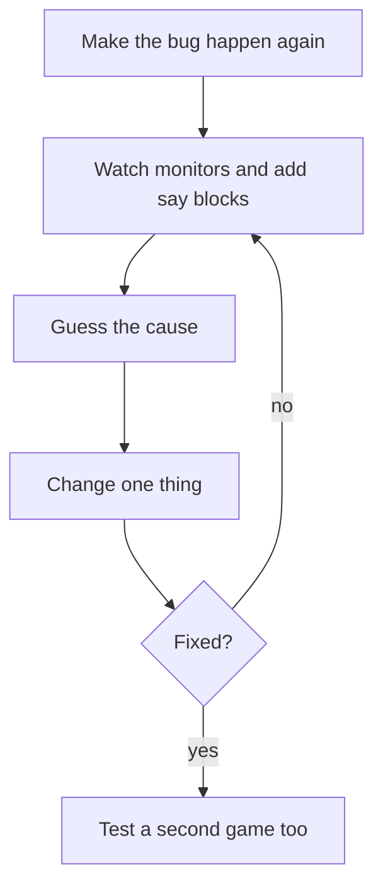

:::objectives
- Add a `level` that rises with the score and makes the game harder.
- Give a game a winning ending that can't clash with its losing ending.
- Find bugs by reading scripts and watching variables, then fix one thing at a time.
- Decide what belongs on a shared project page and what stays private.
:::

This set has three flavors. Exercises 1 and 2 add levels and a way to win to your **Apple Catcher** from Week 4. Exercises 3 to 5 are bug hunts: read the script, work out what's wrong, and fix it. Exercise 6 is about sharing. Before you change Apple Catcher, save a copy with **File > Save to your computer** so you can always go back.

For the bug hunts, use the detective's loop from the notes:



## Warm-up: which suspect?

Each of these is one of the "usual suspects" from the notes. Name the cause before reading the answer underneath.

```text
1. The Game Over backdrop is still showing when a new game starts.
2. The coin's score goes up, but the stage's score monitor stays at 0.
3. After two minutes of play, no more enemies appear.
```

```text
1. No "switch backdrop" under the green flag.
2. The coin made its own "For this sprite only" score.
3. Clones never delete themselves, so the 300-clone limit was reached.
```

### Exercise 1: Level up every 5 points

In Apple Catcher, add a `level` variable that starts at 1. Each time the score reaches a multiple of 5, the level goes up by 1, and the apple falls faster on higher levels.

After catching 10 apples, the monitors should read:

```text
score 10
level 3
```

:::hint
You used `mod` for bonus lives in Week 4; the same trick works here with 5. For the speed, put `(level)` into the number in `change y by`, so a higher level means a bigger step down.
:::

:::solution
On the **Stage**, add `set [level v] to (1)` next to the other `set` blocks in the green flag script.

On the **Apple**, change the falling block and the "caught it" branch:

```scratch title="Apple"
repeat until <<touching (Bowl v)?> or <(y position) < (-170)>>
  change y by ((-3) - ((level) * (2)))
end
if <touching (Bowl v)?> then
  change [score v] by (1)
  start sound (Pop v)
  if <((score) mod (5)) = (0)> then
    change [level v] by (1)
  end
else
  change [lives v] by (-1)
  if <(lives) = (0)> then
    broadcast (game over v)
  end
end
```

On level 1 the apple falls 5 steps at a time, on level 2 it falls 7, and on level 3 it falls 9. Scores 5 and 10 each bump the level, which is how 10 catches gets you to level 3.
:::

### Exercise 2: A way to win

Right now Apple Catcher can only end badly. Add a winning ending: catch 20 apples and the game shows a `You Win` backdrop and stops. Paint the backdrop first.

When you catch apple number 20, the sky should switch to your You Win backdrop and stay there, even if the clock had time left.

:::hint
The Apple knows the moment the score changes, so the check goes there and sends a new message. The stage answers it, but think about what the stage's countdown loop might do after you've already won.
:::

:::solution
On the **Apple**, inside the "caught it" branch, right after `change [score v] by (1)`:

```scratch title="Apple"
if <(score) = (20)> then
  broadcast (you win v)
end
```

On the **Stage**:

```scratch title="Stage"
when I receive [you win v]
stop [other scripts in stage v]
switch backdrop to (You Win v)
wait (2) seconds
stop [all v]
```

`stop [other scripts in stage v]` stops the countdown, so the clock can't reach 0 and broadcast `game over` after you've already won. Two endings fighting over the screen is a classic bug, and this one block prevents it.
:::

### Exercise 3: Bug hunt, the instant game over

This player has 3 lives, but a single touch of the ghost takes all of them. Why? Fix it so each touch costs exactly one life.

```scratch title="Player"
when green flag clicked
set [lives v] to (3)
forever
  if <touching (Ghost v)?> then
    change [lives v] by (-1)
  end
end
```

:::hint
Tick the `lives` checkbox and play slowly. How many times does the `forever` loop run while the player is still overlapping the ghost? What could make the script hold still until they're apart?
:::

:::solution
The `forever` loop runs about 30 times a second. While the player is still touching the ghost, every pass takes another life, so three passes later you're at 0.

One fix is to wait until they're no longer touching:

```scratch title="Player"
when green flag clicked
set [lives v] to (3)
forever
  if <touching (Ghost v)?> then
    change [lives v] by (-1)
    wait until <not <touching (Ghost v)?>>
  end
end
```

Now each touch costs exactly one life. Sending the player back to the start, the way Maze Escape does, works too.
:::

### Exercise 4: Bug hunt, the broken second game

The first game works. But on the second green-flag click, the player is invisible and the game starts on Level 2. Find the two missing blocks.

```scratch title="Player"
when green flag clicked
go to x: (-200) y: (-150)
set [lives v] to (3)
forever
  if <touching (Goal v)?> then
    change [level v] by (1)
  end
end

when I receive [game over v]
hide
stop [other scripts in sprite v]
```

:::hint
List everything that changes during a game: position, lives, level, and whether the player is showing. Now check which of those the green flag script puts back.
:::

:::solution
The sprite hides at game over and nothing shows it again. And `level` is never reset, so it keeps last game's value.

```scratch title="Player"
when green flag clicked
show
set [level v] to (1)
go to x: (-200) y: (-150)
set [lives v] to (3)
forever
  if <touching (Goal v)?> then
    change [level v] by (1)
  end
end
```

Rule of thumb: anything that can change during a game must be put back under `when green flag clicked`.
:::

### Exercise 5: Bug hunt, double points

In this catching game, catching an apple sometimes adds **2** points instead of 1. Here are the scripts from two sprites:

```scratch title="Apple"
if <touching (Bowl v)?> then
  change [score v] by (1)
  go to x: (pick random (-220) to (220)) y: (180)
end
```

```scratch title="Bowl"
if <touching (Apple v)?> then
  change [score v] by (1)
end
```

:::hint
Both scripts sit inside `forever` loops. Scratch gives each sprite a turn, one after another, many times a second. What happens if the Bowl gets its turn while the apple is still sitting in it?
:::

:::solution
Both sprites notice the same catch, and **both** add a point. If the Bowl's loop gets its turn before the Apple moves back to the top, it sees the touch too. Whether it does depends on which sprite Scratch runs first, which is why the bug only shows up sometimes.

Pick one sprite to own the score. The Apple is the better choice, because it also moves itself away right after. Delete the `if` block from the Bowl, and every catch adds exactly one point.

When two sprites both react to one event, you often get double results. One job, one owner.
:::

### Exercise 6: A safe, honest project page

Write the **Instructions** and **Notes and Credits** for your Maze Escape. Then decide which of these five lines are OK to include:

```text
A. "Use the arrow keys to reach the star. Avoid the red lava!"
B. "Made by Maya, age 10, Lincoln Elementary, Room 4."
C. "Star sprite from the Scratch library. Maze idea from my Scratch class."
D. "Comment your best time below!"
E. "Message me at maya.k@example.com if you find a bug."
```

:::hint
Go back to the Community Guidelines section of the notes. Which lines would help a stranger find or contact Maya outside of Scratch?
:::

:::solution
OK: **A**, **C**, and **D**.

Not OK: **B** and **E**. A school name and an email address are personal and contact information, and the Scratch Community Guidelines ask you to keep those private. Your Scratch username is all anyone needs.

A good page might look like this:

```text
Instructions:
Use the arrow keys to move the green dot. Reach the gold star to
escape each level. Red lava sends you back and costs a life.
You have 3 lives. Beat both levels to win!

Notes and Credits:
Star sprite and Zoop sound from the Scratch library.
Maze idea from my Scratch class.
```
:::

## Challenge: Best time

In Maze Escape, record how fast the player escapes. Start the stopwatch when the game begins. When the player wins, save the time in a `best time` variable, but only if it beats the old record or there's no record yet. Show the result in a speech bubble.

Escape in 41 seconds, then in 35, and the second win shows:

```text
New record!
Best time: 35 seconds
```

:::hint
Put `reset timer` just before the Player's `forever` loop. On a win, compare `(timer)` with `(best time)`. A brand-new variable holds 0, so "no record yet" means `best time` is 0. You'll need an `or` to check both cases.
:::

:::solution
On **Player**, add `reset timer` to the green flag script, right before the `forever` loop.

Then replace the Player's win script:

```scratch title="Player"
when I receive [you win v]
stop [other scripts in sprite v]
if <<(best time) = (0)> or <(timer) < (best time)>> then
  set [best time v] to (round (timer))
  say [New record!] for (2) seconds
end
say (join [Best time: ] (join (best time) [ seconds])) for (2) seconds
stop [all v]
```

Don't reset `best time` under the green flag, or it forgets your record every game. The `<(best time) = (0)>` half of the `or` is what lets the very first win count as a record.
:::

:::video 1LK7sJVW9EA
The Scratch Team on nested `if` blocks and how to debug them. Pause before each script runs and predict what the sprite will do. That's the same skill every bug hunt on this page uses.
:::
