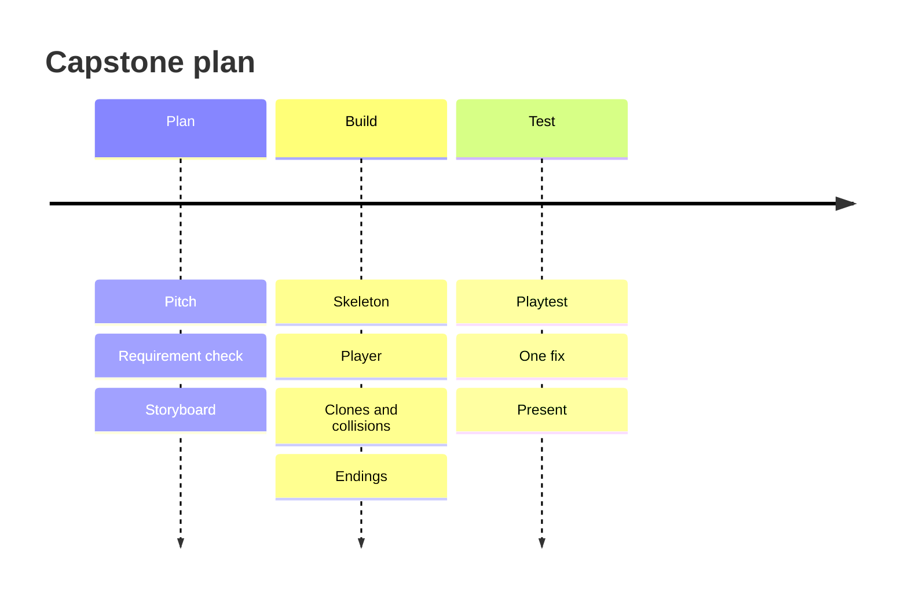

:::objectives
- Explain every requirement in the capstone brief and where you learned it.
- Choose a game idea that's small enough to finish and big enough to meet the brief.
- Write a one-sentence pitch and check it against every requirement.
- Sketch a storyboard and list the sprites, backdrops, variables, and messages you'll need.
:::

For six weeks you've built games someone else designed: a catching game, a space shooter, a maze. Now you're the designer. You decide who the player is, what they're trying to do, and what's standing in their way.

Before anyone builds anything, real game studios spend days planning on paper, because changing a sketch takes seconds and changing a finished game takes hours. Today you'll plan. Here's the whole capstone at a glance:



This lesson is the first column. The next lesson builds the game one milestone at a time, and the last one tests, polishes, and presents it.

## The brief

Make an original game in Scratch 3. It can be about anything you like, as long as it's kind and appropriate for everyone. Your game **must** include all of these:

| Requirement | What it means | Where you learned it |
| --- | --- | --- |
| Instructions | The player knows how to play: on a title screen, in a speech bubble, or on the project page | Week 6 |
| Score or timer | A variable the player can see that counts points or time | Week 4 |
| Collisions | Something happens when sprites touch each other, a color, or the edge | Week 3 |
| A clone | At least one sprite makes copies of itself or of another sprite | Week 5 |
| A My Block | At least one block you defined yourself **and** actually use | Week 5 |
| Two levels | At least two levels that look or play differently | Week 6 |
| Win and lose | A clear winning ending and a clear losing ending | Week 6 |

### What you turn in

1.  **Your game:** a shared Scratch link, **or** your `.sb3` file from **File > Save to your computer**.
2.  **Playtest notes:** what happened when at least one other person played your game.
3.  **One fix:** a short write-up of one thing you changed because of playtesting.

Your instructor will tell you the due date and how to send your file or link.

## Pick an idea

Here are six ideas that fit the brief, sorted from the most manageable to the most ambitious. Borrow one, mash two together, or invent your own.

**Starter-sized** (great if this is your first game from scratch):

-   **Bug Catcher.** Bugs crawl across a garden (clones). Click them for points before the timer runs out. Level 2 adds fast bugs and a bee you must **not** click.
-   **Snowball Fight.** Targets pop up around the stage (clones). Throw snowball clones at them. Hit 10 to reach Level 2, where the targets move.

**Medium:**

-   **Meteor Dodge.** Meteors fall (clones) and you steer a ship to dodge them. Survive 20 seconds to reach Level 2, where meteors fall faster. The next lesson builds this one as its example.
-   **Pizza Rush.** Toppings fall from the sky. Catch the good ones and dodge the burnt ones. Level 2 adds a topping that's worth double.

**Ambitious** (pick one only if you finished last week's projects with time to spare):

-   **Deep Sea Diver.** Swim around collecting pearls while sharks patrol. Level 2 is deeper and darker, with more sharks and less air on a timer.
-   **Ghost House.** A maze with ghosts gliding back and forth. Find the key to open the door to Level 2.

:::tip
Choose the **smaller** idea. A simple game that works and feels finished beats a giant game that's half built. Once the basics work, you can always add more.
:::

:::video Ex1ktxOxVgI
A short explainer from MIT on how video games get made. Watch for the steps between having an idea and having a game people can play, then compare them with the plan, build, and test columns above.
:::

## Step 1: Write your pitch

A **pitch** is one or two sentences that tell someone what your game is. If you can't say it simply, the idea might be too big.

```text
In Bug Catcher, you click crawling bugs to score points before
time runs out, but click the bee and you lose a life!
```

A good pitch names the player's goal (click bugs), the danger (the bee), and the pressure (time runs out). Read yours out loud. Would a friend know what to do in the first five seconds?

## Step 2: Check your idea against the brief

Go down the brief's table and write how your game will meet each row. Here's the check for Bug Catcher:

```text
Instructions:  Title screen says "Click bugs! Don't click the bee!"
Score/timer:   score goes up per bug; time left counts down from 30
Collisions:    bugs bounce off the edges as they crawl
Clone:         the Bug sprite makes clones that crawl across
My Block:      define spawn bugs (count)
Two levels:    Level 1 = slow bugs; Level 2 = fast bugs + a bee
Win:           reach 15 points on Level 2
Lose:          timer hits 0, or lives hit 0 from clicking the bee
```

If any row is empty, change your idea until every row has an answer. An empty row now is a missing requirement later.

## Step 3: Draw a storyboard

A **storyboard** is a set of quick sketches, like a comic strip, showing each screen of your game. Grab a sheet of paper and fold it into six boxes. Draw one screen in each:

```text
+-------------+-------------+-------------+
| 1. Title    | 2. Level 1  | 3. Level 2  |
| Name, how   | What's on   | What's new  |
| to play,    | screen?     | or harder?  |
| "press      | Where's the | Draw arrows |
| space"      | player?     | for motion  |
+-------------+-------------+-------------+
| 4. Win      | 5. Lose     | 6. My Block |
| What does   | What does   | Which code  |
| the player  | the player  | will I reuse|
| see & hear? | see & hear? | and why?    |
+-------------+-------------+-------------+
```

Stick figures and boxes are perfect, and nobody is grading the drawing. Draw arrows to show which way things move, and label every sprite.

## Step 4: List what you'll build

Before you open Scratch, write down everything you'll need. This list becomes your checklist while building, and it catches problems early, like a sprite that needs a variable nobody made.

```text
Sprites:    Bug (clones), Bee, Title Text
Backdrops:  Title, Garden (Level 1), Night Garden (Level 2), You Win, Game Over
Variables:  score, lives, time left, level   (all For all sprites)
Messages:   start level, you win, game over
```

## Step 5: Build your first script today

Most games start the same way: show a title screen, wait for the player, then start Level 1. You can build this right now, before anything else. Put it on the **Stage**:

```scratch title="Stage"
when green flag clicked
switch backdrop to (Title v)
set [score v] to (0)
set [lives v] to (3)
set [level v] to (1)
wait until <key (space v) pressed?>
broadcast (start level v)
```

Paint a backdrop called `Title` with your game's name and "Press SPACE to start." Click the green flag. The title appears, and nothing happens until you press space. Then the `start level` message goes out, ready for your sprites to listen for.

This one script already covers two parts of the brief: instructions, and resetting your variables for every new game.

## Check your plan with a buddy

Before you build, show your pitch and storyboard to a classmate, a family member, or your instructor. Ask them:

-   Does this game sound fun?
-   Is anything confusing?
-   Does it look small enough to finish?

Change your plan if you need to. Erasing a box on paper takes 30 seconds.

## Your planning checklist

-   [ ] A one- or two-sentence pitch.
-   [ ] Every row of the brief has an answer.
-   [ ] A six-box storyboard.
-   [ ] A list of sprites, backdrops, variables, and messages.
-   [ ] The title-screen script works.
-   [ ] Someone else has seen your plan.

## Further reading

-   [Scratch Ideas](https://scratch.mit.edu/ideas): official tutorials and coding cards, handy when you need one specific trick for your game.
-   [Game (Scratch Wiki)](https://en.scratch-wiki.info/wiki/Game): the kinds of games Scratchers make most often, with tips for each.
