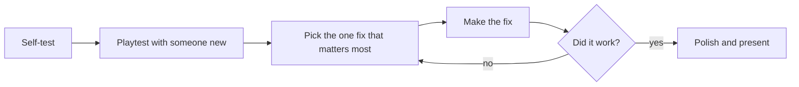

:::objectives
- Try to break your own game with a self-test checklist.
- Run a real playtest, take notes, and choose the one fix that matters most.
- Write up a fix as problem, change, and result, then test it again.
- Save or share your game safely, present it in about two minutes, and check it against the rubric.
:::

Your game runs. Now comes the part that makes it good. "It works when I play it" is a long way from "it's fun for someone who has never seen it." The last stretch of any game project is testing, fixing, and showing it off. Game studios call it **polish**, and it's often what players remember most.

Here's the loop you'll go around at least once:



## Round 1: Try to break it yourself

Before anyone else plays, try your hardest to break your own game. Work through this list and fix anything that fails:

-   **Both endings.** Win once. Lose once. Does each one show the right screen and stop the game?
-   **Play again.** Click the green flag after each ending. Is every variable back to its starting value? Is every sprite visible and in the right place? Is the title or Level 1 backdrop showing?
-   **Both levels.** Does Level 2 really look or play differently?
-   **Strange players.** Mash every key. Hold an arrow key the whole time. Don't touch anything at all. Does the game still behave?
-   **Clones.** Play for a few minutes. Do clones keep appearing, or do they stop? Stopping is a sign they never get deleted.

:::tip
Testing a long game takes forever. Temporarily set `time left` to 5, or start on `level` 2, so you can reach the endings quickly. Write yourself a sticky note to change them back.
:::

## Round 2: A real playtest

Find at least one person who hasn't played your game: a family member, a friend, or a classmate in a breakout room. Two testers are even better.

Use the playtest rules from Week 6:

1.  Let them read your instructions, and don't explain anything else.
2.  Watch quietly. Your job is to notice, not to help.
3.  Write down what they **do** and **say**.
4.  At the end, ask three questions: What was fun? What was confusing? Too easy, too hard, or just right?

Use this template for your notes. They're part of what you turn in.

```text
PLAYTEST NOTES
Game:     Meteor Dodge
Tester:   my cousin (age 9)
Played:   3 times

What I saw:
- Skipped the title screen and just pressed space.
- Got hit by a meteor in the first second of Level 2. Said "That's not fair!"
- Won on the third try. Smiled at the "I made it!" bubble.

Answers:
- Fun:        dodging at the last second
- Confusing:  didn't know how many lives were left
- Difficulty: Level 1 too easy, Level 2 hard but OK
```

## Pick your one fix

Your tester probably found several things. You need to make **at least one** fix and write it up. Pick the one that matters most, in this order:

1.  **Broken:** something doesn't work, like a sprite missing in the second game.
2.  **Unfair or confusing:** the player didn't know what to do, or lost for no good reason.
3.  **Too easy or too hard:** speeds, timers, or the number of clones.
4.  **Looks and sounds:** nice to have, but last.

### An example fix

In the notes above, the tester got hit the moment Level 2 began, because meteors start falling before the player is ready. That's "unfair," so it beats everything except a broken game. The fix: give the player a one-second head start before spawning begins.

Before, on **Meteor**:

```scratch title="Meteor (before)"
when I receive [start level v]
delete this clone
forever
  spawn meteor :: custom
  wait ((1) / (level)) seconds
end
```

After:

```scratch title="Meteor (after)"
when I receive [start level v]
delete this clone
wait (1) seconds
forever
  spawn meteor :: custom
  wait ((1) / (level)) seconds
end
```

For "didn't know how many lives were left," tick the checkbox next to `lives` so its monitor shows, then right-click the monitor and choose **large readout**.

Write your fix up in three lines:

```text
Problem:      Tester got hit at the very start of Level 2.
What I did:   Added wait (1) seconds before meteors start spawning.
Did it work?: Tester played again and said Level 2 felt fair.
```

Then run your fix past the tester again, or a new one. A fix nobody has tested is still just a guess.

## Polish checklist

With time left over, pick a few:

-   Sounds for scoring, getting hit, winning, and losing.
-   A "Level 2!" message so players notice the change.
-   A "Click the green flag to play again" line on your ending backdrops.
-   Tidy code: right-click an empty part of the code area and choose **Clean up Blocks**, then delete leftover test scripts.
-   Check that the monitors don't cover anything important.

## Save it or share it

**To turn in a file:** use **File > Save to your computer**. You'll get an `.sb3` file. Give it a clear name, like `meteor-dodge-final.sb3`.

**To share a link** (only with a Scratch account and a grown-up's OK):

1.  Click **Share** in the editor.
2.  On the project page, fill in **Instructions** and **Notes and Credits**.
3.  In Notes and Credits, name anything you didn't make yourself. Library sprites are fine to use, but if you remixed a project or used someone's art or music, thank them by username.
4.  Check that nothing on the page, in your sprites, or on your backdrops shows your last name, school, location, or photos of you.
5.  Copy the link from your browser's address bar.

:::video qozj78W2v5U
A quick walkthrough of sharing a Scratch project and adding it to a studio. Watch where the Share button is and what the project page looks like afterward, so you know where Instructions and Notes and Credits go.
:::

## Present your game

You'll have about two minutes to show your game to the class. Use this plan:

1.  **Pitch (15 seconds):** your one-sentence description.
2.  **Demo (60 seconds):** play a bit of Level 1, then show Level 2 and one ending.
3.  **Code tour (20 seconds):** show one script you're proud of, like your My Block or your clone script.
4.  **Playtest fix (15 seconds):** what your tester found and how you fixed it.
5.  **Next time (10 seconds):** one thing you'd add with another week.

:::warning
Demos love to break when people are watching. Practice once beforehand, and keep a copy of your last working `.sb3` file ready to open with **File > Load from your computer**, just in case.
:::

## The rubric

Use this before you turn anything in. Every row in the middle column is required; the right column is how to go further.

| Part | Complete | Extra polish |
| --- | --- | --- |
| Instructions | The player can learn the keys, goal, and how to win without asking you | A title screen with a "Press SPACE to start" prompt |
| Score or timer | A visible variable that changes as you play | A high score or best time that survives between games |
| Collisions | At least one touch (sprite, color, or edge) changes the game | Different reactions to different things you touch |
| Clones | At least one sprite uses clones, and they get deleted | Clones with their own speed or ID |
| My Block | At least one block is defined **and** used | A My Block with an input that you call more than once |
| Two levels | Level 2 looks or plays differently | Difficulty uses `level` in the math, or there's a Level 3 |
| Endings | A clear win and a clear lose, and the green flag starts a fresh game | Sounds or animations on each ending |
| Playtest | Notes from at least one tester | Two testers, or a second round after your fix |
| Fix write-up | Problem, change, and whether it worked | A before-and-after of the script |
| Good Scratcher | Credit for anything you didn't make, and no personal information | Instructions and Notes and Credits filled in on a shared page |

## What comes next

Your game doesn't have to stop when the class does. Keep adding levels, ask a friend to remix it, or try one of the official tutorials on the Scratch Ideas page. When you're ready for something new, everything you learned here (variables, loops, `if` blocks, messages, and your own blocks) carries straight into text-based languages like Python, where the ideas are the same and only the typing is different.

## Further reading

-   [Scratch Community Guidelines](https://scratch.mit.edu/community_guidelines): read them once more before you click Share.
-   [Sharing Projects (Scratch Wiki)](https://en.scratch-wiki.info/wiki/Sharing_Projects): what happens when you share, and how to unshare.
-   [Notes and Credits (Scratch Wiki)](https://en.scratch-wiki.info/wiki/Notes_and_Credits): what to write in that box, with examples.
