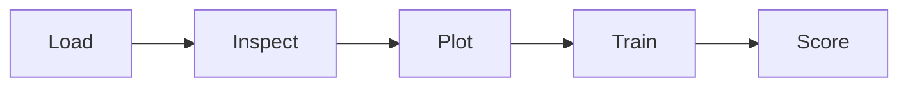

:::objectives
- Explain why a notebook remembers variables between cells, and why run order matters.
- Load a dataset that ships with scikit-learn into a pandas DataFrame.
- Inspect data with `shape`, `value_counts`, and `describe`, and draw a scatter plot.
- Train and score a model with a fixed `random_state`, and match the class's result.
:::

A version check proves each library imports. It doesn't prove they work together, and that's where setups usually break: pandas loads the data, but matplotlib draws nothing; or the model trains, but your score doesn't match anyone else's. This lesson runs the exact chain you'll use every week, so any problem shows up now instead of in the middle of Week 1.

Open `c4t-setup.ipynb` from the last lesson, or make a fresh notebook. Put each code block below in its **own cell** and run it with **Shift + Enter**. Every block on this page shows the output it really produced when this page was built.



## A notebook remembers, in the order you ran things

A notebook is a list of cells plus a running Python process called the **kernel**. When a cell creates a variable, the kernel keeps it, so later cells can use it. That gives you two rules worth learning on day one:

- **Run order matters, not page order.** The number in brackets beside a cell, like `[4]`, records when it actually ran. If cell 3 uses `df` and you never ran cell 2, you get a `NameError`.
- **The last line of a cell shows itself.** If a cell ends with a value such as `df.head()`, the notebook displays it as a table without `print()`. This class mostly uses `print()` so your output looks like the page.

## Cell 1: load a dataset

scikit-learn ships a few small datasets, so nothing needs downloading. The wine dataset holds chemical measurements of 178 wines from three growers in the same region of Italy.

```python run
from sklearn.datasets import load_wine

wine = load_wine(as_frame=True)
df = wine.frame

print(df.shape)
print(df.columns[:5].tolist())
print(df["target"].value_counts().sort_index())
```

`as_frame=True` hands you a pandas DataFrame instead of a bare numpy array, so columns have names. The shape `(178, 14)` means 178 rows (wines) and 14 columns: 13 measurements plus `target`, which holds the grower as 0, 1, or 2. The three classes aren't the same size. Keep that in mind; it's the whole story of Week 1.

## Cell 2: look before you model

Before training anything, look at the numbers. `head()` shows the first rows and `describe()` gives a summary of each column.

```python run
import pandas as pd

pd.set_option("display.width", 100)
print(df[["alcohol", "malic_acid", "color_intensity", "proline", "target"]].head())
print()
print(df[["alcohol", "color_intensity", "proline"]].describe().round(2))
```

Compare the `min` and `max` rows. `alcohol` stays between about 11 and 15, while `proline` runs from under 300 to almost 1,700. Columns measured on wildly different scales will cause a real problem for one of the models in Week 1, and you'll fix it with scaling in Week 2.

## Cell 3: draw a chart

This proves matplotlib can draw inside your notebook. Each class gets its own color.

```python run alt="Scatter plot of 178 wines, alcohol on the x-axis and color intensity on the y-axis, colored by class. Class 1 clusters at low alcohol and pale color, class 0 at high alcohol, and class 2 reaches the highest color intensity." caption="Two measurements already separate the three growers fairly well."
import matplotlib.pyplot as plt

colors = {0: "#2a78d6", 1: "#eb6834", 2: "#1baf7a"}
fig, ax = plt.subplots(figsize=(6, 4))
for label, color in colors.items():
    rows = df[df["target"] == label]
    ax.scatter(rows["alcohol"], rows["color_intensity"], s=22, color=color,
               edgecolor="white", linewidth=0.6, label=f"class {label}")
ax.set_xlabel("alcohol (%)")
ax.set_ylabel("color intensity")
ax.set_title("Wine samples by grower")
ax.legend(frameon=False)
ax.spines[["top", "right"]].set_visible(False)
plt.show()
```

Class 1 (orange) sits in the lower left: less alcohol, paler color. Class 0 sits to the right, and class 2 climbs highest on color. When classes pull apart this clearly with only two features, a model should do well with all thirteen. If you see the chart in your notebook, matplotlib works.

## Cell 4: train and score a model

```python run
from sklearn.model_selection import train_test_split
from sklearn.tree import DecisionTreeClassifier

X, y = load_wine(return_X_y=True)
X_train, X_test, y_train, y_test = train_test_split(X, y, random_state=0)

model = DecisionTreeClassifier(random_state=0)
model.fit(X_train, y_train)
print("Test accuracy:", round(model.score(X_test, y_test), 3))
```

You've trained a model like this before; here it's a smoke test. If your number matches the one above, scikit-learn is working and your results will line up with the class's. The two `random_state=0` arguments are what make that possible: the split shuffles rows randomly and the tree breaks ties randomly, and fixing the seed makes both the same on every computer. Whether this score is actually *good* is the question Week 1 answers.

## What a run-order mistake looks like

Suppose you restart the notebook (or Colab disconnects) and then run only a cell further down. The kernel has forgotten everything, so the first unknown name stops the cell:

```python run raises
print(tuned_model.score(X_test, y_test))
```

Here `tuned_model` was never created, which is exactly what you'd see after a restart for a name that *was* created earlier. The fix is never to retype the variable; it's to rerun the cells above. In Colab that's **Runtime → Run all**; in JupyterLab, **Run → Run All Cells**.

:::video 5pf0_bpNbkw
A beginner's tour of notebooks, from classic Jupyter to JupyterLab and Colab. Focus on the parts about running cells and on the tool you chose; it's fine to skip the rest.
:::

## If something goes wrong

| What you see | What it usually means | Fix |
|---|---|---|
| `ModuleNotFoundError: No module named 'sklearn'` | scikit-learn isn't installed in this kernel | `%pip install scikit-learn`, then restart the kernel |
| `NameError: name 'df' is not defined` | You skipped a cell, or the kernel restarted | Run all cells from the top |
| No chart appears | `plt.show()` is missing, or the cell errored before it | Read the error first; then add `plt.show()` |
| A different test accuracy | A `random_state` is missing, or a very old scikit-learn | Copy the cell exactly; check your version |

:::warning
Don't fix a `NameError` by pasting the missing line into the cell that failed. It works once, but now your notebook only runs in one magic order. When in doubt, use **Runtime → Restart session and run all** in Colab (or **Kernel → Restart Kernel and Run All Cells** in JupyterLab), which is how anyone else will run your notebook.
:::

## Proof it works

Before Week 1, take a screenshot showing your chart and your `Test accuracy` line, and keep it handy. If a cell failed and the table didn't fix it, bring the exact error to the first class. Copy the **last line** of the red error text; that line names the real problem.

## Further reading

- [Toy datasets in scikit-learn](https://scikit-learn.org/stable/datasets/toy_dataset.html): what's in wine, breast cancer, diabetes, and the other built-in sets you'll use all term.
- [10 minutes to pandas](https://pandas.pydata.org/docs/user_guide/10min.html): the fastest refresher on selecting rows and columns.
- [The JupyterLab interface](https://jupyterlab.readthedocs.io/en/stable/user/interface.html): menus, the file browser, and kernels, if you chose JupyterLab.
