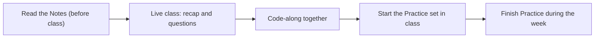
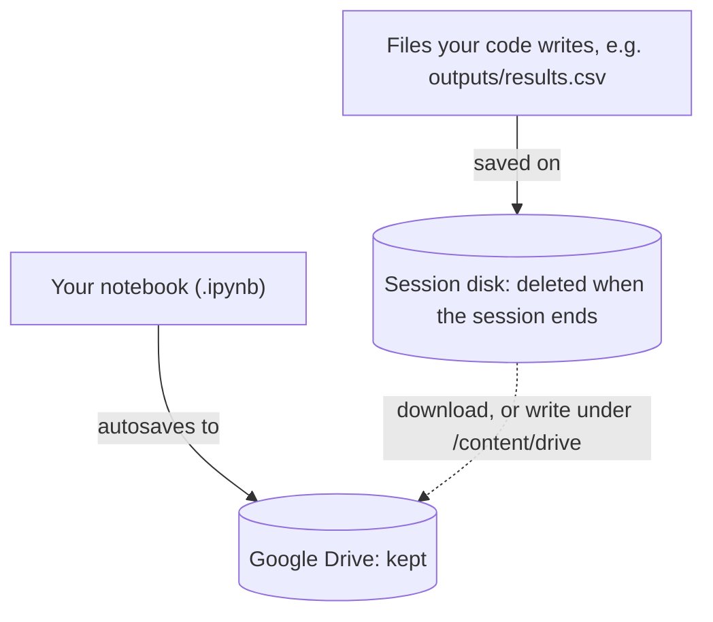

:::objectives
- Describe what happens before, during, and after each weekly class.
- Name notebooks so a term's worth of work stays in order.
- Tell which Colab files survive a disconnect and which vanish, and save the second kind somewhere safe.
- Back up a notebook three ways: Google Drive, GitHub, and a downloaded `.ipynb`.
- Explain why your numbers can differ from the lesson's, and fix it.
:::

The most common way to lose a week of work in this class has nothing to do with machine learning. It's writing a results file in Colab, closing the tab, and coming back to find the file gone. Or starting JupyterLab in the wrong folder and thinking a notebook was deleted. Ten minutes of habits now prevents both.

## How each week runs

The class meets live once a week for 1.5 hours, for six weeks, followed by a capstone project. Each week has three lessons on this site, and each has a job:

1. **Notes:** the ideas, with short examples you can run. Read these before class, even quickly; class goes much better when the words aren't new.
2. **Code-along:** one small project we build together during class. Type the code instead of pasting it. Typing is slower, and that's the point, because you notice every argument.
3. **Practice:** exercises that get harder as they go, each with a hint and a solution. Try each one for real before opening its solution.



A typical session: a recap and your questions (about 10 minutes), the week's ideas on screen (about 25), the code-along (about 40), and starting the practice set with help on hand (about 15).

:::tip
When you're stuck in class, paste the **last line** of your error into the chat. "It doesn't work" can't be debugged. `ValueError: Found input variables with inconsistent numbers of samples: [142, 36]` usually can, within a minute: it says your `X` and `y` have different lengths.
:::

## Name notebooks so they sort themselves

Use one notebook per lesson, with the week number first so they line up in order:

```text
c4t-ml/
  w1-notes.ipynb
  w1-codealong-baseline.ipynb
  w1-practice.ipynb
  w2-notes.ipynb
  ...
  outputs/
```

Start each notebook with a text cell saying what it is and the date. In Colab, click **+ Text**; in JupyterLab, change a cell's type to **Markdown**. Three weeks from now you'll be glad you did.

## Which files survive a disconnect

Colab keeps two kinds of things in two different places. The **notebook** (your code, text, and the last outputs) autosaves to Google Drive. **Files your code writes**, like a CSV of results, land on the temporary disk of the Google machine running your session. That machine is deleted when the session ends, and its files go with it.



Here's a cell that writes a small results file. Run it, then open the folder icon in Colab's left sidebar and you'll see `outputs/` appear.

```python run
from pathlib import Path
from sklearn.datasets import load_wine

out = Path("outputs")
out.mkdir(exist_ok=True)

df = load_wine(as_frame=True).frame
df.head(20).to_csv(out / "wine_sample.csv", index=False)

print("Saved files:", sorted(p.name for p in out.iterdir()))
```

`exist_ok=True` means running the cell a second time doesn't crash just because the folder already exists. Any later cell can read the file back:

```python run
import pandas as pd

sample = pd.read_csv("outputs/wine_sample.csv")
print(sample.shape, "rows and columns read back")
```

In JupyterLab, that file sits next to your notebook on your own disk and stays there. In Colab, it's gone after a disconnect unless you do one of the things in the next section.

## Three ways to back up your work

### 1. Google Drive (Colab)

Notebooks you create with **New notebook** or **File → New notebook in Drive** already live in **My Drive → Colab Notebooks**. If the title starts with **Copy of**, or you opened a notebook someone shared with you, use **File → Save a copy in Drive** so you own an editable version.

To make files your code writes survive too, mount Drive at the top of the notebook:

```python
from google.colab import drive
drive.mount("/content/drive")
```

Colab asks you to approve access. After that, anything you save under `/content/drive/MyDrive/` (for example `/content/drive/MyDrive/c4t-ml/outputs/`) is a real Drive file. This cell only works inside Colab.

### 2. GitHub

GitHub keeps every version of your work and gives you a link to share for the capstone. From Colab, use **File → Save a copy in GitHub**, pick a repository, and write a short commit message. From JupyterLab, create a repository on github.com and use **Add file → Upload files** to drag in your `.ipynb` files. GitHub displays notebooks with their outputs, so a reader sees your charts without running anything.

### 3. Download the .ipynb

The simplest backup works everywhere. In Colab: **File → Download → Download .ipynb**. In JupyterLab: right-click the file in the left panel and choose **Download**. The file holds your code, text, and last outputs, and it opens in either tool.

## Why your numbers might not match the lesson

Many steps in machine learning shuffle data randomly. Here's the same split-and-train code run with three different seeds, then three times with the same seed:

```python run
from sklearn.model_selection import train_test_split
from sklearn.tree import DecisionTreeClassifier

X, y = load_wine(return_X_y=True)

def score_with_seed(seed):
    X_tr, X_te, y_tr, y_te = train_test_split(X, y, random_state=seed)
    tree = DecisionTreeClassifier(random_state=0).fit(X_tr, y_tr)
    return round(tree.score(X_te, y_te), 3)

print("seeds 1, 2, 3:", [score_with_seed(s) for s in [1, 2, 3]])
print("seed 0 three times:", [score_with_seed(0) for _ in range(3)])
```

Leave out `random_state` and every run uses a fresh random seed, so your score drifts from run to run and from the lesson's. That's the cause of almost every "my number is slightly different" question. Copy every `random_state=` argument exactly, and your output will match the page.

## Fixes for common problems

**"I installed it but it still says ModuleNotFoundError."** Your `pip` installed into a different Python than the notebook's. Run `%pip install scikit-learn pandas matplotlib` inside a notebook cell, then restart the kernel.

**"Colab disconnected and my variables are gone."** Colab deletes idle machines, and every session has a maximum lifetime (up to 12 hours on the free tier). Your code is still in the notebook; only the kernel's memory was lost. Use **Runtime → Run all** to rebuild it.

**"JupyterLab opened but my files aren't there."** You started it from a different folder. Stop it (press **Ctrl + C** twice in the terminal), `cd` into `c4t-ml`, and start it again.

**"A cell shows `[*]` and never finishes."** It's still running or stuck. Use **Runtime → Interrupt execution** in Colab, or the square stop button in JupyterLab. If that fails, restart the kernel.

:::warning
Never keep the only copy of an important result in Colab's session disk or in a variable's memory. If it took more than a minute to produce, save it to Drive or download it before you close the tab.
:::

:::quiz
Q: You wrote `outputs/scores.csv` from a Colab cell yesterday, without mounting Drive. Today the notebook reconnects to a new session. Where is the file?
- [ ] In the `outputs` folder, as before
  The notebook came back because it lives in Drive. The CSV was on the old session's disk, which was deleted.
- [x] Gone, because it was on the deleted session's disk
  Files your code writes go to the session machine unless you write under a mounted Drive path or download them.
- [ ] In Drive's Colab Notebooks folder
  Only the `.ipynb` file autosaves there. Data files need an explicit Drive path.

Q: Your test accuracy is 0.911 but the lesson shows 0.933, with the same code. What's the most likely cause?
- [ ] Your computer is slower
  Speed never changes a model's predictions.
- [x] A `random_state` argument is missing or different
  A different seed gives a different split, and on 45 test rows one or two different wines move accuracy by several points.
- [ ] Colab uses a different dataset
  `load_wine` is bundled with scikit-learn and is the same everywhere.
:::

## Before Week 1

Check off these four things:

- The version check from the first lesson prints its last line without errors.
- The model cell from the second lesson prints the same `Test accuracy` as the page.
- You know where your notebooks are saved, and you've set up one backup method.
- You have a `c4t-ml` folder (in Drive or on your computer) ready for Week 1.

## Further reading

- [Colab FAQ](https://research.google.com/colaboratory/faq.html): official answers on session limits, idle timeouts, and getting your data out.
- [Adding a file to a GitHub repository](https://docs.github.com/en/repositories/working-with-files/managing-files/adding-a-file-to-a-repository): the upload steps for JupyterLab users, with screenshots.
- [Project Jupyter documentation](https://docs.jupyter.org/en/latest/): how kernels and notebooks fit together, if you want the full picture.
