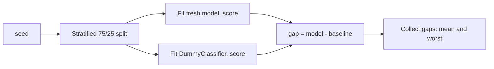

:::objectives
- Predict a `most_frequent` baseline from class proportions before running any code.
- Show what `stratify=y` changes in a split, with counts and a chart.
- Judge a model by its gap over a baseline, including on imbalanced data and regression.
- Spot an unfair model comparison and fix it.
- Write a reusable function that measures a model's baseline gap across many splits.
:::

These exercises climb from one-line checks to a small reusable tool. For each one, **write down your prediction before you run anything**. Guessing a baseline in your head and then checking it is the fastest way to build intuition for what a score really means. Every dataset here ships with scikit-learn, so it all runs offline. Use one notebook, and run the cells in order.

## Warm-up: guess the dumbest model

The wine dataset has 59 wines from grower 0, 71 from grower 1, and 48 from grower 2. Without running code, answer two questions: what does `DummyClassifier()` predict for *every* wine, and roughly what accuracy does it get on the whole dataset? Then check:

```python run
from sklearn.datasets import load_wine
from sklearn.dummy import DummyClassifier

X, y = load_wine(return_X_y=True)
dummy = DummyClassifier().fit(X, y)
print("Predicts:", set(dummy.predict(X).tolist()))
print("Accuracy:", round(dummy.score(X, y), 3), "=", 71, "/", len(y))
```

It always predicts the biggest class, 1, so it's right for exactly those 71 wines: 71 / 178. Every baseline in this set is that kind of quick arithmetic, and you should be able to do it before the code runs.

### Exercise 1: Predict the baseline

Load `load_breast_cancer`. Split it with `test_size=0.2`, `stratify=y`, and `random_state=1`. About 62.7% of the whole dataset is benign (label 1). **Write down** what a `most_frequent` baseline will score on the test set. Then fit one and print the number of test rows and the baseline's accuracy.

Your output should have this shape:

```text
Test rows: ...
Baseline accuracy: ...
```

:::hint
Stratifying keeps the benign share in the test set almost exactly the same as in the full data. The baseline always says benign, so its accuracy *is* the benign share of the test set.
:::

:::solution
```python run
from sklearn.datasets import load_breast_cancer
from sklearn.model_selection import train_test_split

X, y = load_breast_cancer(return_X_y=True)
X_train, X_test, y_train, y_test = train_test_split(
    X, y, test_size=0.2, stratify=y, random_state=1
)
baseline = DummyClassifier(strategy="most_frequent").fit(X_train, y_train)
print("Test rows:", len(y_test))
print("Baseline accuracy:", round(baseline.score(X_test, y_test), 3))
print("Benign tumors in test:", y_test.sum())
```

A good prediction was "about 0.63." The test set holds 72 benign tumors out of 114, and 72 / 114 is the baseline's accuracy. Any model you train on this split has to clear that number before it has shown anything.
:::

### Exercise 2: See what stratify changes

Split the wine data with `test_size=0.2` and `random_state=3`, once without `stratify` and once with `stratify=y`. For each, print how many test wines come from class 0, 1, and 2. Then draw a grouped bar chart comparing the two test sets with what a perfectly proportional 36-wine test set would hold.

:::hint
`np.bincount(y_test)` counts how many times each label appears. A perfectly proportional test set holds `len(y_test) * np.bincount(y) / len(y)` wines from each class. For grouped bars, shift each group's x positions slightly, for example by `-0.27`, `0`, and `+0.27`.
:::

:::solution
```python run alt="Grouped bar chart of test wines per class. The ideal proportional split has about 12, 14, and 10. The stratified split has 12, 14, and 10. The plain split has 15, 14, and 7, short on class 2." caption="The plain split is short three class-2 wines; the stratified split matches the ideal."
import numpy as np
import matplotlib.pyplot as plt

X, y = load_wine(return_X_y=True)
counts = {}
for name, strat in [("plain", None), ("stratified", y)]:
    *_, y_test = train_test_split(X, y, test_size=0.2, random_state=3, stratify=strat)
    counts[name] = np.bincount(y_test)
    print(f"{name:10s} {counts[name].tolist()}")
counts["ideal"] = len(y_test) * np.bincount(y) / len(y)

fig, ax = plt.subplots(figsize=(6, 3))
classes = np.arange(3)
for offset, (name, color) in zip([-0.27, 0, 0.27],
                                 [("ideal", "#b8b7b1"), ("stratified", "#2a78d6"), ("plain", "#eb6834")]):
    ax.bar(classes + offset, counts[name], width=0.25, color=color, label=name)
ax.set_xticks(classes, ["class 0", "class 1", "class 2"])
ax.set_ylabel("wines in the 36-wine test set")
ax.legend(frameon=False)
ax.spines[["top", "right"]].set_visible(False)
plt.show()
```

The full dataset is about 33% / 40% / 27%, so a 36-wine test set "should" hold about 12, 14, and 10. The stratified split does. The plain one holds only 7 wines from class 2, about 19%, so any score on class 2 would rest on very few examples.
:::

### Exercise 3: A baseline that never misses a cancer

Use the breast cancer data with `test_size=0.25`, `stratify=y`, and `random_state=42`. Build `DummyClassifier(strategy="constant", constant=0)`, which always predicts malignant (label 0). Print its accuracy and how many of the malignant test tumors it catches. Then explain in one sentence why a model that catches every cancer can still be a bad model.

:::hint
The malignant test rows are `y_test == 0`. Select the predictions for just those rows with `pred[y_test == 0]`, then count how many of them are 0.
:::

:::solution
```python run
X, y = load_breast_cancer(return_X_y=True)
X_train, X_test, y_train, y_test = train_test_split(
    X, y, test_size=0.25, stratify=y, random_state=42
)
always_malignant = DummyClassifier(strategy="constant", constant=0).fit(X_train, y_train)
pred = always_malignant.predict(X_test)
print("Accuracy:", round(always_malignant.score(X_test, y_test), 3))
print("Malignant caught:", (pred[y_test == 0] == 0).sum(), "of", (y_test == 0).sum())
print("Healthy patients told they might have cancer:", (pred[y_test == 1] == 0).sum())
```

It catches every malignant tumor because it calls **everyone** malignant, so every healthy patient gets a false alarm too. Catching all the positives is trivial if you ignore false alarms. Week 3 gives this trade-off proper names: recall and precision.
:::

### Exercise 4: Regression baselines

On `load_diabetes`, split with `test_size=0.25` and `random_state=0` (no `stratify`; the target is a number). Compare three models by mean absolute error, to two decimals: `DummyRegressor(strategy="mean")`, `DummyRegressor(strategy="median")`, and `LinearRegression()`.

:::hint
Loop over a dictionary of name to model. Inside the loop: `fit` on the training set, `predict` on the test set, and pass both to `mean_absolute_error(y_test, predictions)`.
:::

:::solution
```python run
from sklearn.datasets import load_diabetes
from sklearn.dummy import DummyRegressor
from sklearn.linear_model import LinearRegression
from sklearn.metrics import mean_absolute_error

X, y = load_diabetes(return_X_y=True)
X_train, X_test, y_train, y_test = train_test_split(X, y, test_size=0.25, random_state=0)

regressors = {
    "mean": DummyRegressor(strategy="mean"),
    "median": DummyRegressor(strategy="median"),
    "linear": LinearRegression(),
}
for name, reg in regressors.items():
    reg.fit(X_train, y_train)
    print(f"{name:7s} MAE {mean_absolute_error(y_test, reg.predict(X_test)):.2f}")
```

The two baselines are nearly tied. The median baseline often edges ahead on MAE, because the median is the single number that minimizes average absolute error on the training set (the mean minimizes squared error instead). The linear model's typical miss is about 13 points smaller than either, a clear gain.
:::

### Exercise 5: Is 94.8% impressive?

Generate an imbalanced dataset:

```python run
from sklearn.datasets import make_classification

X, y = make_classification(n_samples=1000, n_features=10, n_informative=2,
                           weights=[0.92, 0.08], flip_y=0.05, random_state=0)
print("Share of class 1:", round(y.mean(), 3))
```

Split with `test_size=0.25`, `stratify=y`, `random_state=0`. Print the test accuracy of `DecisionTreeClassifier(random_state=0)` and of a default `DummyClassifier`. Is the tree good? Answer in terms of error rates, not accuracy.

:::hint
Error rate is `1 - accuracy`. Compare the tree's error rate with the baseline's: what fraction of the baseline's mistakes did the tree get rid of?
:::

:::solution
```python run
from sklearn.tree import DecisionTreeClassifier

X_train, X_test, y_train, y_test = train_test_split(
    X, y, test_size=0.25, stratify=y, random_state=0
)
tree = DecisionTreeClassifier(random_state=0).fit(X_train, y_train)
dummy = DummyClassifier().fit(X_train, y_train)
tree_acc, dummy_acc = tree.score(X_test, y_test), dummy.score(X_test, y_test)
print(f"Tree accuracy:  {tree_acc:.3f}   error rate {1 - tree_acc:.3f}")
print(f"Dummy accuracy: {dummy_acc:.3f}   error rate {1 - dummy_acc:.3f}")
```

Alone, 94.8% sounds excellent. Beside an 89.6% baseline, the tree is about 5 points better, which halves the error rate. So it has learned something, but accuracy can't tell you whether it actually finds the rare class-1 rows, which are probably the ones you care about. `flip_y=0.05` also flips about 5% of labels at random, so no model can be perfect. Week 3 measures the rare class properly.
:::

### Exercise 6: Catch the unfair comparison

A teammate ran these two cells on different days and concluded, "The tree beats k-NN by almost 9 points." Run them, then explain what's wrong and write a fair comparison: both models on the **same** 20 stratified splits (seeds 0 to 19, `test_size=0.2`). Report each model's mean accuracy and how many splits each one wins.

```python run
from sklearn.neighbors import KNeighborsClassifier

X, y = load_breast_cancer(return_X_y=True)

# Monday
X_a, X_b, y_a, y_b = train_test_split(X, y, test_size=0.2, random_state=4)
print("k-NN:", round(KNeighborsClassifier().fit(X_a, y_a).score(X_b, y_b), 3))

# Tuesday
X_a, X_b, y_a, y_b = train_test_split(X, y, test_size=0.2, random_state=0)
tree = DecisionTreeClassifier(max_depth=3, random_state=0)
print("Tree:", round(tree.fit(X_a, y_a).score(X_b, y_b), 3))
```

:::hint
Inside one loop over seeds, make the split once, then fit and score **both** models on it. Store the scores in two lists, and count wins with something like `(np.array(tree_scores) > np.array(knn_scores)).sum()`.
:::

:::solution
The two models took different exams. Monday's split happened to be hard and Tuesday's easy, so most of that 9-point gap is the split, not the model.

```python run
knn_scores, tree_scores = [], []
for seed in range(20):
    X_a, X_b, y_a, y_b = train_test_split(X, y, test_size=0.2, stratify=y, random_state=seed)
    knn_scores.append(KNeighborsClassifier().fit(X_a, y_a).score(X_b, y_b))
    tree_scores.append(DecisionTreeClassifier(max_depth=3, random_state=0)
                       .fit(X_a, y_a).score(X_b, y_b))

knn_scores, tree_scores = np.array(knn_scores), np.array(tree_scores)
print(f"k-NN mean {knn_scores.mean():.3f}   tree mean {tree_scores.mean():.3f}")
print("Tree wins:", (tree_scores > knn_scores).sum(),
      " k-NN wins:", (knn_scores > tree_scores).sum(),
      " ties:", (tree_scores == knn_scores).sum())
```

On identical splits, k-NN comes out about a point *ahead* and wins more than half the splits, with several ties. The teammate's conclusion was backwards, and the only thing that changed was making both models take the same exams. Same data, same split, change one thing: that's the rule for every comparison you make in this course.
:::

### Challenge: a baseline-gap function

Write `baseline_gap(make_model, X, y, seeds)`. For each seed it makes a stratified 75/25 split, fits a fresh model from `make_model()` and a default `DummyClassifier`, and records `model accuracy - baseline accuracy`. It returns the list of gaps.

Run it on the breast cancer data with `range(20)` for a depth-3 tree and for `KNeighborsClassifier()`. Print each model's mean gap and **worst** (smallest) gap, and plot both models' gaps seed by seed. Why is the worst gap worth reporting next to the mean?



:::hint
Pass a function that *builds* a model, such as `lambda: KNeighborsClassifier()`, rather than a model object. Then every seed starts with a brand-new model. `min(gaps)` is the worst gap.
:::

:::solution
```python run alt="Line chart of each model's accuracy gap over the baseline for 20 random seeds. Both lines stay between about 0.25 and 0.34. k-NN's line is a little higher and steadier; the tree dips lowest on a couple of seeds." caption="Both models beat the baseline by roughly 30 points on every split; k-NN's worst split is better than the tree's."
def baseline_gap(make_model, X, y, seeds):
    gaps = []
    for seed in seeds:
        X_tr, X_te, y_tr, y_te = train_test_split(
            X, y, test_size=0.25, stratify=y, random_state=seed
        )
        model_acc = make_model().fit(X_tr, y_tr).score(X_te, y_te)
        base_acc = DummyClassifier().fit(X_tr, y_tr).score(X_te, y_te)
        gaps.append(model_acc - base_acc)
    return gaps

X, y = load_breast_cancer(return_X_y=True)
makers = {
    "tree": lambda: DecisionTreeClassifier(max_depth=3, random_state=0),
    "k-NN": lambda: KNeighborsClassifier(),
}
fig, ax = plt.subplots(figsize=(6.4, 3))
for (name, make), color in zip(makers.items(), ["#2a78d6", "#eb6834"]):
    gaps = baseline_gap(make, X, y, range(20))
    print(f"{name}: mean gap {np.mean(gaps):.3f}, worst gap {min(gaps):.3f}")
    ax.plot(range(20), gaps, marker="o", markersize=5, linewidth=2, color=color, label=name)
ax.set_ylim(0.2, 0.36)
ax.set_xticks(range(0, 20, 2))
ax.set_xlabel("split seed")
ax.set_ylabel("accuracy above baseline")
ax.legend(frameon=False)
ax.spines[["top", "right"]].set_visible(False)
plt.show()
```

Both models beat the baseline by about 30 points on average, with k-NN slightly ahead and steadier. The worst gap is the guarantee: even on its unluckiest split, k-NN was still well above doing nothing. A model with a high mean but a worst gap near zero is risky, because on some days it's no better than guessing. Building a fresh model per seed keeps every split independent.
:::

:::video Zcjl8xPLmPw
Kevin Markham of Data School explains the `stratify` option of `train_test_split`. Watch for what happens to the class proportions in each half, the same thing you measured in Exercise 2.
:::
