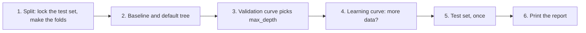

:::objectives
- Lock away a test set and create one shared set of folds before any modeling.
- Use `cross_validate` with `return_train_score=True` to measure the train/validation gap.
- Choose `max_depth` from a validation curve and break ties toward the simpler tree.
- Compare a single test score with the cross-validated range, and write both into a short report.
:::

The wine dataset has 178 wines from three growers, with 13 chemical measurements each. That's small. Move five wines from the test side to the training side and accuracy can swing by several points, which makes it a perfect place to practice validating properly. By the end of this code-along your notebook will print a five-line validation report that a teammate could trust, and every number in it will come from a cell above it.



Open a new Colab notebook and put each step in its own cell. Run them top to bottom.

## Step 1: Lock the test set and make the folds

```python run
import matplotlib.pyplot as plt
import numpy as np
from sklearn.datasets import load_wine
from sklearn.dummy import DummyClassifier
from sklearn.metrics import f1_score
from sklearn.model_selection import (StratifiedKFold, cross_validate,
                                     learning_curve, train_test_split,
                                     validation_curve)
from sklearn.tree import DecisionTreeClassifier

X, y = load_wine(return_X_y=True)
X_train, X_test, y_train, y_test = train_test_split(
    X, y, test_size=0.25, stratify=y, random_state=0)
cv = StratifiedKFold(n_splits=5, shuffle=True, random_state=0)
print("train rows:", len(X_train), "| test rows:", len(X_test))
print("wines per grower in train:", np.bincount(y_train))
```

From here until Step 5, every cell uses only `X_train` and `y_train`. The `cv` object is created once, so every experiment below runs on exactly the same five folds.

The growers are uneven (36 to 53 training wines), so the metric is **macro F1**: compute F1 for each grower separately, then average the three, so the smallest grower counts as much as the largest. In scikit-learn that's `scoring="f1_macro"`.

## Step 2: A baseline, then a default tree

`cross_validate` is the bigger sibling of `cross_val_score`. With `return_train_score=True` it also scores each fold's model on the rows it trained on, and you need those to spot overfitting.

```python run
models = {
    "baseline (most frequent)": DummyClassifier(strategy="most_frequent"),
    "default tree": DecisionTreeClassifier(random_state=0),
}
for name, model in models.items():
    res = cross_validate(model, X_train, y_train, cv=cv,
                         scoring="f1_macro", return_train_score=True)
    print(f"{name:<25} train {res['train_score'].mean():.3f}   "
          f"valid {res['test_score'].mean():.3f} ± {res['test_score'].std():.3f}")
```

Don't be thrown by the key `test_score`: inside cross-validation, scikit-learn calls each held-out fold the "test" fold. Your real test set is still locked away.

The baseline always predicts the most common grower, so its macro F1 sits near 0.19. That's the floor. The default tree is far above it on validation, but it scores a perfect 1.000 on its own training rows. With no depth limit, a tree keeps splitting until every training wine is classified correctly, and that gap of about six points is what we'll try to close next.

## Step 3: Choose the depth with a validation curve

```python run alt="Validation curve for the wine tree. Training macro F1 jumps from about 0.55 at depth 1 to nearly 1.0 by depth 3. Validation rises from about 0.52 to a plateau near 0.94 from depth 4 onward, with a shaded band of about plus or minus 0.03." caption="Validation plateaus at depth 4, so deeper settings buy nothing"
depths = [1, 2, 3, 4, 5, 6, 8, None]
tr, va = validation_curve(DecisionTreeClassifier(random_state=0), X_train, y_train,
                          param_name="max_depth", param_range=depths,
                          cv=cv, scoring="f1_macro")
labels = [str(d) for d in depths]
for label, t, v, s in zip(labels, tr.mean(1), va.mean(1), va.std(1)):
    print(f"max_depth {label:>4}: train {t:.3f}  valid {v:.3f} ± {s:.3f}")

best_depth = depths[int(np.argmax(va.mean(1)))]
print("chosen depth:", best_depth)

plt.figure(figsize=(7, 3.2))
plt.plot(labels, tr.mean(1), "o-", label="training")
plt.plot(labels, va.mean(1), "o-", label="validation")
plt.fill_between(labels, va.mean(1) - va.std(1), va.mean(1) + va.std(1), alpha=0.2, color="C1")
plt.xlabel("max_depth")
plt.ylabel("macro F1")
plt.legend()
```

Read the table and the chart together:

-   **Depth 1** underfits badly. One yes/no question can't separate three growers, so both scores sit near 0.5.
-   **Depths 2 and 3** are still climbing.
-   **Depth 4 and beyond** all score the same. Grown without a limit, these fold trees stop at 3 to 5 levels on roughly 106 rows, so any limit of 4 or more barely changes them.

`np.argmax` returns the *first* maximum, so it picks depth 4: the simplest tree with the best score. That's the tie-breaker you want. A simpler model is easier to explain and is usually more stable on new data.

:::tip
`param_range` can include `None`, but matplotlib can't put `None` on an axis. Converting the depths to strings (`labels`) lets the chart treat them as categories in the order you listed them.
:::

## Step 4: Would more wines help?

```python run alt="Learning curve for a depth-4 tree on wine. Training macro F1 stays close to 1.0 at every size. Validation rises from about 0.87 at 21 rows to 0.93 at 106 rows, with a dip at 84 rows." caption="A persistent gap, with validation still climbing"
chosen = DecisionTreeClassifier(max_depth=best_depth, random_state=0)
sizes, lt, lv = learning_curve(chosen, X_train, y_train, cv=cv,
                               train_sizes=np.linspace(0.2, 1.0, 5), scoring="f1_macro")
for n, t, v in zip(sizes, lt.mean(1), lv.mean(1)):
    print(f"{n:>4} training wines: train {t:.3f}  valid {v:.3f}")

plt.figure(figsize=(7, 3.2))
plt.plot(sizes, lt.mean(1), "o-", label="training")
plt.plot(sizes, lv.mean(1), "o-", label="validation")
plt.xlabel("training wines")
plt.ylabel("macro F1")
plt.legend()
```

The validation line rises overall but dips once in the middle. That dip is noise, not a pattern. Each validation fold here holds only about 27 wines, so two extra mistakes move the score by several points. The training line stays near 1.0 the whole way, and the gap never closes.

That shape says **variance**. More wines would probably help, and so would a model that averages many trees to cancel out their individual quirks. You'll meet that model, the random forest, next week.

:::video EuBBz3bI-aA
What to watch for: the squiggly line that fits the training points perfectly and misses the test points. That's your default tree from Step 2.
:::

## Step 5: Open the test set once

```python run alt="Strip chart of macro F1. Orange dots mark the five fold scores from about 0.89 to 0.97, two of them overlapping at 0.96. A dashed line marks their mean, 0.94. A black star marks the single test score, 0.89, near the lowest fold." caption="Did the test score land where the folds said it would?"
chosen.fit(X_train, y_train)
test_f1 = f1_score(y_test, chosen.predict(X_test), average="macro")
cv_scores = va[depths.index(best_depth)]
print(f"cross-validated macro F1: {cv_scores.mean():.3f} ± {cv_scores.std():.3f}")
print(f"test macro F1 (used once): {test_f1:.3f} on {len(y_test)} wines")

plt.figure(figsize=(7, 1.8))
plt.scatter(cv_scores, np.zeros(5), s=60, color="C1", label="CV folds")
plt.axvline(cv_scores.mean(), color="C1", linestyle="--", label="CV mean")
plt.scatter([test_f1], [0], marker="*", s=300, color="black", label="test", zorder=3)
plt.yticks([])
plt.xlabel("macro F1")
plt.legend(loc="upper left", ncol=3, fontsize=8)
```

`chosen.fit` retrains the depth-4 tree on all 133 training wines, then the test set is scored exactly once. The test score comes in about five points under the cross-validated mean, but still inside the spread of the fold scores: one fold scored 0.887. That isn't a bug, and it isn't a reason to go back and fiddle. With 45 test wines, each mistake is worth about two points, so one or two unlucky wines explain the difference.

:::warning
If you change `max_depth` now because of the test score, the test set becomes a second validation set and you no longer have an unbiased number. Make every decision in Steps 2 to 4, then look at the test set and accept what it says.
:::

## Step 6: Print the report

Type numbers into a report by hand and sooner or later one will be stale. Build it from the variables instead:

```python run
baseline = cross_validate(DummyClassifier(strategy="most_frequent"), X_train, y_train,
                          cv=cv, scoring="f1_macro")["test_score"].mean()
print(f"""VALIDATION REPORT: wine grower classifier
Model:      decision tree, max_depth={best_depth} (chosen by 5-fold validation curve)
Metric:     macro F1 (growers are uneven: {np.bincount(y_train).tolist()} training wines)
CV:         {cv_scores.mean():.2f} ± {cv_scores.std():.2f}   (baseline {baseline:.2f})
Test:       {test_f1:.2f} on {len(y_test)} wines, scored once
Diagnosis:  training ~1.00 at every size, so the tree has high variance; try a forest""")
```

Anyone who reads that knows the score, its uncertainty, what it's compared to, how the setting was chosen, and what to try next. Nothing in it is typed by hand.

:::quiz
Q: In Step 3, depths 4, 5, 6, 8, and `None` all tie on validation. Why take depth 4?
- [x] It's the simplest tree with the best score, so it's easier to explain and usually steadier on new data
  When scores tie, extra complexity buys nothing and adds risk. `np.argmax` returning the first maximum gives you this rule for free.
- [ ] Depth 4 had the highest training score
  Training scores were higher for deeper trees, and they're not what you choose by anyway.
- [ ] Any of them is fine, so pick at random
  They score the same here, but they don't carry the same risk. The simplest one wins the tie.

Q: The test macro F1 is about five points below the cross-validated mean. What should the report do?
- [ ] Retune `max_depth` until the test score matches CV
  That uses the test set to make a choice, so its score stops being an honest estimate.
- [x] Report both numbers as they are and note how small the test set is
  With 45 wines, one or two mistakes move the score by several points, and a reader deserves to see both numbers.
- [ ] Report only the CV score because it's higher
  Hiding the test result is cherry-picking. The test score is the one number nothing was tuned on.

Q: Why does Step 1 use `scoring="f1_macro"` instead of plain accuracy?
- [ ] Accuracy can't be computed with three classes
  Accuracy works fine with three classes. The issue is what it hides.
- [x] It averages per-grower F1, so the smallest grower counts as much as the largest
  With uneven growers, a model could do badly on the 36-wine grower and still post good accuracy. Macro F1 would show it.
- [ ] Decision trees can only be scored with F1
  Any classifier can be scored with any classification metric.
:::

:::takeaways
- Split off the test set and create the `cv` object before any modeling, and reuse that `cv` for every experiment.
- `cross_validate(..., return_train_score=True)` gives you both sides of the train/validation gap in one call.
- Choose a hyperparameter at the validation peak, and when settings tie, take the simplest.
- A learning curve with training stuck near 1.0 and a gap that won't close points to high variance.
- The test score is checked once and reported as-is, next to the CV mean ± std.
:::

## Extend it

-   Change `cv` to `StratifiedKFold(n_splits=10, shuffle=True, random_state=0)` and rerun every cell. Do the standard deviations go up or down? (Think about how many wines are in each fold.)
-   Swap `scoring="f1_macro"` for `"accuracy"` everywhere. Does the chosen depth change?
-   Add `min_samples_leaf` as a second validation curve. Does a leaf size of 3 or 5 shrink the gap without costing validation F1?

## Further reading

-   [scikit-learn API: cross_validate](https://scikit-learn.org/stable/modules/generated/sklearn.model_selection.cross_validate.html) lists every key in the result dictionary, including fit and score times.
-   [scikit-learn API: validation_curve](https://scikit-learn.org/stable/modules/generated/sklearn.model_selection.validation_curve.html) explains the shapes of the two arrays it returns.
-   [scikit-learn User Guide: Wine recognition dataset](https://scikit-learn.org/stable/datasets/toy_dataset.html#wine-recognition-dataset) describes the 13 measurements and where the data comes from.
