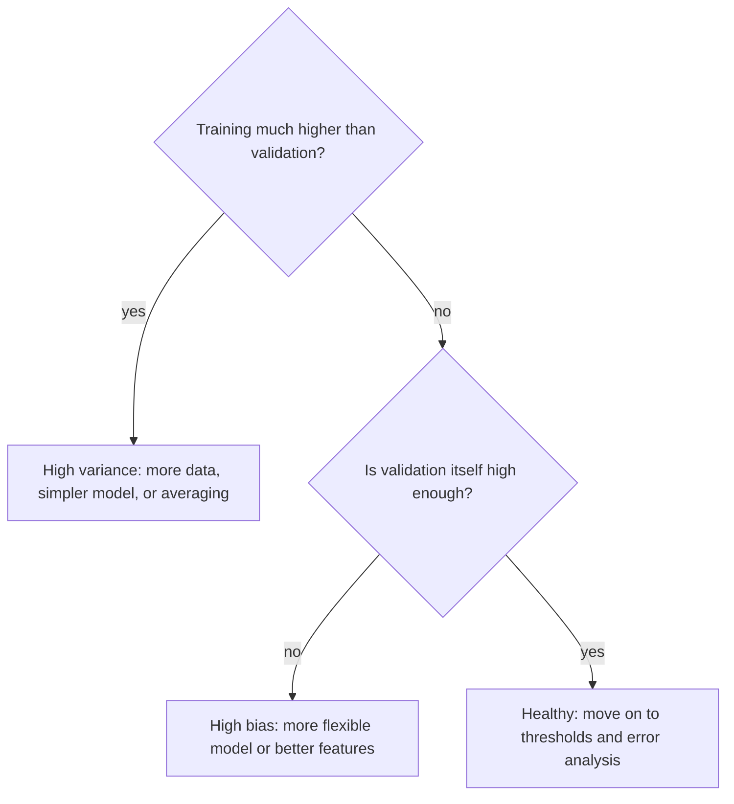

:::objectives
- Predict how the number of folds changes the mean and the std of a CV score.
- Spot the sorted-data trap and fix it with a shuffled, stratified splitter.
- Score several metrics in one `cross_validate` call and read its result keys.
- Use validation curves for `C` and for `n_neighbors`, and say which end of each is the complex end.
- Diagnose bias versus variance from learning curves, and package the checks in a reusable function.
:::

Every solution below is a complete program that runs in Colab on a bundled dataset. Try each exercise before you open the hint, and open the hint before the solution. If your numbers differ in the third decimal, check your `random_state` values first, then your scikit-learn version.

## Warm-up: count the fits

Before running anything, predict how many models each call trains:

1.  `cross_val_score(model, X, y, cv=5)`
2.  `validation_curve(model, X, y, param_name="max_depth", param_range=[1, 2, 3, 4, 5, 6, 8], cv=5)`
3.  `learning_curve(model, X, y, train_sizes=[0.2, 0.4, 0.6, 0.8, 1.0], cv=5)`

Then check the first one. `cross_validate` returns one `fit_time` per trained model:

```python run
from sklearn.datasets import load_breast_cancer
from sklearn.model_selection import cross_validate
from sklearn.tree import DecisionTreeClassifier

X, y = load_breast_cancer(return_X_y=True)
res = cross_validate(DecisionTreeClassifier(random_state=0), X, y, cv=5)
print("models trained:", len(res["fit_time"]))
```

The answers are 5, 7 × 5 = 35, and 5 × 5 = 25. Settings times folds is the cost of everything you'll do for the next three weeks, so get used to multiplying before you press Run.

### Exercise 1: How many folds?

Cross-validate `make_pipeline(StandardScaler(), LogisticRegression(max_iter=1000))` on `load_breast_cancer` with `StratifiedKFold` for k = 3, 5, and 10 (`shuffle=True, random_state=0`). Print mean ± std accuracy and the approximate fold size for each k. Does the mean change much? What happens to the std, and why?

```text
k= 3: 0.9xx ± 0.0xx  (each fold ~189 rows)
k= 5: ...
k=10: ...
```

:::hint
Loop over `[3, 5, 10]` and build a new `StratifiedKFold(n_splits=k, ...)` each time. For the "why," work out how many accuracy points one misclassified tumor is worth in a 56-row fold versus a 189-row fold.
:::

:::solution
```python run
from sklearn.datasets import load_breast_cancer
from sklearn.linear_model import LogisticRegression
from sklearn.model_selection import StratifiedKFold, cross_val_score
from sklearn.pipeline import make_pipeline
from sklearn.preprocessing import StandardScaler

X, y = load_breast_cancer(return_X_y=True)
pipe = make_pipeline(StandardScaler(), LogisticRegression(max_iter=1000))

for k in [3, 5, 10]:
    cv = StratifiedKFold(n_splits=k, shuffle=True, random_state=0)
    s = cross_val_score(pipe, X, y, cv=cv, scoring="accuracy")
    print(f"k={k:>2}: {s.mean():.3f} ± {s.std():.3f}  (each fold ~{len(y) // k} rows)")
```

The mean barely moves. The std grows with k because the validation folds shrink: one wrong tumor costs about 1.8 points in a 56-row fold but only about 0.5 points in a 189-row fold. Larger k also trains on more rows per round and costs more fits. Five folds is a sensible default for class projects.
:::

### Exercise 2: The sorted-data trap

`load_wine` is sorted by grower. Cross-validate a scaled logistic regression on it twice with three folds: once with `KFold(n_splits=3)` (no shuffle) and once with `StratifiedKFold(n_splits=3, shuffle=True, random_state=0)`. Print the first and last ten labels, then both sets of fold scores, and explain the difference.

:::hint
Look at which labels end up in the first third of the rows. If the model trains on folds 2 and 3, how many class 0 wines has it seen?
:::

:::solution
```python run
from sklearn.datasets import load_wine
from sklearn.linear_model import LogisticRegression
from sklearn.model_selection import KFold, StratifiedKFold, cross_val_score
from sklearn.pipeline import make_pipeline
from sklearn.preprocessing import StandardScaler

X, y = load_wine(return_X_y=True)
print("first 10 labels:", y[:10], "| last 10 labels:", y[-10:])
pipe = make_pipeline(StandardScaler(), LogisticRegression(max_iter=1000))

unshuffled = cross_val_score(pipe, X, y, cv=KFold(n_splits=3))
stratified = cross_val_score(pipe, X, y, cv=StratifiedKFold(n_splits=3, shuffle=True, random_state=0))
print("KFold, no shuffle:", unshuffled.round(3))
print("StratifiedKFold:  ", stratified.round(3))
```

Without shuffling, the first fold is almost entirely grower 0, so the model trained on the other two folds has barely seen grower 0 and gets nearly every wine in that fold wrong. The model isn't bad; the folds are. Shuffled, stratified folds give every round a fair mix.

When you pass a classifier and a plain integer like `cv=5`, scikit-learn uses `StratifiedKFold` *without* shuffling, which is stratified but keeps the original row order. Passing your own shuffled splitter makes the choice visible.
:::

### Exercise 3: Several metrics in one call

Use `cross_validate` with `scoring=["accuracy", "precision", "recall", "f1"]` to evaluate `RandomForestClassifier(n_estimators=100, random_state=0)` on breast cancer with five stratified, shuffled folds (`random_state=0`). Print mean ± std for each metric. What key names does the result use, and in this dataset, which tumors does "recall" measure?

:::hint
Print `sorted(res.keys())` first. For the second question, check `load_breast_cancer().target_names`: scikit-learn treats label 1 as the positive class.
:::

:::solution
```python run
from sklearn.datasets import load_breast_cancer
from sklearn.ensemble import RandomForestClassifier
from sklearn.model_selection import StratifiedKFold, cross_validate

data = load_breast_cancer()
X, y = data.data, data.target
print("label 0 =", data.target_names[0], "| label 1 =", data.target_names[1])
cv = StratifiedKFold(n_splits=5, shuffle=True, random_state=0)
model = RandomForestClassifier(n_estimators=100, random_state=0)

metrics = ["accuracy", "precision", "recall", "f1"]
res = cross_validate(model, X, y, cv=cv, scoring=metrics)
print(sorted(res.keys()))
for m in metrics:
    s = res[f"test_{m}"]
    print(f"{m:>9}: {s.mean():.3f} ± {s.std():.3f}")
```

The keys are `test_accuracy`, `test_precision`, and so on, plus `fit_time` and `score_time`. All four metrics come from the same five fits, which is cheaper than four separate `cross_val_score` calls. Label 1 is *benign* here, so this recall is the share of benign tumors found. If cancers are what you care about, flip the labels first; you'll do exactly that in Week 6.
:::

### Exercise 4: A validation curve for C

In logistic regression, `C` is the *inverse* of regularization strength: small C means a simpler, more constrained model. Build `make_pipeline(StandardScaler(), LogisticRegression(max_iter=5000))` and run `validation_curve` over `C` in `[0.0001, 0.001, 0.01, 0.1, 1, 10, 100]` on breast cancer. Plot both lines with a log-scale x-axis. Where does the model underfit, and where does it start to overfit?

:::hint
Inside a pipeline, a parameter is named `<step name>__<parameter>`. `make_pipeline` names each step after its class in lowercase, so print `pipe.steps` to find it. Use `plt.xscale("log")` so the seven values are evenly spaced.
:::

:::solution
```python run alt="Validation curve for logistic regression C on a log axis. Both lines start near 0.64 at C = 0.0001 and climb together. Validation peaks near 0.98 at C = 1, then dips slightly while training keeps rising toward 0.99." caption="Small C underfits; past C = 1 validation slips"
import matplotlib.pyplot as plt
from sklearn.datasets import load_breast_cancer
from sklearn.linear_model import LogisticRegression
from sklearn.model_selection import StratifiedKFold, validation_curve
from sklearn.pipeline import make_pipeline
from sklearn.preprocessing import StandardScaler

X, y = load_breast_cancer(return_X_y=True)
cv = StratifiedKFold(n_splits=5, shuffle=True, random_state=0)
pipe = make_pipeline(StandardScaler(), LogisticRegression(max_iter=5000))
print("step names:", [name for name, _ in pipe.steps])

Cs = [0.0001, 0.001, 0.01, 0.1, 1, 10, 100]
tr, va = validation_curve(pipe, X, y, param_name="logisticregression__C",
                          param_range=Cs, cv=cv, scoring="accuracy")
for c, t, v in zip(Cs, tr.mean(1), va.mean(1)):
    print(f"C={c:<7} train {t:.3f}  valid {v:.3f}")

plt.figure(figsize=(7, 3.2))
plt.plot(Cs, tr.mean(1), "o-", label="training")
plt.plot(Cs, va.mean(1), "o-", label="validation")
plt.xscale("log")
plt.xlabel("C (log scale)")
plt.ylabel("accuracy")
plt.legend()
```

At C = 0.0001 both scores sit around 0.64, barely above always guessing "benign" (63%), so the model is heavily constrained and underfits. Validation peaks at C = 1. Past that, training keeps rising while validation falls a little, which is mild overfitting. Unlike `max_depth`, the "complex" end here is the right side only because C is an *inverse* strength; read the parameter's docs before you read its curve.
:::

### Exercise 5: Which end is complex for k-NN?

For k-nearest neighbors, the dial runs backwards. Run a validation curve for `make_pipeline(StandardScaler(), KNeighborsClassifier())` on breast cancer over `n_neighbors` in `[1, 3, 5, 9, 15, 25, 50, 100]`. Plot it. Which k overfits, which underfits, and why does k = 1 score a perfect 1.000 on training data?

:::hint
With k = 1, each training point's nearest neighbor is itself. With k = 100, every prediction is a vote of 100 tumors, so the decision boundary is very smooth.
:::

:::solution
```python run alt="Validation curve for k-nearest neighbors. Training accuracy starts at 1.0 for k = 1 and falls steadily as k grows. Validation is 0.958 at k = 1, peaks at 0.965 for k = 3 to 9, then drifts down to about 0.93 by k = 100, where the two lines meet." caption="For k-NN the complex end is on the left"
import matplotlib.pyplot as plt
from sklearn.datasets import load_breast_cancer
from sklearn.model_selection import StratifiedKFold, validation_curve
from sklearn.neighbors import KNeighborsClassifier
from sklearn.pipeline import make_pipeline
from sklearn.preprocessing import StandardScaler

X, y = load_breast_cancer(return_X_y=True)
cv = StratifiedKFold(n_splits=5, shuffle=True, random_state=0)
pipe = make_pipeline(StandardScaler(), KNeighborsClassifier())

ks = [1, 3, 5, 9, 15, 25, 50, 100]
tr, va = validation_curve(pipe, X, y, param_name="kneighborsclassifier__n_neighbors",
                          param_range=ks, cv=cv, scoring="accuracy")
for k, t, v in zip(ks, tr.mean(1), va.mean(1)):
    print(f"k={k:>3}: train {t:.3f}  valid {v:.3f}  gap {t - v:.3f}")

plt.figure(figsize=(7, 3.2))
plt.plot(ks, tr.mean(1), "o-", label="training")
plt.plot(ks, va.mean(1), "o-", label="validation")
plt.xscale("log")
plt.xlabel("n_neighbors (log scale)")
plt.ylabel("accuracy")
plt.legend()
```

Small k is the complex end. At k = 1 every training tumor is its own nearest neighbor, so the model "predicts" its own label and training accuracy is perfect, which says nothing about new tumors. Large k is the simple end: averaging over 100 neighbors smooths away real detail, and the scores drift down together. The sweet spot sits in between. The lesson is to know which way your dial turns before you call something overfitting.
:::

### Exercise 6: Diagnose three models

Make learning curves for three models on breast cancer, side by side, with five training sizes from 10% to 100%: (a) `make_pipeline(StandardScaler(), KNeighborsClassifier(n_neighbors=1))`, (b) `DecisionTreeClassifier(max_depth=1)`, and (c) `make_pipeline(StandardScaler(), LogisticRegression(max_iter=1000))`. For each, write one word, *variance*, *bias*, or *healthy*, and one action you'd take.

:::hint
Use `plt.subplots(1, 3, sharey=True)` and loop over the three models. For each panel, ask two questions from the diagram below: is training much higher than validation at the right edge, and is validation itself high?
:::

:::solution
```python run alt="Three learning-curve panels. Left, 1-nearest-neighbor: training is 1.0 everywhere and validation climbs to about 0.95, leaving a gap. Middle, stump: after about 150 rows, training sits near 0.93 and validation near 0.90, and neither improves. Right, logistic regression: validation climbs from about 0.87 to 0.98 and nearly meets training, which stays near 0.98 to 0.99." caption="Variance, bias, and healthy, in that order"
import matplotlib.pyplot as plt
import numpy as np
from sklearn.datasets import load_breast_cancer
from sklearn.linear_model import LogisticRegression
from sklearn.model_selection import StratifiedKFold, learning_curve
from sklearn.neighbors import KNeighborsClassifier
from sklearn.pipeline import make_pipeline
from sklearn.preprocessing import StandardScaler
from sklearn.tree import DecisionTreeClassifier

X, y = load_breast_cancer(return_X_y=True)
cv = StratifiedKFold(n_splits=5, shuffle=True, random_state=0)
models = {
    "1-NN": make_pipeline(StandardScaler(), KNeighborsClassifier(n_neighbors=1)),
    "stump": DecisionTreeClassifier(max_depth=1, random_state=0),
    "logistic": make_pipeline(StandardScaler(), LogisticRegression(max_iter=1000)),
}

fig, axes = plt.subplots(1, 3, figsize=(10, 3), sharey=True)
for ax, (name, model) in zip(axes, models.items()):
    sizes, tr, va = learning_curve(model, X, y, cv=cv, train_sizes=np.linspace(0.1, 1.0, 5))
    ax.plot(sizes, tr.mean(1), "o-", label="training")
    ax.plot(sizes, va.mean(1), "o-", label="validation")
    ax.set_title(name)
    ax.set_xlabel("training rows")
    print(f"{name:>8}: train {tr.mean(1)[-1]:.3f}, valid {va.mean(1)[-1]:.3f}, "
          f"gap {tr.mean(1)[-1] - va.mean(1)[-1]:.3f}")
axes[0].set_ylabel("accuracy")
axes[0].legend()
```

-   **1-NN: variance.** Training is perfect and a gap remains. Action: raise k (Exercise 5 found the peak at 3 to 9), or collect more rows.
-   **Stump: bias.** Both lines are flat and well below the other models' validation scores, so more rows won't help. Action: allow deeper trees or switch to a more flexible model.
-   **Logistic: healthy.** Both lines are high and nearly touching. Action: leave it, and spend your time on the threshold and on error analysis instead.
:::

### Challenge: a reusable CV report

Write `cv_report(name, model, X, y, cv, metrics=("accuracy", "f1"), gap_limit=0.03)` that prints, for each metric, the validation mean ± std, the mean training score, the gap, and a warning when the gap exceeds `gap_limit`. Run it on a scaled logistic regression, an unlimited decision tree, and a default random forest on breast cancer, all with the same folds.

:::hint
One `cross_validate` call with `scoring=list(metrics)` and `return_train_score=True` gives you `train_<metric>` and `test_<metric>` arrays for every metric at once.
:::

:::solution
```python run
from sklearn.datasets import load_breast_cancer
from sklearn.ensemble import RandomForestClassifier
from sklearn.linear_model import LogisticRegression
from sklearn.model_selection import StratifiedKFold, cross_validate
from sklearn.pipeline import make_pipeline
from sklearn.preprocessing import StandardScaler
from sklearn.tree import DecisionTreeClassifier


def cv_report(name, model, X, y, cv, metrics=("accuracy", "f1"), gap_limit=0.03):
    res = cross_validate(model, X, y, cv=cv, scoring=list(metrics), return_train_score=True)
    print(name)
    for m in metrics:
        train = res[f"train_{m}"].mean()
        valid = res[f"test_{m}"]
        gap = train - valid.mean()
        flag = "  <- check for overfitting" if gap > gap_limit else ""
        print(f"  {m:>8}: {valid.mean():.3f} ± {valid.std():.3f}  (train {train:.3f}, gap {gap:.3f}){flag}")


X, y = load_breast_cancer(return_X_y=True)
cv = StratifiedKFold(n_splits=5, shuffle=True, random_state=0)
cv_report("Logistic regression", make_pipeline(StandardScaler(), LogisticRegression(max_iter=1000)), X, y, cv)
cv_report("Deep tree", DecisionTreeClassifier(random_state=0), X, y, cv)
cv_report("Random forest", RandomForestClassifier(random_state=0), X, y, cv)
```

Look closely at the random forest. Its gap may be flagged, yet its validation score beats the deep tree's by a wide margin. A forest nearly always scores 1.000 on its own training rows, so for forests the gap matters less than the validation score itself. A flag is a reason to look, not a verdict. Keep this function; it's a good first cell for your capstone.
:::


