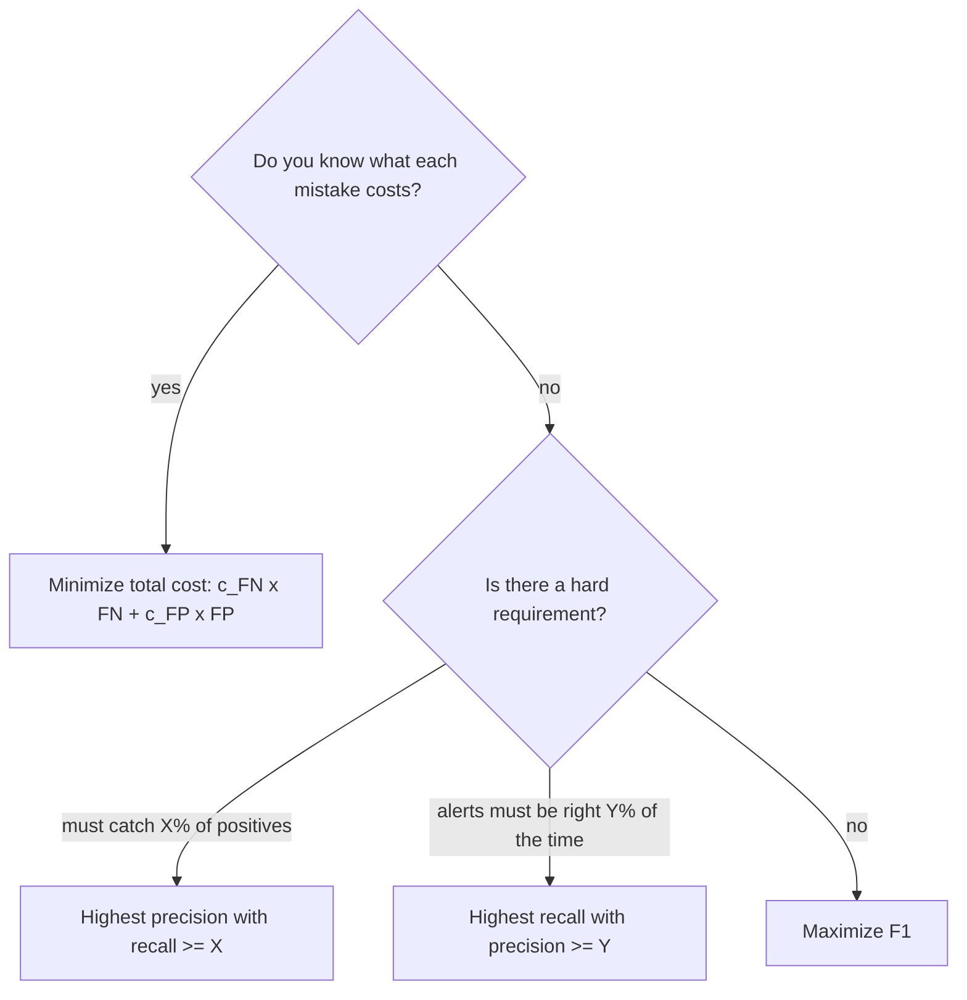
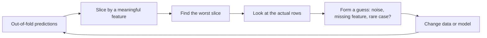

:::objectives
- Explain why accuracy misleads when one class is rare, and pick metrics that don't: balanced accuracy, recall, F1, and average precision.
- Compare `class_weight="balanced"` with choosing a threshold from out-of-fold probabilities, and say what each really changes.
- Choose a threshold from a stated rule: best F1 or a recall requirement.
- Slice a model's errors by a meaningful feature to find the group it fails.
- Write a one-page model report with specific limitations.
:::

Suppose 1 card payment in 20 is fraud. A model that answers "not fraud" every single time is 95% accurate, catches zero fraud, and would get its builder fired. When one class is rare, the usual scoreboard stops working. This week you'll measure what matters instead, push a model toward the rare class in two different ways, find *where* it fails, and write it up so a reader can trust it.

Here's a dataset built to look like that problem: 3,000 rows, about 5% positive.

```python run alt="Bar chart of class counts: 2,834 normal rows and 166 fraud rows. The fraud bar is barely visible next to the normal one." caption="One class is barely there"
import matplotlib.pyplot as plt
import numpy as np
from sklearn.datasets import make_classification

X, y = make_classification(n_samples=3000, n_features=12, n_informative=4,
                           weights=[0.95, 0.05], flip_y=0.01,
                           class_sep=0.8, random_state=4)
counts = np.bincount(y)
print(f"negatives {counts[0]}, positives {counts[1]} ({y.mean():.1%} positive)")

plt.figure(figsize=(5, 2.6))
plt.bar(["0: normal", "1: fraud"], counts, color=["#9aa9c7", "#d1495b"])
for i, c in enumerate(counts):
    plt.text(i, c, str(c), ha="center", va="bottom")
plt.ylabel("rows")
```

## The accuracy trap, in numbers

Let's cross-validate three models on six metrics: a do-nothing baseline, a plain logistic regression, and one with `class_weight="balanced"`.

```python run
import warnings
from sklearn.dummy import DummyClassifier
from sklearn.exceptions import UndefinedMetricWarning
from sklearn.linear_model import LogisticRegression
from sklearn.model_selection import StratifiedKFold, cross_validate
from sklearn.pipeline import make_pipeline
from sklearn.preprocessing import StandardScaler

# The baseline never predicts 1, so its precision is 0/0. Silence that warning.
warnings.filterwarnings("ignore", category=UndefinedMetricWarning)

cv = StratifiedKFold(n_splits=5, shuffle=True, random_state=0)
metrics = ["accuracy", "balanced_accuracy", "precision", "recall", "f1", "average_precision"]
short = ["acc", "bal_acc", "prec", "recall", "f1", "avg_prec"]
models = {
    "baseline": DummyClassifier(strategy="most_frequent"),
    "logreg": make_pipeline(StandardScaler(), LogisticRegression(max_iter=1000)),
    "logreg balanced": make_pipeline(StandardScaler(),
                                     LogisticRegression(max_iter=1000, class_weight="balanced")),
}
print(f"{'':>16}" + "".join(f"{name:>9}" for name in short))
for name, model in models.items():
    res = cross_validate(model, X, y, cv=cv, scoring=metrics)
    print(f"{name:>16}" + "".join(f"{res['test_' + m].mean():>9.3f}" for m in metrics))
```

Read down each column:

-   **Accuracy** barely separates the baseline from the real model. The baseline is only a couple of points behind while finding no fraud at all.
-   **Balanced accuracy** averages the recall of each class, so the baseline drops to exactly 0.5. That gap is honest.
-   **Average precision** summarizes how well the model ranks the rare class above the rest, across every threshold. Its floor is the positive rate (about 0.055 here), not 0.5, so it's hard to flatter.
-   The plain model is very precise but finds well under half the fraud. The balanced model finds most of it but drowns it in false alarms.

## Fix 1: class weights change the price of a mistake

Here's the intuition. Training a logistic regression means minimizing a total penalty over all rows. With 17 normal rows for every fraud, the model can ignore fraud and still keep the total low. `class_weight="balanced"` multiplies each row's penalty by `n_rows / (2 × rows in its class)`, so each fraud row now counts about 17 times as much as a normal one.

That changes the table in a revealing way. Recall jumps, precision collapses, and average precision barely moves. Weighting mostly slides the model's probabilities upward, which is a lot like lowering the threshold. It rarely makes the model better at *telling the classes apart*. Trees and forests accept the same `class_weight` argument and behave similarly.

## Fix 2: choose the threshold on purpose

In Week 3 you saw that `predict` cuts probabilities at 0.5 and that you can move the cut. With a rare class, 0.5 is almost never the right place: the model seldom gets confident enough to cross it. To choose a better cut without leaking, get **out-of-fold** probabilities with `cross_val_predict`, so every row is scored by a model that never trained on it, then look at precision and recall at every possible threshold:

```python run alt="Precision, recall, and F1 plotted against the decision threshold from 0 to 1. Recall falls steadily as the threshold rises; precision climbs. F1 peaks around a threshold of 0.25. A dotted line at 0.5 marks the default, well to the right of the F1 peak." caption="Moving the threshold trades recall for precision; the default 0.5 isn't where F1 peaks"
from sklearn.metrics import precision_recall_curve
from sklearn.model_selection import cross_val_predict

pipe = make_pipeline(StandardScaler(), LogisticRegression(max_iter=1000))
proba = cross_val_predict(pipe, X, y, cv=cv, method="predict_proba")[:, 1]
precision, recall, thresholds = precision_recall_curve(y, proba)
f1 = 2 * precision * recall / (precision + recall + 1e-12)

best = np.argmax(f1[:-1])
print(f"best-F1 threshold {thresholds[best]:.3f}: precision {precision[best]:.3f}, "
      f"recall {recall[best]:.3f}, F1 {f1[best]:.3f}")
ok = np.where(recall[:-1] >= 0.70)[0]
pick = ok[np.argmax(precision[ok])]
print(f"recall >= 0.70 threshold {thresholds[pick]:.3f}: precision {precision[pick]:.3f}, "
      f"recall {recall[pick]:.3f}")

plt.figure(figsize=(7, 3.2))
plt.plot(thresholds, precision[:-1], label="precision")
plt.plot(thresholds, recall[:-1], label="recall")
plt.plot(thresholds, f1[:-1], label="F1", linewidth=2.5)
plt.axvline(0.5, color="gray", linestyle=":", label="default 0.5")
plt.axvline(thresholds[best], color="C2", linestyle="--", label="best F1")
plt.xlabel("threshold")
plt.legend(fontsize=8)
```

`precision_recall_curve` returns one more precision and recall value than thresholds, which is why the code slices with `[:-1]`. The chart makes the trade visible: slide right and you get fewer, more reliable alerts; slide left and you catch more fraud at the cost of more false alarms. Moving from 0.5 to the best-F1 threshold lifts F1 well above the plain model's score in the table, without retraining anything.

Which threshold is right isn't a math question. It depends on what a mistake costs, so decide the rule first and let the code find the number:



scikit-learn 1.5 and later can do the out-of-fold search for you. `TunedThresholdClassifierCV` wraps a model, cross-validates thresholds for a metric, and refits:

```python run
from sklearn.model_selection import TunedThresholdClassifierCV

tuned = TunedThresholdClassifierCV(pipe, scoring="f1", cv=cv).fit(X, y)
print(f"chosen threshold {tuned.best_threshold_:.3f}, mean F1 across folds {tuned.best_score_:.3f}")
```

It lands close to the hand-made best-F1 threshold. Its score is averaged fold by fold rather than computed on all the pooled out-of-fold predictions at once, so the two numbers differ slightly. Doing it by hand once is how you'll know what the tool is doing.

:::warning
The threshold is a hyperparameter. Choose it from out-of-fold predictions on the **training** data, then check it once on the test set. Choosing it by looking at test predictions leaks, exactly like tuning `C` on the test set.
:::

Resampling (for example, SMOTE, which invents synthetic minority rows) is a third option. It lives in the separate `imbalanced-learn` package, and this course doesn't need it. If you try it, the resampling must happen inside the pipeline so only training folds are resampled.

## Error analysis: find the group the model fails

One overall score can hide a group the model fails badly. The method is simple: get out-of-fold predictions, bucket a meaningful feature, and count errors per bucket. Let's do it on breast cancer, grouping tumors by size, with **malignant** as the positive class (in this dataset's labels, 0 means malignant, so we flip them).

```python run alt="Bar chart of out-of-fold error rate by tumor size third. Small tumors have a 1.6% error rate, medium 3.2%, and large 1.6%, against a dashed overall line at 2.1%. The bars are labeled with their error counts: 3, 6, and 3." caption="The middle third, where benign and malignant overlap, gets twice the error rate"
import pandas as pd
from sklearn.datasets import load_breast_cancer

cancer = load_breast_cancer(as_frame=True)
X_bc = cancer.frame[cancer.feature_names]
y_bc = (cancer.target == 0).astype(int)  # 1 = malignant
pred_bc = cross_val_predict(make_pipeline(StandardScaler(), LogisticRegression(max_iter=1000)),
                            X_bc, y_bc, cv=cv)

df = pd.DataFrame({"y": y_bc, "pred": pred_bc})
df["size"] = pd.qcut(X_bc["mean area"], q=3, labels=["small", "medium", "large"])
df["error"] = df["pred"] != df["y"]
df["missed_cancer"] = (df["y"] == 1) & (df["pred"] == 0)
summary = df.groupby("size", observed=True).agg(
    rows=("y", "size"), malignant=("y", "sum"), errors=("error", "sum"),
    error_rate=("error", "mean"), missed=("missed_cancer", "sum"))
print(summary.round(3))
print(f"overall error rate: {df['error'].mean():.3f}")

plt.figure(figsize=(6, 2.8))
bars = plt.bar(summary.index.astype(str), summary["error_rate"], color="#7f9cc9")
plt.bar_label(bars, labels=[f"{e} errors" for e in summary["errors"]])
plt.axhline(df["error"].mean(), color="gray", linestyle="--", label="overall")
plt.ylim(0, summary["error_rate"].max() * 1.3)
plt.ylabel("error rate")
plt.legend()
```

`pd.qcut` makes three equal-sized buckets by mean area. Overall, the model is wrong on about 2% of tumors, but medium tumors get **double** the error rate of the other two groups, and more than half of the missed cancers are there. That makes sense: small tumors are almost all benign and large ones almost all malignant, so the hard, ambiguous cases live in the middle. Keep the counts next to the rates, though. Six errors is a small number, so treat this as a lead worth checking, not a law.

Error analysis is a loop, not a single table:



:::video JoAxZsdw_3w
What to watch for: the spreadsheet of misclassified examples. Andrew Ng counts which kind of error is most common before deciding what to fix, which is the same idea as your slice table.
:::

## The one-page model report

Your work is only as useful as a reader's understanding of it. A short report needs eight parts:

```text
MODEL REPORT: <task name>
1. Goal: what decision this supports and who acts on it
2. Data: source, rows, positive rate, date or version, known gaps
3. Method: pipeline steps, models compared, tuning, CV scheme
4. Results: CV metrics as mean ± std next to the baseline; test score (used once)
5. Threshold: the value, the rule that chose it, and what it trades
6. Where it fails: the slice table and a few example errors
7. Limitations: what it was NOT tested on, and the risks of misuse
8. Recommendation: use, don't use, or use with conditions
```

Specific limitations are the heart of it. "Medium-sized tumors have twice the error rate; all data comes from one hospital study; the model has not been tested on other imaging equipment" gives a reader three things to act on. "The model may not be perfect" gives them nothing.

:::quiz
Q: A fraud model reports 96% accuracy on data that is 5% fraud. What's the first number you ask for?
- [ ] Its precision at the default threshold
  Precision alone can look perfect while the model catches almost no fraud.
- [x] Its recall on the fraud class, or its balanced accuracy, next to the baseline's
  A model that never predicts fraud already scores 95%. Recall or balanced accuracy shows whether the extra point means anything.
- [ ] Its training accuracy
  Training accuracy tells you about memorization, not about catching fraud on new data.

Q: Turning on `class_weight="balanced"` raised recall from 0.39 to 0.80, cut precision from 0.99 to 0.19, and left average precision almost unchanged. What happened?
- [ ] The model learned to separate the classes much better
  Average precision measures separation across all thresholds, and it didn't improve.
- [x] The weighting mostly shifted where the model draws the line, much like lowering the threshold
  Same ranking quality, different operating point. You could get a similar trade by moving the threshold of the unweighted model.
- [ ] Class weights broke the model
  Nothing broke. It's a different trade between misses and false alarms.

Q: You choose a threshold by finding the best F1 on the **test set** predictions, then report that F1. What's wrong?
- [x] The threshold was tuned on the test set, so the reported F1 is optimistic
  Choose the threshold from out-of-fold training predictions and score the test set once with it.
- [ ] Nothing, because a threshold isn't a hyperparameter
  It's a setting you choose, and choosing it with test data leaks just like tuning `C` would.
- [ ] F1 can't be used with thresholds
  F1 is computed from predictions at a threshold. That's exactly how the chart above was made.

Q: Your slice table shows a 6% error rate in one bucket and 2% elsewhere, but the bad bucket has only 4 errors. How should the report put it?
- [ ] "The model fails on this group" in the headline
  Four errors is too few to call it a proven failure.
- [ ] Leave it out, because it isn't statistically solid
  Hiding a possible weak spot is worse than reporting it with a caveat.
- [x] Report the rate with its count, and call it a lead worth checking on more data
  Counts let a reader judge the evidence themselves, and the lead tells them where to look first.
:::

:::takeaways
- With a rare class, accuracy hides failure. Report recall, F1, balanced accuracy, or average precision next to a baseline.
- `class_weight="balanced"` makes rare-class mistakes cost more; it mostly moves the operating point rather than improving ranking.
- Choose thresholds from out-of-fold training probabilities with a rule decided in advance: a cost table, a requirement, or best F1.
- Slice out-of-fold errors by meaningful features, and always show counts beside rates.
- A one-page report leads with the decision, gives every number context, and names specific limitations.
:::

## Further reading

-   [scikit-learn User Guide: Tuning the decision threshold](https://scikit-learn.org/stable/modules/classification_threshold.html) explains `TunedThresholdClassifierCV` and `FixedThresholdClassifier`, with a cost-sensitive example.
-   [scikit-learn User Guide: Precision, recall and F-measures](https://scikit-learn.org/stable/modules/model_evaluation.html#precision-recall-f-measure-metrics) defines every metric used here, including average precision.
-   [Mitchell et al., "Model Cards for Model Reporting" (2019)](https://arxiv.org/abs/1810.03993) is the paper behind the one-page report; its example cards are worth skimming.
