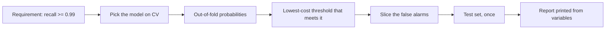

:::objectives
- Set the positive class to the outcome you must not miss, and check it before computing any metric.
- Test whether `class_weight` actually helps before adopting it.
- Turn a requirement ("catch 99% of cancers") into a threshold using out-of-fold probabilities.
- Slice false alarms by a feature to see who pays for a low threshold.
- Score the test set once and generate the model report from variables.
:::

Screening tools play by different rules than leaderboards. A tool that flags tumors for a specialist to review must almost never let a malignant one slip through, and it can afford some false alarms, because a human looks at every flag. Today you'll build that tool on the breast cancer data. Andrew Ng would call recall the *satisficing* metric here (it must reach 99%) and precision the *optimizing* one (as high as possible once recall is met).



:::video BH9mlmdXzzI
What to watch for: "maximize accuracy subject to running time under 100 ms." Swap in "maximize precision subject to recall of at least 99%" and you have today's build.
:::

## Step 1: Make malignant the positive class

```python run
import matplotlib.pyplot as plt
import numpy as np
import pandas as pd
from sklearn.datasets import load_breast_cancer
from sklearn.model_selection import StratifiedKFold, train_test_split

data = load_breast_cancer(as_frame=True)
print("original labels: 0 =", data.target_names[0], "and 1 =", data.target_names[1])
X = data.frame[data.feature_names]
y = (data.target == 0).astype(int)  # 1 = malignant, the class we must not miss
X_train, X_test, y_train, y_test = train_test_split(
    X, y, test_size=0.25, stratify=y, random_state=1)
cv = StratifiedKFold(n_splits=5, shuffle=True, random_state=1)
print(f"train {len(y_train)} tumors ({y_train.mean():.1%} malignant) | test {len(y_test)} tumors")
```

scikit-learn's metrics treat label 1 as positive, and in the original labels 1 means *benign*. Flipping them makes "recall" mean "share of cancers caught." Skip this and every number in your report answers the wrong question.

## Step 2: Do class weights help here?

Last lesson showed that weighting can shift a model's operating point. Before using it, check whether it improves anything on *this* data:

```python run
from sklearn.ensemble import RandomForestClassifier
from sklearn.linear_model import LogisticRegression
from sklearn.model_selection import cross_validate
from sklearn.pipeline import Pipeline
from sklearn.preprocessing import StandardScaler

candidates = {
    "logreg": Pipeline([("scale", StandardScaler()),
                        ("model", LogisticRegression(max_iter=1000))]),
    "logreg balanced": Pipeline([("scale", StandardScaler()),
                                 ("model", LogisticRegression(max_iter=1000, class_weight="balanced"))]),
    "forest balanced": Pipeline([("model", RandomForestClassifier(
        n_estimators=150, class_weight="balanced", random_state=1))]),
}
print(f"{'':>16}  recall  precision  avg_prec")
for name, model in candidates.items():
    r = cross_validate(model, X_train, y_train, cv=cv,
                       scoring=["recall", "precision", "average_precision"])
    print(f"{name:>16}  {r['test_recall'].mean():.3f}   {r['test_precision'].mean():.3f}"
          f"      {r['test_average_precision'].mean():.3f}")
```

At 37% malignant the imbalance is mild, and weighting doesn't raise recall at all; it only costs a little precision. Average precision, which ignores the threshold and measures ranking, is the same for both logistic models, and the forest ranks slightly worse. So the honest choice is the **plain logistic regression**, and the recall target will come from the threshold. Testing a fix before adopting it is half of evaluating well.

## Step 3: Find the threshold that meets the requirement

```python run alt="Precision and recall of out-of-fold predictions against the threshold. Recall stays between about 0.95 and 0.99 until the threshold passes 0.7, then plunges near 1.0. Precision climbs steeply from about 0.4 to 0.85 by a threshold of 0.1, then slowly toward 1.0. A dashed line marks the chosen threshold, about 0.09, and a dotted line marks the default 0.5." caption="Lowering the cutoff from 0.5 to about 0.1 buys the last few cancers"
from sklearn.metrics import precision_recall_curve, precision_score, recall_score
from sklearn.model_selection import cross_val_predict

chosen = candidates["logreg"]
oof = cross_val_predict(chosen, X_train, y_train, cv=cv, method="predict_proba")[:, 1]
prec, rec, thr = precision_recall_curve(y_train, oof)

TARGET_RECALL = 0.99
ok = np.where(rec[:-1] >= TARGET_RECALL)[0]
best = ok[np.argmax(prec[ok])]
threshold = thr[best]
print(f"chosen {threshold:.3f}: OOF recall {rec[best]:.3f}, precision {prec[best]:.3f}")
print(f"default 0.5:   OOF recall {recall_score(y_train, oof >= 0.5):.3f}, "
      f"precision {precision_score(y_train, oof >= 0.5):.3f}")

plt.figure(figsize=(7, 3))
plt.plot(thr, prec[:-1], label="precision")
plt.plot(thr, rec[:-1], label="recall")
plt.axvline(threshold, color="C2", linestyle="--", label=f"chosen {threshold:.2f}")
plt.axvline(0.5, color="gray", linestyle=":", label="default 0.5")
plt.xlabel("threshold")
plt.legend(fontsize=8)
```

`oof` holds **out-of-fold** probabilities for the 426 training tumors: each one comes from a model that never saw that tumor. Among all thresholds that reach 99% recall, the code keeps the one with the best precision.

Here's the trade in plain numbers. Lowering the cutoff from 0.5 to the chosen value cuts the cancers missed on the training folds from about four to one. In exchange, precision drops from 99% to about 85%, so roughly one flag in seven is a false alarm. For a tool that sends cases to a specialist, that's a good deal. For a tool that orders surgery, it would not be. The threshold is a values decision; the code just puts a price on it.

## Step 4: Who pays for the false alarms?

A low threshold creates false alarms, and they may not fall evenly. Bucket tumors by `mean texture` (variation in gray levels on the scan) and count both kinds of error per bucket, using the out-of-fold predictions at the chosen threshold:

```python run alt="Bar chart of false-alarm rate among benign tumors by texture third: about 5.5% for low texture, 10% for mid, and 22% for high, each bar labeled with its count of false alarms: 7, 9, and 11." caption="Benign tumors with high texture get flagged four times as often"
train_df = X_train.assign(y=y_train, pred=(oof >= threshold).astype(int))
train_df["texture"] = pd.qcut(train_df["mean texture"], q=3, labels=["low", "mid", "high"])
train_df["missed"] = (train_df["y"] == 1) & (train_df["pred"] == 0)
train_df["false_alarm"] = (train_df["y"] == 0) & (train_df["pred"] == 1)
slices = train_df.groupby("texture", observed=True).agg(
    rows=("y", "size"), malignant=("y", "sum"),
    missed=("missed", "sum"), false_alarms=("false_alarm", "sum"))
slices["false_alarm_rate"] = (slices["false_alarms"] / (slices["rows"] - slices["malignant"])).round(3)
print(slices)

plt.figure(figsize=(6, 2.8))
bars = plt.bar(slices.index.astype(str), slices["false_alarm_rate"], color="#d9a05b")
plt.bar_label(bars, labels=[f"{n} false alarms" for n in slices["false_alarms"]])
plt.ylim(0, slices["false_alarm_rate"].max() * 1.3)
plt.xlabel("mean texture third")
plt.ylabel("false-alarm rate (benign)")
```

The false-alarm rate is divided by the number of **benign** tumors in each bucket, since only benign tumors can be false alarms. Benign tumors with high texture get flagged far more often than low-texture ones. In practice, those patients would be called back for review more often. That's not a reason to throw the model out, but it's exactly the kind of fact a report should state.

:::tip
Slicing the 426 out-of-fold training predictions gives you three times as many rows as the 143-row test set. Slicing doesn't choose anything, so it doesn't leak. If you *change* the model because of a slice, rerun Steps 2 and 3 so the change is validated too.
:::

## Step 5: One look at the test set

```python run alt="Two by two confusion matrix for the test set with labels benign and malignant. 84 benign tumors correctly cleared, 6 benign tumors flagged, 2 malignant tumors missed, and 51 malignant tumors caught." caption="The test set, scored once at the chosen threshold"
from sklearn.metrics import ConfusionMatrixDisplay, confusion_matrix

chosen.fit(X_train, y_train)
test_proba = chosen.predict_proba(X_test)[:, 1]
test_pred = (test_proba >= threshold).astype(int)
tn, fp, fn, tp = confusion_matrix(y_test, test_pred).ravel()
test_recall, test_precision = tp / (tp + fn), tp / (tp + fp)
print(f"test: caught {tp}, missed {fn}, false alarms {fp}, cleared {tn}")
print(f"test recall {test_recall:.3f}, precision {test_precision:.3f}")

ConfusionMatrixDisplay.from_predictions(y_test, test_pred, display_labels=["benign", "malignant"],
                                        colorbar=False, cmap="Blues")
plt.gcf().set_size_inches(4, 4)
```

Test recall came in under the 0.99 target. With 53 malignant test tumors, each miss costs almost two points of recall, so two misses instead of one is the whole difference. Don't lower the threshold again to fix it; that would be tuning on the test set. Report it as it is, because a reader planning to use this tool needs to know that 99% on the training folds became about 96% on new tumors.

## Step 6: Generate the report from the numbers

```python run
worst = slices["false_alarm_rate"].idxmax()
report = f"""MODEL REPORT: breast tumor screening (malignant = positive)
Goal:       flag possibly malignant tumors for a specialist to review
Data:       scikit-learn breast cancer set, {len(X)} tumors, {y.mean():.0%} malignant
Model:      scaled logistic regression (class weights tested, no gain)
Threshold:  {threshold:.3f}, chosen on out-of-fold training predictions for recall >= {TARGET_RECALL}
Test set:   recall {test_recall:.3f}, precision {test_precision:.3f} ({fn} missed, {fp} false alarms, {len(y_test)} tumors)
Weak spot:  highest false-alarm rate among benign tumors in the {worst!r} texture third
Limits:     one dataset from a single source; {y_test.sum()} malignant test cases is a small sample;
            not checked on other hospitals or imaging equipment
Use:        as a second reader that prioritizes cases, never as the only decision"""
print(report)
```

Notice what the report *doesn't* say. It doesn't say "96% accurate," and it doesn't hide that test recall missed the target. It states plainly how the model should and shouldn't be used, and every number in it came from a variable.

:::quiz
Q: Why does Step 1 flip the labels so that 1 means malignant?
- [x] scikit-learn computes recall and precision for label 1, so the class you care about must be 1
  Without the flip, "recall" would measure how many benign tumors were found, which isn't the requirement.
- [ ] Logistic regression can only learn when the rare class is 1
  The model trains the same either way; only the meaning of the metrics changes.
- [ ] It makes the dataset more balanced
  Flipping labels doesn't change the class counts at all.

Q: In Step 2, class weights didn't raise recall. Why choose the threshold instead of keeping weights "just in case"?
- [ ] Weights always make models worse
  Sometimes they help. Here the check showed they didn't, which is why you check.
- [x] The threshold reaches the recall target directly, and the weights added nothing measurable while costing precision
  Same ranking quality and lower precision is a cost with no benefit. A simpler model is easier to explain and defend.
- [ ] Thresholds can't be combined with class weights
  They can be combined; it just wasn't needed here.

Q: Test recall is 0.962, below the 0.99 target. What's the right move?
- [ ] Lower the threshold until test recall reaches 0.99
  That chooses the threshold with the test set, and the test score stops being honest.
- [ ] Drop the test result from the report
  The test result is the most honest number you have; hiding it misleads the reader.
- [x] Report it with the counts (2 missed of 53) and note the small test sample
  A reader can see the size of the miss and judge it. If the target matters, gather more data and re-validate.
:::

:::takeaways
- Make the class you must not miss label 1 before you compute anything.
- Check whether a fix such as `class_weight` helps before keeping it.
- A requirement like "recall ≥ 0.99" becomes a threshold by searching out-of-fold probabilities for the best precision that still meets it.
- Slice the errors your threshold creates; false alarms can fall unevenly across groups.
- Score the test set once, report the result even when it misses the target, and print the report from variables.
:::

## Extend it

-   Set `TARGET_RECALL = 0.95` and rerun Steps 3 to 6. How many false alarms disappear, and how many extra cancers are missed?
-   Slice by `mean area` instead of texture. Is the weak spot the same group?
-   Replace Step 3 with `TunedThresholdClassifierCV`. It optimizes a single score rather than a constraint, so try `scoring="recall"` and see why that alone isn't enough. (Hint: what threshold maximizes recall?)

## Further reading

-   [scikit-learn API: cross_val_predict](https://scikit-learn.org/stable/modules/generated/sklearn.model_selection.cross_val_predict.html) explains how out-of-fold predictions are built and when they're appropriate.
-   [scikit-learn API: precision_recall_curve](https://scikit-learn.org/stable/modules/generated/sklearn.metrics.precision_recall_curve.html) documents why the arrays differ in length by one.
-   [pandas User Guide: Group by](https://pandas.pydata.org/docs/user_guide/groupby.html) covers `groupby` and named aggregation, the tools behind every slice table.
