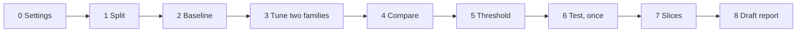

:::objectives
- Run a complete evaluation notebook end to end, one milestone per cell.
- Replace the starter's settings with the decisions from your plan.
- Know the check that ends each milestone, so you can tell when it's done.
- Finish the session with a first-draft report printed from your own numbers.
:::

Capstones stall in one of two ways. You lose a day to something that didn't matter, or you reach the final week with a pile of results and no report. Milestones prevent both: each one ends with something printed that you can check, and the last one prints the first draft of your report.

Below is a starter notebook that runs end to end on the breast cancer data. Copy each cell into Colab in order and run them once without changes, so you know it works on your machine. Then go back to Milestone 0 and start replacing the `TODO` lines with your project's choices.



## Milestone 0: Settings you'll change

```python run
import warnings

import matplotlib.pyplot as plt
import numpy as np
import pandas as pd
from scipy.stats import loguniform, randint
from sklearn.datasets import load_breast_cancer
from sklearn.dummy import DummyClassifier
from sklearn.ensemble import RandomForestClassifier
from sklearn.exceptions import UndefinedMetricWarning
from sklearn.linear_model import LogisticRegression
from sklearn.metrics import (ConfusionMatrixDisplay, average_precision_score,
                             confusion_matrix, precision_recall_curve)
from sklearn.model_selection import (RandomizedSearchCV, StratifiedKFold,
                                     cross_val_predict, cross_val_score,
                                     train_test_split)
from sklearn.pipeline import Pipeline
from sklearn.preprocessing import StandardScaler

warnings.filterwarnings("ignore", category=UndefinedMetricWarning)
SEED = 0
PRIMARY = "average_precision"     # TODO: your primary metric
TARGET_RECALL = 0.95              # TODO: your threshold rule
SLICE_FEATURE = "mean radius"     # TODO: a feature a user would care about
print("settings:", PRIMARY, TARGET_RECALL, SLICE_FEATURE)
```

The three constants are the decisions from your plan. Keeping them in one place means a change here flows through every later cell. `SEED` controls every random step, so anyone who reruns your notebook gets your exact numbers. The warnings filter hides the expected "precision is 0/0" warning when the baseline is scored.

**Check:** your plan's primary metric, threshold rule, and slice feature are typed here.

## Milestone 1: Load, define the positive class, split once

```python run
data = load_breast_cancer(as_frame=True)      # TODO: your dataset
X = data.frame[data.feature_names]
y = (data.target == 0).astype(int)            # TODO: 1 must mean the class you care about
X_train, X_test, y_train, y_test = train_test_split(
    X, y, test_size=0.2, stratify=y, random_state=SEED)
cv = StratifiedKFold(n_splits=5, shuffle=True, random_state=SEED)
print(f"train {X_train.shape}, test {X_test.shape}, positive rate {y_train.mean():.3f}")
```

Replace the loader with your dataset. If it has text categories or missing values, add a `ColumnTransformer` with `OneHotEncoder` and `SimpleImputer` to the *front* of each pipeline in Milestone 3. Don't clean or scale `X` in this cell; anything fitted here would see the test rows.

**Check:** the printed positive rate is what you expect, and 1 means the class you care about.

## Milestone 2: The baseline on the shared folds

```python run
baseline = DummyClassifier(strategy="prior")
base_scores = cross_val_score(baseline, X_train, y_train, cv=cv, scoring=PRIMARY)
print(f"baseline {PRIMARY}: {base_scores.mean():.3f} ± {base_scores.std():.3f}")
```

`strategy="prior"` predicts the class proportions for every row, so its average precision equals the positive rate. Every later number gets compared with this one.

**Check:** the baseline uses the same `cv` and `PRIMARY` as the real models.

## Milestone 3: Tune two model families

```python run
searches = {
    "logistic": RandomizedSearchCV(
        Pipeline([("scale", StandardScaler()),
                  ("model", LogisticRegression(max_iter=5000))]),
        {"model__C": loguniform(1e-3, 1e2)},
        n_iter=10, cv=cv, scoring=PRIMARY, random_state=SEED),
    "forest": RandomizedSearchCV(
        Pipeline([("model", RandomForestClassifier(random_state=SEED))]),
        {"model__n_estimators": randint(50, 150),
         "model__max_depth": [None, 4, 8],
         "model__min_samples_leaf": randint(1, 6)},
        n_iter=6, cv=cv, scoring=PRIMARY, random_state=SEED),
}
for name, search in searches.items():
    search.fit(X_train, y_train)
    print(f"{name:>8}: best CV {PRIMARY} {search.best_score_:.3f}")
```

Ways to adapt it:

-   Swap a family: a tuned `DecisionTreeClassifier`, or logistic regression with `"model__class_weight": [None, "balanced"]` added to its search space.
-   Move the ranges toward where the best values land. If the best `C` is at the edge, extend the range (Week 5 practice).
-   Keep `n_iter` and `n_estimators` small while developing. Raise them once for the final run, and budget the time first.

**Check:** both searches finish, and neither best value sits at the edge of its range.

## Milestone 4: Compare on the same folds

```python run alt="Per-fold average precision for the tuned logistic regression and the tuned forest across five shared folds. All scores sit between about 0.983 and 0.999. Logistic is above the forest on four folds; on fold 4 the forest edges ahead." caption="A consistent edge, but a tiny one"
def clean(params):
    """Round floats and turn NumPy numbers into plain Python ones for printing."""
    return {k: round(float(v), 4) if isinstance(v, float) else
            int(v) if isinstance(v, np.integer) else v for k, v in params.items()}


rows, folds = [], {}
for name, search in searches.items():
    i = search.best_index_
    folds[name] = np.array([search.cv_results_[f"split{k}_test_score"][i] for k in range(5)])
    rows.append({"model": name, "mean": folds[name].mean(), "std": folds[name].std(),
                 "params": clean(search.best_params_)})
board = pd.DataFrame(rows).sort_values("mean", ascending=False).reset_index(drop=True)
for r in board.itertuples():
    print(f"{r.model:>8}: {r.mean:.3f} ± {r.std:.3f}  {r.params}")
winner_name = board.loc[0, "model"]
winner = searches[winner_name].best_estimator_
print("winner:", winner_name)

plt.figure(figsize=(6.5, 2.8))
for name, scores in folds.items():
    plt.plot(range(1, 6), scores, "o-", label=name)
plt.xticks(range(1, 6), [f"fold {k}" for k in range(1, 6)])
plt.ylabel(PRIMARY)
plt.legend()
```

Every search used the same `cv`, so `cv_results_["split0_test_score"]` through `split4_test_score` are directly comparable fold by fold, with no extra fitting. In the starter, logistic regression leads on four of the five folds, but by margins much smaller than either model's std. That's a consistent but tiny edge, and your report should say both halves of that sentence. When results tie, the simpler or faster model is a fair tie-breaker; write down whichever reason you use.

**Check:** the board shows mean ± std for each model, and you've written one sentence on whether the gap is meaningful.

## Milestone 5: Choose the threshold from out-of-fold predictions

```python run alt="Precision and recall of the winner's out-of-fold predictions against the threshold. Recall stays near 1.0 at low thresholds and falls steeply near 1.0; precision climbs from about 0.4 to nearly 1.0. A dashed line at about 0.4 marks the chosen threshold, where both are close to 0.97 or higher." caption="The rule picks the number; the chart shows what it trades"
oof = cross_val_predict(winner, X_train, y_train, cv=cv, method="predict_proba")[:, 1]
prec, rec, thr = precision_recall_curve(y_train, oof)
ok = np.where(rec[:-1] >= TARGET_RECALL)[0]
best = ok[np.argmax(prec[ok])]
threshold = thr[best]
print(f"threshold {threshold:.3f}: OOF recall {rec[best]:.3f}, precision {prec[best]:.3f}")

plt.figure(figsize=(6.5, 2.8))
plt.plot(thr, prec[:-1], label="precision")
plt.plot(thr, rec[:-1], label="recall")
plt.axvline(threshold, color="C2", linestyle="--", label="chosen")
plt.xlabel("threshold")
plt.legend(fontsize=8)
```

The rule here is "best precision with recall at least `TARGET_RECALL`." If your plan uses a cost table, swap in the cost loop from Week 6 practice; for best F1, use the F1 line from the Week 6 notes. Whatever the rule, it runs only on **out-of-fold training** probabilities.

**Check:** you can explain the threshold in one sentence that mentions your use case.

## Milestone 6: The one and only test evaluation

```python run alt="Two by two confusion matrix for the test set at the chosen threshold: 67 negatives correctly cleared, 5 false alarms, 2 missed positives, and 40 positives caught." caption="Run this cell once, after Milestones 1 to 5 are final"
test_proba = winner.predict_proba(X_test)[:, 1]
test_pred = (test_proba >= threshold).astype(int)
tn, fp, fn, tp = confusion_matrix(y_test, test_pred).ravel()
test_recall, test_precision = tp / (tp + fn), tp / (tp + fp)
test_ap = average_precision_score(y_test, test_proba)
print(f"test: TP={tp} FN={fn} FP={fp} TN={tn} | recall {test_recall:.3f}, "
      f"precision {test_precision:.3f}, AP {test_ap:.3f}")

ConfusionMatrixDisplay.from_predictions(y_test, test_pred, display_labels=["negative", "positive"],
                                        colorbar=False, cmap="Blues")
plt.gcf().set_size_inches(3.8, 3.8)
```

This is the only cell that touches `X_test`. If the result disappoints, that's a finding for your report, not a cue to go back and adjust.

**Check:** you've copied the printed test line into your report notes, with the date you ran it.

## Milestone 7: Slice the errors

```python run alt="Bar chart of out-of-fold error rate by thirds of mean radius: low 0.7% (1 error), mid 2.0% (3 errors), high 2.6% (4 errors), with a dashed line at the overall rate of about 1.8%." caption="Where the errors fall, with counts on every bar"
df = X_train.assign(y=y_train, pred=(oof >= threshold).astype(int))
df["slice"] = pd.qcut(df[SLICE_FEATURE], q=3, labels=["low", "mid", "high"])
df["fn"] = (df["y"] == 1) & (df["pred"] == 0)
df["fp"] = (df["y"] == 0) & (df["pred"] == 1)
slices = df.groupby("slice", observed=True).agg(
    rows=("y", "size"), positives=("y", "sum"), missed=("fn", "sum"), false_alarms=("fp", "sum"))
slices["errors"] = slices["missed"] + slices["false_alarms"]
slices["error_rate"] = (slices["errors"] / slices["rows"]).round(3)
print("errors by", SLICE_FEATURE)
print(slices)

plt.figure(figsize=(6, 2.8))
bars = plt.bar(slices.index.astype(str), slices["error_rate"], color="#7f9cc9")
plt.bar_label(bars, labels=[f"{e} errors" for e in slices["errors"]])
plt.axhline(slices["errors"].sum() / slices["rows"].sum(), color="gray", linestyle="--", label="overall")
plt.ylim(0, slices["error_rate"].max() * 1.35)
plt.xlabel(SLICE_FEATURE)
plt.ylabel("error rate")
plt.legend()
```

The starter buckets one feature into thirds and counts both kinds of error. Make it yours: try two or three features, use domain cut points with `pd.cut` (age groups, price bands), or for a multiclass project, slice by the true class. Always show **counts** next to rates, so a reader can see that a high rate might mean four errors.

**Check:** you have at least one slice table and one sentence interpreting it, even if the finding is "no meaningful difference."

## Milestone 8: Draft the report from the numbers

```python run
print(f"""REPORT DRAFT
Baseline {PRIMARY}: {base_scores.mean():.3f}
Best model: {winner_name}, CV {PRIMARY} {board.loc[0, 'mean']:.3f} ± {board.loc[0, 'std']:.3f}
Runner-up: {board.loc[1, 'model']}, CV {PRIMARY} {board.loc[1, 'mean']:.3f} ± {board.loc[1, 'std']:.3f}
Threshold {threshold:.3f} (rule: recall >= {TARGET_RECALL} on out-of-fold training predictions)
Test (used once): recall {test_recall:.3f}, precision {test_precision:.3f}, {fn} missed of {tp + fn} positives
Worst slice: {slices['error_rate'].idxmax()} {SLICE_FEATURE} (error rate {slices['error_rate'].max():.3f}, {slices['errors'].max()} errors)
TODO: recommendation and limitations in your own words""")
```

The f-string pulls every number from a variable, so the draft can't go stale when you rerun something. The last line is deliberately a `TODO`: the recommendation and limitations must come from your judgment, using the eight-part report from Week 6 as the outline.

**Check:** the draft prints without errors, and every number in it matches the cells above.

:::tip
In Colab, use **File → Save a copy in Drive** after each milestone works. If a later change breaks something, you can return to the last good copy instead of debugging everything at once.
:::

:::warning
If you rerun Milestone 6 after changing anything above it, say so in your report ("test set viewed twice"). Graders respect honesty about process far more than a perfect-looking number.
:::

## Further reading

-   [scikit-learn User Guide: Pipelines and composite estimators](https://scikit-learn.org/stable/modules/compose.html) shows how to put a `ColumnTransformer` in front of a model, which you'll need for datasets with text columns.
-   [scikit-learn User Guide: Tuning the decision threshold](https://scikit-learn.org/stable/modules/classification_threshold.html) is the reference for Milestone 5 if you'd rather use `TunedThresholdClassifierCV`.
