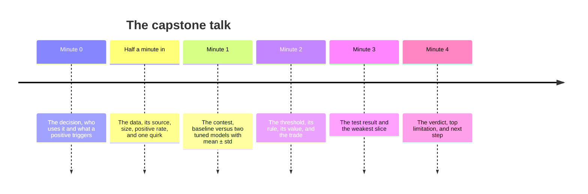

:::objectives
- Run four sanity checks on your final pipeline: shared rows, shuffled labels, fold-seed stability, and single-feature leakage.
- Explain what a failing result on each check would mean and how to fix it.
- Edit a report draft so it leads with the recommendation and gives every number context.
- Present the project in five minutes and answer the four questions audiences always ask.
- Grade your notebook and report against the rubric before you submit.
:::

Plenty of excellent-looking capstones fall apart under one question from the audience: "What happens if you shuffle the labels?" Today you ask those questions yourself, first. Then you'll tighten the report and rehearse the talk.

## Four sanity checks

Run these against your *final* pipeline, on training data only. They take a minute and catch the most common reasons a result is too good to be true. The cells below use the breast cancer example from the starter notebook; swap in your own `X_train`, `y_train`, `winner`, and metric.

```python run
import matplotlib.pyplot as plt
import numpy as np
from sklearn.datasets import load_breast_cancer
from sklearn.linear_model import LogisticRegression
from sklearn.model_selection import StratifiedKFold, cross_val_score, train_test_split
from sklearn.pipeline import Pipeline
from sklearn.preprocessing import StandardScaler

data = load_breast_cancer(as_frame=True)
X = data.frame[data.feature_names]
y = (data.target == 0).astype(int)
X_train, X_test, y_train, y_test = train_test_split(
    X, y, test_size=0.2, stratify=y, random_state=0)
cv = StratifiedKFold(n_splits=5, shuffle=True, random_state=0)
winner = Pipeline([("scale", StandardScaler()),
                   ("model", LogisticRegression(C=0.1313, max_iter=5000))])
METRIC = "average_precision"

shared_rows = X_train.merge(X_test, how="inner").shape[0]
print("Check 1: identical rows in both train and test:", shared_rows)
```

**Check 1, shared rows.** If the same row sits in both train and test, the model is graded on something it memorized. Datasets stitched together from several files often contain duplicates. The fix is to drop duplicates *before* splitting, with `df.drop_duplicates()`.

```python run alt="Bar chart comparing average precision: the real labels score about 0.99, shuffled labels score about 0.40, and the do-nothing baseline (the positive rate) is about 0.37." caption="With the pattern destroyed, the score falls to the baseline, as it should"
rng = np.random.default_rng(0)
y_shuffled = rng.permutation(y_train.to_numpy())
real = cross_val_score(winner, X_train, y_train, cv=cv, scoring=METRIC).mean()
fake = cross_val_score(winner, X_train, y_shuffled, cv=cv, scoring=METRIC).mean()
print(f"Check 2: real labels {real:.3f} | shuffled labels {fake:.3f} | positive rate {y_train.mean():.3f}")

plt.figure(figsize=(5.5, 2.6))
bars = plt.bar(["real labels", "shuffled labels", "baseline"], [real, fake, y_train.mean()],
               color=["#4c72b0", "#d1495b", "#9aa9c7"])
plt.bar_label(bars, fmt="%.3f")
plt.ylim(0, 1.1)
plt.ylabel(METRIC)
```

**Check 2, shuffled labels.** Shuffling the labels destroys every real pattern, so an honest pipeline must collapse to about the baseline. Here it drops from 0.993 to near the 0.374 positive rate. If your shuffled score stays high, something in `X` is leaking the answer, or a preprocessing step is running outside the pipeline.

```python run
seed_means = [cross_val_score(winner, X_train, y_train, scoring=METRIC,
                              cv=StratifiedKFold(5, shuffle=True, random_state=s)).mean()
              for s in range(5)]
print(f"Check 3: CV mean across 5 fold seeds ranges from {min(seed_means):.3f} to {max(seed_means):.3f}")
```

**Check 3, fold-seed stability.** Re-shuffling the folds five times barely moves the mean, so you can report it with confidence. If your range is wide, report the range and avoid fine distinctions between models whose gap is smaller than it.

```python run alt="Horizontal bar chart of the ten single features with the highest average precision on their own. The top five (worst perimeter, worst radius, worst area, worst concave points, and mean concave points) each score about 0.96, and the tenth, mean concavity, about 0.88. A dashed line marks the full model at about 0.99, clearly above every single feature." caption="Strong single features, but none is suspiciously perfect"
single = {f: cross_val_score(LogisticRegression(max_iter=1000), X_train[[f]], y_train,
                             cv=cv, scoring=METRIC).mean() for f in X_train.columns}
top = sorted(single.items(), key=lambda kv: kv[1], reverse=True)[:10]
for f, s in top[:3]:
    print(f"Check 4: {f:<22} alone: {s:.3f}")

plt.figure(figsize=(6.5, 3.4))
plt.barh([f for f, _ in top], [s for _, s in top], color="#7f9cc9")
plt.axvline(real, color="black", linestyle="--", label="full model")
plt.gca().invert_yaxis()
plt.xlim(0.8, 1.0)
plt.xlabel(f"{METRIC} using one feature")
plt.legend(loc="lower right")
```

**Check 4, single-feature scan.** If one feature alone scores near 1.0, ask whether it would really exist at prediction time. Here `worst perimeter` reaches about 0.96 on its own. That's high but sensible, since large tumors are more often malignant, and it's still well below the full model. It belongs in your report anyway: it tells the reader that tumor size carries much of the signal.

:::warning
Run these checks on training data only. They're part of development, and any check that leads you to change the model must not involve the test set.
:::

:::video fE_25esn-5U
What to watch for: the ways information about the answer can hide inside the features. As you watch, ask of every feature in your own dataset, "would I know this at the moment of prediction?"
:::

## Polishing the report

Your report must fit on one page. Go through your draft and make these edits:

-   **Lead with the recommendation.** The first two sentences say what the model is for and whether you recommend it. Details follow.
-   **Give every number context.** "AP 0.993 ± 0.006 (baseline 0.374)" beats "AP 0.993". "2 missed of 42 malignant test tumors" beats "recall 0.952".
-   **Round to what the evidence supports.** Three decimals for metrics, two significant figures for thresholds. More digits than the std justifies is false precision.
-   **State the trade.** One sentence on what the threshold gains and costs: "catches about 95% of malignant tumors; about 1 flag in 9 is a false alarm."
-   **Name limitations specifically.** Data source, time period, groups not represented, the weak slice, small test counts. Each one should change how a reader uses the model.
-   **Caption every chart in words.** "Validation F1 peaks at depth 4 and falls after" lets a grader get the point without studying the axes.

A strong recommendation paragraph sounds like this:

```text
Recommendation: use with conditions. The tuned logistic regression ranks tumors
far better than the baseline (AP 0.993 ± 0.006 vs 0.374) and, at threshold 0.40,
caught 40 of 42 malignant tumors in the held-out test set. It should be used only
to prioritize cases for specialist review, never to clear patients, because 2 of
42 cancers were still missed. It was trained on one historical study, so it must
be re-validated before use on data from any other clinic or imaging system.
```

## Presenting in five minutes

The talk mirrors the report, so you won't need a separate script:



Practice once out loud with a timer. Then prepare one-sentence answers to the four questions audiences always ask, using the quiz below as a rehearsal.

:::quiz
Q: "How many times did you look at the test set?" Which answer is strongest?
- [x] "Once, after every choice was made on cross-validation, and I report that score as it came out"
  That's the answer graders hope to hear, and the notebook should back it up.
- [ ] "A few times, but I only kept the best one"
  Keeping the best of several test looks turns the test set into a validation set.
- [ ] "It doesn't matter, because I used cross-validation"
  It matters a lot. CV made the choices; the test set is the unbiased check on them.

Q: "What happens if you shuffle the labels?" Your shuffled score was 0.40 with a 0.37 baseline. What do you say?
- [ ] "It still scores 0.40, so the model is robust"
  On shuffled labels, a score above the baseline would be a warning sign, not a strength.
- [x] "It drops to about the baseline, which tells me the pipeline isn't leaking the answer"
  The collapse is the point of the check. A small gap above the baseline is ordinary noise.
- [ ] "I didn't try that"
  You did, in Check 2, and it's one of the fastest ways to earn a reader's trust.

Q: "Would this work on data from another hospital?" What's the honest answer?
- [ ] "Yes, the test score proves it generalizes"
  The test set came from the same source as the training data, so it can't speak for other hospitals.
- [x] "I don't know yet; it was only tested on data from one source, so it would need re-validation there"
  Naming what you didn't test is part of a good answer, and it matches your limitations section.
- [ ] "No, models never transfer"
  Some do and some don't. The point is that you haven't measured it.
:::

:::tip
If a result surprised you, such as a simpler model winning or a slice showing no difference, say so. An explained surprise sounds like real analysis; a story where everything went as planned sounds rehearsed.
:::

## The rubric

Check each row before you submit. The points add up to 100.

| Criterion | Points | What earns full marks |
| --- | --- | --- |
| Problem framing | 10 | The decision, the user, the positive class, and the worse error are stated up front |
| Baseline | 5 | A `DummyClassifier` scored on the same folds and metric |
| Leak-free pipelines | 15 | All preprocessing inside `Pipeline` or `ColumnTransformer`; the shuffled-label check falls to about the baseline |
| Two tuned model families | 15 | Sensible ranges, correct `step__param` names, best values not stuck at a range edge |
| Fair comparison | 10 | Shared folds, mean ± std, and a sentence on whether the gap is meaningful |
| Justified threshold | 10 | Chosen from out-of-fold training predictions with a stated rule tied to the use case |
| Single test evaluation | 5 | Done once, reported as it came out, with counts |
| Slice-based error analysis | 10 | At least one bucketed feature with counts and rates, plus an interpretation |
| Report and limitations | 15 | One page, recommendation first, specific limitations, numbers match the notebook |
| Reproducibility and talk | 5 | The notebook runs top to bottom with fixed seeds; the talk fits in five minutes |

Before you hand in, choose **Runtime → Restart session and run all** in Colab (or **Kernel → Restart Kernel and Run All Cells** in JupyterLab). If any cell fails or any number changes, fix it first. A notebook that runs cleanly from a fresh start is the strongest proof your results are real.

## Further reading

-   [scikit-learn User Guide: Common pitfalls and recommended practices](https://scikit-learn.org/stable/common_pitfalls.html) covers the leakage patterns behind Checks 2 and 4.
-   [Mitchell et al., "Model Cards for Model Reporting" (2019)](https://arxiv.org/abs/1810.03993) shows how professional teams structure the same kind of one-page report.
